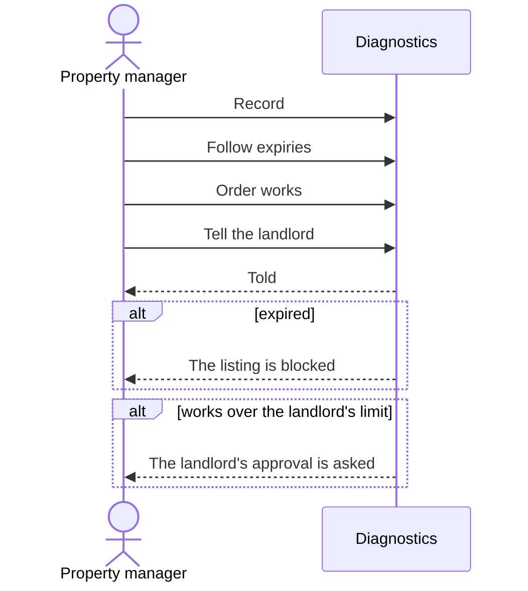

🏠 [Specs](../../../../README.md) › 🏷️ [Sectors](../../../README.md) › 🏘️ [SC10 Real estate](../../README.md) ›
📝 [Use cases](../README.md) › 📝 [Use cases: FL-SC10-03 Lettings](README.md) › 📝 UC-SC10-13 Track diagnostics and works

# 📝 UC-SC10-13 Track diagnostics and works

**Status:** ✅ specified

## Summary

The property manager records diagnostics and repairs per property, follows expiries and orders works.

## Personas

- [U34 Property manager](../../../../01-users/personas/u34-property-manager.md)

## Goal

Properties always with valid diagnostics.

## Trigger

An expiry or a repair need.

## Frequency

Monthly.

## Preconditions

- The SC10 sector pack is installed for the company,
  [UC-F14-02](../../../../02-functional/f14-plugin-store/use-cases/01-find-and-install/uc-f14-02-install-a-plugin-or-sector-pack.md),
  and its users have their roles,
  [UC-F1-06](../../../../02-functional/f01-administration/use-cases/04-edit-a-role/uc-f01-06-edit-a-role-and-its-record-rules.md).

## Postconditions

- **Success:** diagnostics are current and works ordered.
- **Failed:** listings are blocked.

## Main flow

1. The property manager records diagnostics on
   [S-SC10-13 Diagnostics](../../screens/03-lettings/s-sc10-13-diagnostics.md).
2. Expiries are listed.
3. Works are ordered,
   [UC-F7-02](../../../../02-functional/f07-purchasing-and-stock/use-cases/01-procure/uc-f07-02-order-from-a-supplier.md).
4. The landlord sees them on the portal.

## Alternative flows

- 3a. Works voted by the co-ownership: they follow the assembly's decision.

## Error flows

- 2e. Expired: the listing is blocked.
- 3e. Works over the landlord's limit: the landlord's approval is asked.
- Any step: a call to a service or an outside system fails: it is retried first
  ([BR-F3-32](../../../../02-functional/f03-assistant/business-rules/br-f03-32-retry-before-an-error.md)), then the
  error message pattern ([D122](../../../../06-decisions/ux/d122-error-message-standard.md)) says what failed; what was
  typed is kept.

## Business rules

- [BR-SC10-08 Diagnostics valid before listing](../../business-rules/br-sc10-08-diagnostics-valid-before-listing.md)

## Entities

- [E-SC10-12 Diagnostic](../../data/e-sc10-12-diagnostic.md)

## Permissions

The property manager roles; the record rules of their role and site apply,
[UC-F1-06](../../../../02-functional/f01-administration/use-cases/04-edit-a-role/uc-f01-06-edit-a-role-and-its-record-rules.md).

## Notifications

None beyond the in-app updates of the records concerned.

## Audit events

Every creation, change and state change of diagnostic records, with who, when and the values before and after (T3).

## AI involvement

The AI assistant answers questions on the diagnostic records of this use case, with links, and prepares them as drafts
the user confirms. It works within the user's rights,
[BR-F3-34](../../../../02-functional/f03-assistant/business-rules/br-f03-34-every-capability-is-reachable-from-the-assistant.md),
and never deletes or does anything irreversible without the user's confirmation,
[BR-F3-07](../../../../02-functional/f03-assistant/business-rules/br-f03-07-no-deletes-no-irreversible-acts.md).

## API, MCP and A2A exposure

Through the API and webhooks (T5) and the MCP and A2A gateway (T6), with the caller's rights,
[BR-F3-34](../../../../02-functional/f03-assistant/business-rules/br-f03-34-every-capability-is-reachable-from-the-assistant.md),
reading, creating and changing the records of this use case; nothing irreversible without a person's confirmation.

## Screens

- [S-SC10-13 Diagnostics](../../screens/03-lettings/s-sc10-13-diagnostics.md)

## Flowchart

See [FL-SC10-03 Lettings](../../flows/fl-sc10-03-lettings.md#flowchart).

## Sequence diagram

## Acceptance criteria

1. **Given** the example estate agency's flat in Lyon 3 rated D valid to 2034 **when** it is checked **then** it can be
   listed.
2. **Given** an energy diagnostic expired **when** the property is listed **then** the listing is blocked.

## Non-functional notes

[D408](../../../../06-decisions/technical/d408-performance-and-profiles.md)'s targets
([performance](../../../../05-non-functional/performance.md)): 95 % of screens within 1 second; lists paged on the
server, the first page within 1 second; reports within 5 seconds or in the background. WCAG 2.2 AA and RGAA
([D46](../../../../06-decisions/ux/d46-accessibility-standard.md)).

## Regulatory references

Legal values from the France country pack:
[CR-FR-144 Mandatory property diagnostics](../../../../10-country-packs/france/real-estate/cr-fr-144-property-diagnostics.md).

## Related use cases

- [UC-SC10-02 Publish listings on portals](../01-mandates-and-listings/uc-sc10-02-publish-listings-on-portals.md)

## Open questions

None.

---

⬅️ [UC-SC10-12](../04-rents-and-landlords/uc-sc10-12-pay-landlords-and-send-statements.md) · ⬆️ [Up](README.md) ·
➡️ [UC-SC10-14 Handle unpaid rents](../04-rents-and-landlords/uc-sc10-14-handle-unpaid-rents.md)
