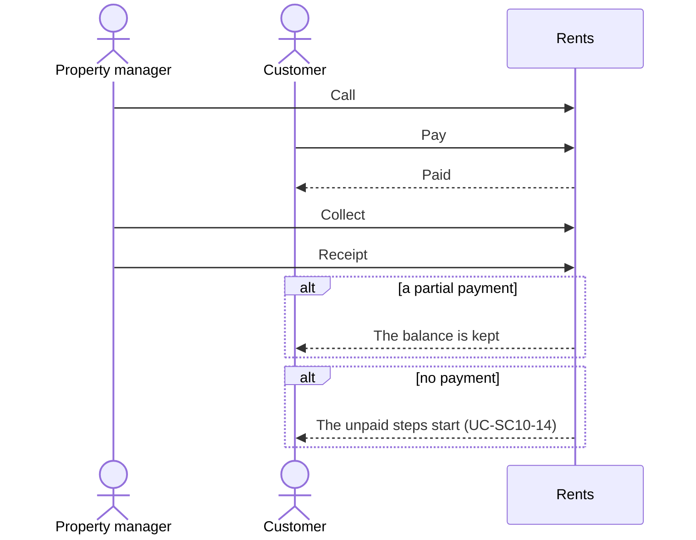

🏠 [Specs](../../../../README.md) › 🏷️ [Sectors](../../../README.md) › 🏘️ [SC10 Real estate](../../README.md) ›
📝 [Use cases](../README.md) › 📝 [Use cases: FL-SC10-04 Rents and landlords](README.md) ›
📝 UC-SC10-08 Call rents and issue receipts

# 📝 UC-SC10-08 Call rents and issue receipts

**Status:** ✅ specified

## Summary

The property manager calls rents monthly, collects them onto the client money account, and issues receipts on request.

## Personas

- [U34 Property manager](../../../../01-users/personas/u34-property-manager.md)
- [U09 Customer](../../../../01-users/personas/u09-customer.md)

## Goal

Rents collected, receipts given.

## Trigger

The start of each month.

## Frequency

Monthly per lease.

## Preconditions

- The SC10 sector pack is installed for the company,
  [UC-F14-02](../../../../02-functional/f14-plugin-store/use-cases/01-find-and-install/uc-f14-02-install-a-plugin-or-sector-pack.md),
  and its users have their roles,
  [UC-F1-06](../../../../02-functional/f01-administration/use-cases/04-edit-a-role/uc-f01-06-edit-a-role-and-its-record-rules.md).

## Postconditions

- **Success:** the rent is paid and the receipt available.
- **Failed:** the balance is kept and unpaid steps start.

## Main flow

1. Rent calls go out on [S-SC10-08 Rents](../../screens/04-rents-and-landlords/s-sc10-08-rents.md).
2. The tenant pays.
3. Payments go to the landlord's client ledger,
   [UC-F8-21](../../../../02-functional/f08-accounting/use-cases/07-client-money-grants-and-non-profits/uc-f08-21-keep-third-party-client-money.md).
4. The receipt is issued on request ([BR-SC10-05](../../business-rules/br-sc10-05-receipts-on-request.md)).

## Alternative flows

- 2a. Direct debit: rents are collected by debit,
  [UC-F8-05](../../../../02-functional/f08-accounting/use-cases/03-bank-and-collect/uc-f08-05-collect-customer-payments.md).

## Error flows

- 2e. A partial payment: the balance is kept.
- 2f. No payment: the unpaid steps start ([UC-SC10-14](uc-sc10-14-handle-unpaid-rents.md)).
- Any step: a call to a service or an outside system fails: it is retried first
  ([BR-F3-32](../../../../02-functional/f03-assistant/business-rules/br-f03-32-retry-before-an-error.md)), then the
  error message pattern ([D122](../../../../06-decisions/ux/d122-error-message-standard.md)) says what failed; what was
  typed is kept.

## Business rules

- [BR-SC10-05 Receipts on request](../../business-rules/br-sc10-05-receipts-on-request.md)
- [BR-F8-13 Client money is segregated and never negative per client](../../../../02-functional/f08-accounting/business-rules/br-f08-13-client-money-is-segregated-and-never-negative-per-client.md)

## Entities

- [E-SC10-09 Rent call](../../data/e-sc10-09-rent-call.md)

## Permissions

The property manager and customer roles; the record rules of their role and site apply,
[UC-F1-06](../../../../02-functional/f01-administration/use-cases/04-edit-a-role/uc-f01-06-edit-a-role-and-its-record-rules.md).

## Notifications

None beyond the in-app updates of the records concerned.

## Audit events

Every creation, change and state change of rent call records, with who, when and the values before and after (T3).

## AI involvement

The AI assistant answers questions on the rent call records of this use case, with links, and prepares them as drafts
the user confirms. It works within the user's rights,
[BR-F3-34](../../../../02-functional/f03-assistant/business-rules/br-f03-34-every-capability-is-reachable-from-the-assistant.md),
and never deletes or does anything irreversible without the user's confirmation,
[BR-F3-07](../../../../02-functional/f03-assistant/business-rules/br-f03-07-no-deletes-no-irreversible-acts.md).

## API, MCP and A2A exposure

Through the API and webhooks (T5) and the MCP and A2A gateway (T6), with the caller's rights,
[BR-F3-34](../../../../02-functional/f03-assistant/business-rules/br-f03-34-every-capability-is-reachable-from-the-assistant.md),
reading, creating and changing the records of this use case; nothing irreversible without a person's confirmation.

## Screens

- [S-SC10-08 Rents](../../screens/04-rents-and-landlords/s-sc10-08-rents.md)

## Flowchart

See [FL-SC10-04 Rents and landlords](../../flows/fl-sc10-04-rents-and-landlords.md#flowchart).

## Sequence diagram

## Acceptance criteria

1. **Given** the example estate agency's December call to S. Roux for 800 EUR rent and 90 EUR charges **when** he pays
   890 EUR **then** the receipt shows rent and charges apart.
2. **Given** S. Roux paying 500 EUR of 890 EUR **when** the month closes **then** the balance is kept.

## Non-functional notes

[D408](../../../../06-decisions/technical/d408-performance-and-profiles.md)'s targets
([performance](../../../../05-non-functional/performance.md)): 95 % of screens within 1 second; lists paged on the
server, the first page within 1 second; reports within 5 seconds or in the background. WCAG 2.2 AA and RGAA
([D46](../../../../06-decisions/ux/d46-accessibility-standard.md)).

## Regulatory references

Legal values from the France country pack:
[CR-FR-141 Rent receipts](../../../../10-country-packs/france/real-estate/cr-fr-141-rent-receipts.md).

## Related use cases

- [UC-SC10-12 Pay landlords and send statements](uc-sc10-12-pay-landlords-and-send-statements.md)

## Open questions

None.

---

⬅️ [UC-SC10-07 Let a property](../03-lettings/uc-sc10-07-let-a-property.md) · ⬆️ [Up](README.md) ·
➡️ [UC-SC10-09 Index rents within the caps](uc-sc10-09-index-rents-within-the-caps.md)
