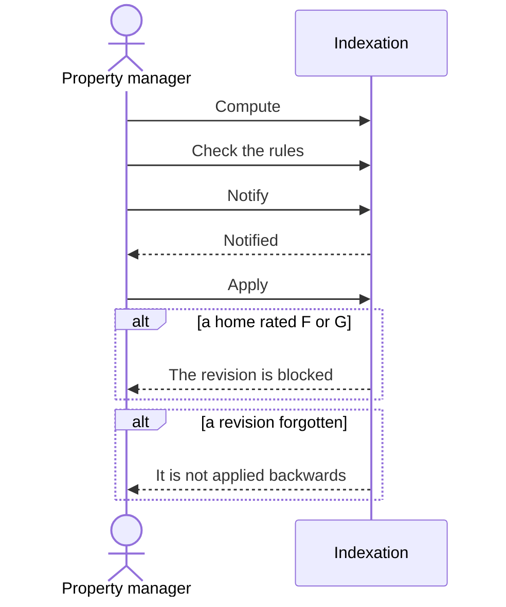

🏠 [Specs](../../../../README.md) › 🏷️ [Sectors](../../../README.md) › 🏘️ [SC10 Real estate](../../README.md) ›
📝 [Use cases](../README.md) › 📝 [Use cases: FL-SC10-04 Rents and landlords](README.md) ›
📝 UC-SC10-09 Index rents within the caps

# 📝 UC-SC10-09 Index rents within the caps

**Status:** ✅ specified

## Summary

The property manager computes yearly revisions by the reference index, checks the rules and notifies tenants.

## Personas

- [U34 Property manager](../../../../01-users/personas/u34-property-manager.md)

## Goal

Rents revised legally.

## Trigger

Each lease's anniversary.

## Frequency

Yearly per lease.

## Preconditions

- The SC10 sector pack is installed for the company,
  [UC-F14-02](../../../../02-functional/f14-plugin-store/use-cases/01-find-and-install/uc-f14-02-install-a-plugin-or-sector-pack.md),
  and its users have their roles,
  [UC-F1-06](../../../../02-functional/f01-administration/use-cases/04-edit-a-role/uc-f01-06-edit-a-role-and-its-record-rules.md).

## Postconditions

- **Success:** the new rent applies.
- **Failed:** the revision is blocked.

## Main flow

1. Revisions are computed on [S-SC10-09 Indexation](../../screens/04-rents-and-landlords/s-sc10-09-indexation.md).
2. Simple-ERP checks the clause and energy rating
   ([BR-SC10-06](../../business-rules/br-sc10-06-rent-revised-by-the-index.md)).
3. Tenants are notified.
4. The next rent call uses the new rent.

## Alternative flows

- 1a. A lease without clause: no revision.

## Error flows

- 2e. A home rated F or G: the revision is blocked.
- 4e. A revision forgotten: it is not applied backwards.
- Any step: a call to a service or an outside system fails: it is retried first
  ([BR-F3-32](../../../../02-functional/f03-assistant/business-rules/br-f03-32-retry-before-an-error.md)), then the
  error message pattern ([D122](../../../../06-decisions/ux/d122-error-message-standard.md)) says what failed; what was
  typed is kept.

## Business rules

- [BR-SC10-06 Rent revised by the index](../../business-rules/br-sc10-06-rent-revised-by-the-index.md)

## Entities

- [E-SC10-07 Lease](../../data/e-sc10-07-lease.md)

## Permissions

The property manager roles; the record rules of their role and site apply,
[UC-F1-06](../../../../02-functional/f01-administration/use-cases/04-edit-a-role/uc-f01-06-edit-a-role-and-its-record-rules.md).

## Notifications

None beyond the in-app updates of the records concerned.

## Audit events

Every creation, change and state change of lease records, with who, when and the values before and after (T3).

## AI involvement

The AI assistant answers questions on the lease records of this use case, with links, and prepares them as drafts the
user confirms. It works within the user's rights,
[BR-F3-34](../../../../02-functional/f03-assistant/business-rules/br-f03-34-every-capability-is-reachable-from-the-assistant.md),
and never deletes or does anything irreversible without the user's confirmation,
[BR-F3-07](../../../../02-functional/f03-assistant/business-rules/br-f03-07-no-deletes-no-irreversible-acts.md).

## API, MCP and A2A exposure

Through the API and webhooks (T5) and the MCP and A2A gateway (T6), with the caller's rights,
[BR-F3-34](../../../../02-functional/f03-assistant/business-rules/br-f03-34-every-capability-is-reachable-from-the-assistant.md),
reading, creating and changing the records of this use case; nothing irreversible without a person's confirmation.

## Screens

- [S-SC10-09 Indexation](../../screens/04-rents-and-landlords/s-sc10-09-indexation.md)

## Flowchart

See [FL-SC10-04 Rents and landlords](../../flows/fl-sc10-04-rents-and-landlords.md#flowchart).

## Sequence diagram

## Acceptance criteria

1. **Given** the example estate agency's lease of S. Roux rated D with clause **when** the index rises 2 % **then** the
   rent becomes 816 EUR.
2. **Given** a flat rated G **when** its revision is computed **then** the revision is blocked.

## Non-functional notes

[D408](../../../../06-decisions/technical/d408-performance-and-profiles.md)'s targets
([performance](../../../../05-non-functional/performance.md)): 95 % of screens within 1 second; lists paged on the
server, the first page within 1 second; reports within 5 seconds or in the background. WCAG 2.2 AA and RGAA
([D46](../../../../06-decisions/ux/d46-accessibility-standard.md)).

## Regulatory references

Legal values from the France country pack:
[CR-FR-142 Yearly rent revision by the reference index](../../../../10-country-packs/france/real-estate/cr-fr-142-rent-revision-irl.md),
[CR-FR-143 Rent caps and energy-inefficient homes](../../../../10-country-packs/france/real-estate/cr-fr-143-rent-caps-and-energy-rules.md).

## Related use cases

- [UC-SC10-08 Call rents and issue receipts](uc-sc10-08-call-rents-and-issue-receipts.md)

## Open questions

None.

---

⬅️ [UC-SC10-08 Call rents and issue receipts](uc-sc10-08-call-rents-and-issue-receipts.md) · ⬆️ [Up](README.md) ·
➡️ [UC-SC10-10 Manage deposits and their return](../03-lettings/uc-sc10-10-manage-deposits-and-their-return.md)
