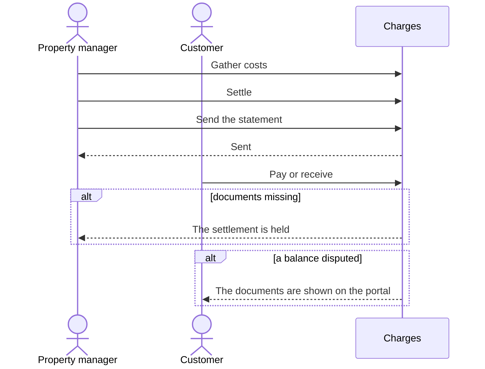

🏠 [Specs](../../../../README.md) › 🏷️ [Sectors](../../../README.md) › 🏘️ [SC10 Real estate](../../README.md) ›
📝 [Use cases](../README.md) › 📝 [Use cases: FL-SC10-04 Rents and landlords](README.md) ›
📝 UC-SC10-11 Settle service charges yearly

# 📝 UC-SC10-11 Settle service charges yearly

**Status:** ✅ specified

## Summary

The property manager gathers the year's costs, settles them against the provisions and sends the statement.

## Personas

- [U34 Property manager](../../../../01-users/personas/u34-property-manager.md)
- [U09 Customer](../../../../01-users/personas/u09-customer.md)

## Goal

Charges settled with proof.

## Trigger

The year end.

## Frequency

Yearly per lease.

## Preconditions

- The SC10 sector pack is installed for the company,
  [UC-F14-02](../../../../02-functional/f14-plugin-store/use-cases/01-find-and-install/uc-f14-02-install-a-plugin-or-sector-pack.md),
  and its users have their roles,
  [UC-F1-06](../../../../02-functional/f01-administration/use-cases/04-edit-a-role/uc-f01-06-edit-a-role-and-its-record-rules.md).

## Postconditions

- **Success:** the balance is billed or refunded.
- **Failed:** the settlement is held.

## Main flow

1. Costs are gathered on [S-SC10-11 Charges](../../screens/04-rents-and-landlords/s-sc10-11-charges.md).
2. They are settled against provisions ([BR-SC10-09](../../business-rules/br-sc10-09-charges-settled-yearly.md)).
3. The statement goes to the tenant.
4. The balance is paid or refunded.

## Alternative flows

- 1a. A tenant leaving mid-year: the share is prorated.

## Error flows

- 1e. Documents missing: the settlement is held.
- 4e. A balance disputed: the documents are shown on the portal.
- Any step: a call to a service or an outside system fails: it is retried first
  ([BR-F3-32](../../../../02-functional/f03-assistant/business-rules/br-f03-32-retry-before-an-error.md)), then the
  error message pattern ([D122](../../../../06-decisions/ux/d122-error-message-standard.md)) says what failed; what was
  typed is kept.

## Business rules

- [BR-SC10-09 Charges settled yearly](../../business-rules/br-sc10-09-charges-settled-yearly.md)

## Entities

- [E-SC10-10 Charge settlement](../../data/e-sc10-10-charge-settlement.md)

## Permissions

The property manager and customer roles; the record rules of their role and site apply,
[UC-F1-06](../../../../02-functional/f01-administration/use-cases/04-edit-a-role/uc-f01-06-edit-a-role-and-its-record-rules.md).

## Notifications

None beyond the in-app updates of the records concerned.

## Audit events

Every creation, change and state change of charge settlement records, with who, when and the values before and after
(T3).

## AI involvement

The AI assistant answers questions on the charge settlement records of this use case, with links, and prepares them as
drafts the user confirms. It works within the user's rights,
[BR-F3-34](../../../../02-functional/f03-assistant/business-rules/br-f03-34-every-capability-is-reachable-from-the-assistant.md),
and never deletes or does anything irreversible without the user's confirmation,
[BR-F3-07](../../../../02-functional/f03-assistant/business-rules/br-f03-07-no-deletes-no-irreversible-acts.md).

## API, MCP and A2A exposure

Through the API and webhooks (T5) and the MCP and A2A gateway (T6), with the caller's rights,
[BR-F3-34](../../../../02-functional/f03-assistant/business-rules/br-f03-34-every-capability-is-reachable-from-the-assistant.md),
reading, creating and changing the records of this use case; nothing irreversible without a person's confirmation.

## Screens

- [S-SC10-11 Charges](../../screens/04-rents-and-landlords/s-sc10-11-charges.md)

## Flowchart

See [FL-SC10-04 Rents and landlords](../../flows/fl-sc10-04-rents-and-landlords.md#flowchart).

## Sequence diagram

## Acceptance criteria

1. **Given** the example estate agency's S. Roux with 1,080 EUR of provisions and 960 EUR of costs **when** 2026 is
   settled **then** 120 EUR is refunded.
2. **Given** the water bill missing **when** 2026 is settled **then** the settlement is held.

## Non-functional notes

[D408](../../../../06-decisions/technical/d408-performance-and-profiles.md)'s targets
([performance](../../../../05-non-functional/performance.md)): 95 % of screens within 1 second; lists paged on the
server, the first page within 1 second; reports within 5 seconds or in the background. WCAG 2.2 AA and RGAA
([D46](../../../../06-decisions/ux/d46-accessibility-standard.md)).

## Regulatory references

Legal values from the France country pack:
[CR-FR-145 Recoverable service charges](../../../../10-country-packs/france/real-estate/cr-fr-145-recoverable-charges.md).

## Related use cases

- [UC-SC10-12 Pay landlords and send statements](uc-sc10-12-pay-landlords-and-send-statements.md)

## Open questions

None.

---

⬅️ [UC-SC10-10 Manage deposits and their return](../03-lettings/uc-sc10-10-manage-deposits-and-their-return.md) ·
⬆️ [Up](README.md) ·
➡️ [UC-SC10-12 Pay landlords and send statements](uc-sc10-12-pay-landlords-and-send-statements.md)
