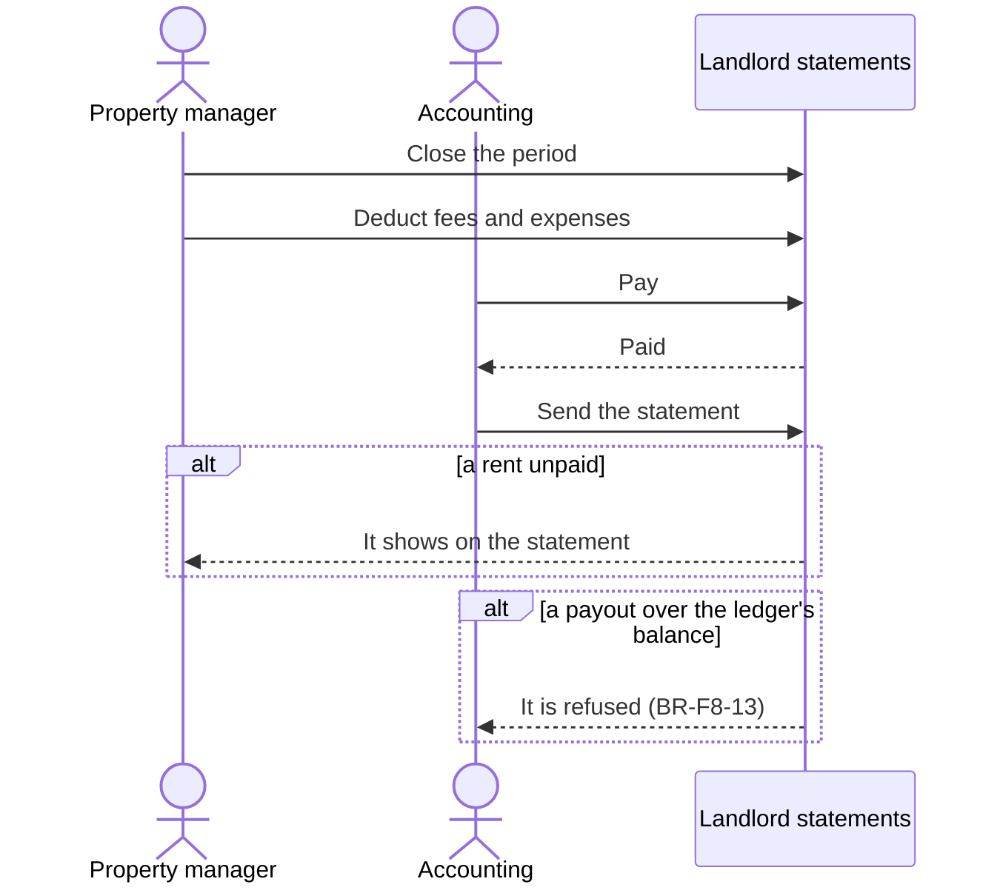

🏠 [Specs](../../../../README.md) › 🏷️ [Sectors](../../../README.md) › 🏘️ [SC10 Real estate](../../README.md) ›
📝 [Use cases](../README.md) › 📝 [Use cases: FL-SC10-04 Rents and landlords](README.md) ›
📝 UC-SC10-12 Pay landlords and send statements

# 📝 UC-SC10-12 Pay landlords and send statements

**Status:** ✅ specified

## Summary

The property manager closes the period, deducts fees and expenses, pays each landlord from the client money ledger and
sends the statement.

## Personas

- [U34 Property manager](../../../../01-users/personas/u34-property-manager.md)
- [U05 Accounting](../../../../01-users/personas/u05-accounting.md)

## Goal

Landlords paid with a clear statement.

## Trigger

Month end.

## Frequency

Monthly.

## Preconditions

- The SC10 sector pack is installed for the company,
  [UC-F14-02](../../../../02-functional/f14-plugin-store/use-cases/01-find-and-install/uc-f14-02-install-a-plugin-or-sector-pack.md),
  and its users have their roles,
  [UC-F1-06](../../../../02-functional/f01-administration/use-cases/04-edit-a-role/uc-f01-06-edit-a-role-and-its-record-rules.md).

## Postconditions

- **Success:** landlords are paid and statements sent.
- **Failed:** the period stays open.

## Main flow

1. The property manager closes the month on
   [S-SC10-12 Landlord statements](../../screens/04-rents-and-landlords/s-sc10-12-landlord-statements.md).
2. Fees and expenses are deducted ([BR-SC10-10](../../business-rules/br-sc10-10-landlords-paid-with-statements.md)).
3. Accounting pays from the client ledger,
   [UC-F8-21](../../../../02-functional/f08-accounting/use-cases/07-client-money-grants-and-non-profits/uc-f08-21-keep-third-party-client-money.md).
4. Statements go to the landlord portal.

## Alternative flows

- 1a. Several owners of one property: each is paid their share.

## Error flows

- 1e. A rent unpaid: it shows on the statement.
- 3e. A payout over the ledger's balance: it is refused,
  [BR-F8-13](../../../../02-functional/f08-accounting/business-rules/br-f08-13-client-money-is-segregated-and-never-negative-per-client.md).
- Any step: a call to a service or an outside system fails: it is retried first
  ([BR-F3-32](../../../../02-functional/f03-assistant/business-rules/br-f03-32-retry-before-an-error.md)), then the
  error message pattern ([D122](../../../../06-decisions/ux/d122-error-message-standard.md)) says what failed; what was
  typed is kept.

## Business rules

- [BR-SC10-10 Landlords paid with statements](../../business-rules/br-sc10-10-landlords-paid-with-statements.md)
- [BR-F8-13 Client money is segregated and never negative per client](../../../../02-functional/f08-accounting/business-rules/br-f08-13-client-money-is-segregated-and-never-negative-per-client.md)

## Entities

- [E-SC10-11 Landlord statement](../../data/e-sc10-11-landlord-statement.md)
- [E-F8-17 Client money ledger](../../../../02-functional/f08-accounting/data/e-f08-17-client-money-ledger.md)

## Permissions

The property manager and accounting roles; the record rules of their role and site apply,
[UC-F1-06](../../../../02-functional/f01-administration/use-cases/04-edit-a-role/uc-f01-06-edit-a-role-and-its-record-rules.md).

## Notifications

None beyond the in-app updates of the records concerned.

## Audit events

Every creation, change and state change of landlord statement, client money ledger records, with who, when and the
values before and after (T3).

## AI involvement

The AI assistant answers questions on the landlord statement, client money ledger records of this use case, with links,
and prepares them as drafts the user confirms. It works within the user's rights,
[BR-F3-34](../../../../02-functional/f03-assistant/business-rules/br-f03-34-every-capability-is-reachable-from-the-assistant.md),
and never deletes or does anything irreversible without the user's confirmation,
[BR-F3-07](../../../../02-functional/f03-assistant/business-rules/br-f03-07-no-deletes-no-irreversible-acts.md).

## API, MCP and A2A exposure

Through the API and webhooks (T5) and the MCP and A2A gateway (T6), with the caller's rights,
[BR-F3-34](../../../../02-functional/f03-assistant/business-rules/br-f03-34-every-capability-is-reachable-from-the-assistant.md),
reading, creating and changing the records of this use case; nothing irreversible without a person's confirmation.

## Screens

- [S-SC10-12 Landlord statements](../../screens/04-rents-and-landlords/s-sc10-12-landlord-statements.md)

## Flowchart

See [FL-SC10-04 Rents and landlords](../../flows/fl-sc10-04-rents-and-landlords.md#flowchart).

## Sequence diagram

## Acceptance criteria

1. **Given** the example estate agency's J. Petit with 890 EUR collected and 8 % fees **when** November is paid **then**
   he is paid 818.80 EUR with a statement.
2. **Given** S. Roux unpaid in December **when** the month closes **then** it shows on the statement.

## Non-functional notes

[D408](../../../../06-decisions/technical/d408-performance-and-profiles.md)'s targets
([performance](../../../../05-non-functional/performance.md)): 95 % of screens within 1 second; lists paged on the
server, the first page within 1 second; reports within 5 seconds or in the background. WCAG 2.2 AA and RGAA
([D46](../../../../06-decisions/ux/d46-accessibility-standard.md)).

## Regulatory references

None specific to this use case; the sector's legal rules are listed in [SC10 regulatory](../../regulatory.md).

## Related use cases

- [UC-SC10-08 Call rents and issue receipts](uc-sc10-08-call-rents-and-issue-receipts.md)

## Open questions

None.

---

⬅️ [UC-SC10-11 Settle service charges yearly](uc-sc10-11-settle-service-charges-yearly.md) · ⬆️ [Up](README.md) ·
➡️ [UC-SC10-13 Track diagnostics and works](../03-lettings/uc-sc10-13-track-diagnostics-and-works.md)
