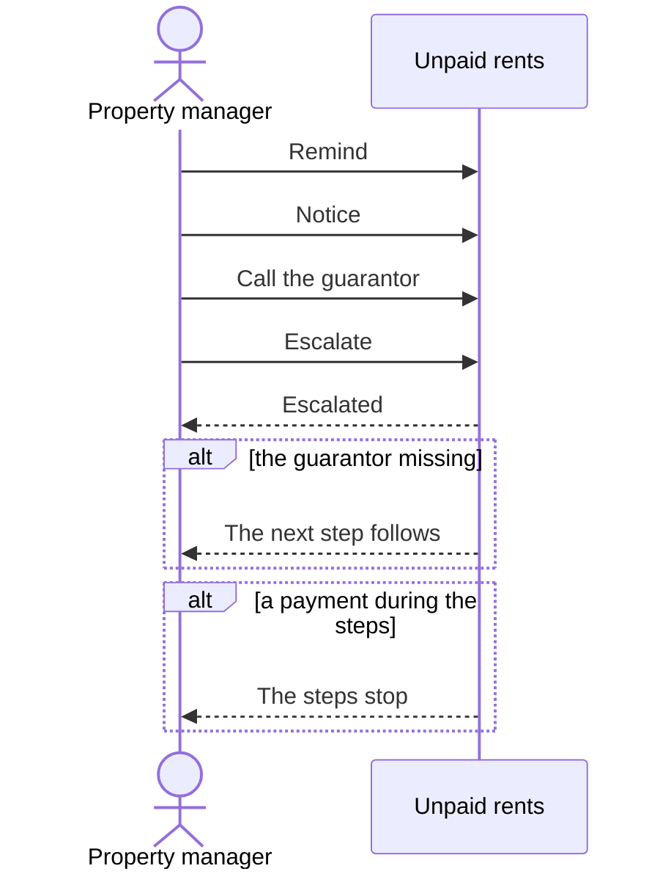

🏠 [Specs](../../../../README.md) › 🏷️ [Sectors](../../../README.md) › 🏘️ [SC10 Real estate](../../README.md) ›
📝 [Use cases](../README.md) › 📝 [Use cases: FL-SC10-04 Rents and landlords](README.md) ›
📝 UC-SC10-14 Handle unpaid rents

# 📝 UC-SC10-14 Handle unpaid rents

**Status:** ✅ specified

## Summary

The property manager follows the steps for an unpaid rent: reminder, formal notice, guarantor, insurer, then legal
action.

## Personas

- [U34 Property manager](../../../../01-users/personas/u34-property-manager.md)

## Goal

Unpaid rents recovered or escalated in order.

## Trigger

A rent unpaid at its date.

## Frequency

Monthly.

## Preconditions

- The SC10 sector pack is installed for the company,
  [UC-F14-02](../../../../02-functional/f14-plugin-store/use-cases/01-find-and-install/uc-f14-02-install-a-plugin-or-sector-pack.md),
  and its users have their roles,
  [UC-F1-06](../../../../02-functional/f01-administration/use-cases/04-edit-a-role/uc-f01-06-edit-a-role-and-its-record-rules.md).

## Postconditions

- **Success:** the rent is paid or escalated.
- **Failed:** the case goes to legal action.

## Main flow

1. A reminder goes out on [S-SC10-14 Unpaid rents](../../screens/04-rents-and-landlords/s-sc10-14-unpaid-rents.md)
   ([BR-SC10-11](../../business-rules/br-sc10-11-unpaid-rent-steps.md)).
2. A formal notice follows.
3. The guarantor or insurer is called.
4. The case goes to legal action.

## Alternative flows

- 1a. A payment plan: an instalment plan is agreed,
  [UC-F6-23](../../../../02-functional/f06-customers-and-sales/use-cases/08-collect-and-settle/uc-f06-23-agree-an-instalment-plan.md).

## Error flows

- 3e. The guarantor missing: the next step follows.
- 1e. A payment during the steps: the steps stop.
- Any step: a call to a service or an outside system fails: it is retried first
  ([BR-F3-32](../../../../02-functional/f03-assistant/business-rules/br-f03-32-retry-before-an-error.md)), then the
  error message pattern ([D122](../../../../06-decisions/ux/d122-error-message-standard.md)) says what failed; what was
  typed is kept.

## Business rules

- [BR-SC10-11 Unpaid rent steps](../../business-rules/br-sc10-11-unpaid-rent-steps.md)

## Entities

- [E-SC10-09 Rent call](../../data/e-sc10-09-rent-call.md)

## Permissions

The property manager roles; the record rules of their role and site apply,
[UC-F1-06](../../../../02-functional/f01-administration/use-cases/04-edit-a-role/uc-f01-06-edit-a-role-and-its-record-rules.md).

## Notifications

None beyond the in-app updates of the records concerned.

## Audit events

Every creation, change and state change of rent call records, with who, when and the values before and after (T3).

## AI involvement

The AI assistant answers questions on the rent call records of this use case, with links, and prepares them as drafts
the user confirms. It works within the user's rights,
[BR-F3-34](../../../../02-functional/f03-assistant/business-rules/br-f03-34-every-capability-is-reachable-from-the-assistant.md),
and never deletes or does anything irreversible without the user's confirmation,
[BR-F3-07](../../../../02-functional/f03-assistant/business-rules/br-f03-07-no-deletes-no-irreversible-acts.md).

## API, MCP and A2A exposure

Through the API and webhooks (T5) and the MCP and A2A gateway (T6), with the caller's rights,
[BR-F3-34](../../../../02-functional/f03-assistant/business-rules/br-f03-34-every-capability-is-reachable-from-the-assistant.md),
reading, creating and changing the records of this use case; nothing irreversible without a person's confirmation.

## Screens

- [S-SC10-14 Unpaid rents](../../screens/04-rents-and-landlords/s-sc10-14-unpaid-rents.md)

## Flowchart

See [FL-SC10-04 Rents and landlords](../../flows/fl-sc10-04-rents-and-landlords.md#flowchart).

## Sequence diagram

## Acceptance criteria

1. **Given** the example estate agency's S. Roux unpaid in December **when** the steps run **then** a reminder goes out
   first.
2. **Given** S. Roux without guarantor **when** the notice period ends **then** the next step follows.

## Non-functional notes

[D408](../../../../06-decisions/technical/d408-performance-and-profiles.md)'s targets
([performance](../../../../05-non-functional/performance.md)): 95 % of screens within 1 second; lists paged on the
server, the first page within 1 second; reports within 5 seconds or in the background. WCAG 2.2 AA and RGAA
([D46](../../../../06-decisions/ux/d46-accessibility-standard.md)).

## Regulatory references

None specific to this use case; the sector's legal rules are listed in [SC10 regulatory](../../regulatory.md).

## Related use cases

- [UC-SC10-08 Call rents and issue receipts](uc-sc10-08-call-rents-and-issue-receipts.md)

## Open questions

None.

---

⬅️ [UC-SC10-13 Track diagnostics and works](../03-lettings/uc-sc10-13-track-diagnostics-and-works.md) ·
⬆️ [Up](README.md) ·
➡️ [UC-SC10-15 Run co-owners' general assemblies](../05-co-ownership/uc-sc10-15-run-co-owners-general-assemblies.md)
