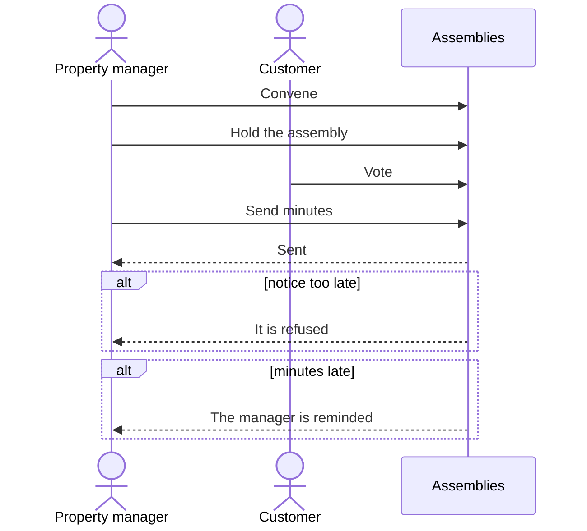

🏠 [Specs](../../../../README.md) › 🏷️ [Sectors](../../../README.md) › 🏘️ [SC10 Real estate](../../README.md) ›
📝 [Use cases](../README.md) › 📝 [Use cases: FL-SC10-05 Co-ownership](README.md) ›
📝 UC-SC10-15 Run co-owners' general assemblies

# 📝 UC-SC10-15 Run co-owners' general assemblies

**Status:** ✅ specified

## Summary

The co-ownership manager convenes the assembly within the legal notice, holds it and sends the minutes in time.

## Personas

- [U34 Property manager](../../../../01-users/personas/u34-property-manager.md)
- [U09 Customer](../../../../01-users/personas/u09-customer.md)

## Goal

Valid assemblies and minutes on time.

## Trigger

The yearly assembly.

## Frequency

Yearly per co-ownership.

## Preconditions

- The SC10 sector pack is installed for the company,
  [UC-F14-02](../../../../02-functional/f14-plugin-store/use-cases/01-find-and-install/uc-f14-02-install-a-plugin-or-sector-pack.md),
  and its users have their roles,
  [UC-F1-06](../../../../02-functional/f01-administration/use-cases/04-edit-a-role/uc-f01-06-edit-a-role-and-its-record-rules.md).

## Postconditions

- **Success:** minutes are sent.
- **Failed:** the assembly is convened again.

## Main flow

1. The notice goes out on [S-SC10-15 Assemblies](../../screens/05-co-ownership/s-sc10-15-assemblies.md)
   ([BR-SC10-12](../../business-rules/br-sc10-12-assemblies-convened-on-time.md)).
2. The assembly is held and recorded,
   [UC-F4-03](../../../../02-functional/f04-meetings/use-cases/02-record-in-person-or-by-phone/uc-f04-03-record-an-in-person-meeting.md).
3. Co-owners vote by shares.
4. Minutes are sent.

## Alternative flows

- 3a. Online voting: co-owners vote online before or during.

## Error flows

- 1e. Notice too late: it is refused.
- 4e. Minutes late: the manager is reminded.
- Any step: a call to a service or an outside system fails: it is retried first
  ([BR-F3-32](../../../../02-functional/f03-assistant/business-rules/br-f03-32-retry-before-an-error.md)), then the
  error message pattern ([D122](../../../../06-decisions/ux/d122-error-message-standard.md)) says what failed; what was
  typed is kept.

## Business rules

- [BR-SC10-12 Assemblies convened on time](../../business-rules/br-sc10-12-assemblies-convened-on-time.md)

## Entities

- [E-SC10-13 Co-owners' assembly](../../data/e-sc10-13-co-owners-assembly.md)

## Permissions

The property manager and customer roles; the record rules of their role and site apply,
[UC-F1-06](../../../../02-functional/f01-administration/use-cases/04-edit-a-role/uc-f01-06-edit-a-role-and-its-record-rules.md).

## Notifications

None beyond the in-app updates of the records concerned.

## Audit events

Every creation, change and state change of co-owners' assembly records, with who, when and the values before and after
(T3).

## AI involvement

The AI assistant answers questions on the co-owners' assembly records of this use case, with links, and prepares them as
drafts the user confirms. It works within the user's rights,
[BR-F3-34](../../../../02-functional/f03-assistant/business-rules/br-f03-34-every-capability-is-reachable-from-the-assistant.md),
and never deletes or does anything irreversible without the user's confirmation,
[BR-F3-07](../../../../02-functional/f03-assistant/business-rules/br-f03-07-no-deletes-no-irreversible-acts.md).

## API, MCP and A2A exposure

Through the API and webhooks (T5) and the MCP and A2A gateway (T6), with the caller's rights,
[BR-F3-34](../../../../02-functional/f03-assistant/business-rules/br-f03-34-every-capability-is-reachable-from-the-assistant.md),
reading, creating and changing the records of this use case; nothing irreversible without a person's confirmation.

## Screens

- [S-SC10-15 Assemblies](../../screens/05-co-ownership/s-sc10-15-assemblies.md)

## Flowchart

See [FL-SC10-05 Co-ownership](../../flows/fl-sc10-05-co-ownership.md#flowchart).

## Sequence diagram

## Acceptance criteria

1. **Given** the example estate agency's Les Tilleuls assembly on 30 November with notice sent on 6 November **when** it
   is held **then** budget and works resolutions are recorded.
2. **Given** Les Tilleuls' assembly on 30 November with notice on 20 November **when** the notice is sent **then** it is
   refused.

## Non-functional notes

[D408](../../../../06-decisions/technical/d408-performance-and-profiles.md)'s targets
([performance](../../../../05-non-functional/performance.md)): 95 % of screens within 1 second; lists paged on the
server, the first page within 1 second; reports within 5 seconds or in the background. WCAG 2.2 AA and RGAA
([D46](../../../../06-decisions/ux/d46-accessibility-standard.md)).

## Regulatory references

Legal values from the France country pack:
[CR-FR-146 Co-owners' general assembly](../../../../10-country-packs/france/real-estate/cr-fr-146-co-ownership-assembly.md).

## Related use cases

- [UC-SC10-16 Vote the co-ownership budget and call funds](uc-sc10-16-vote-the-co-ownership-budget-and-call-funds.md)

## Open questions

None.

---

⬅️ [UC-SC10-14 Handle unpaid rents](../04-rents-and-landlords/uc-sc10-14-handle-unpaid-rents.md) · ⬆️ [Up](README.md) ·
➡️ [UC-SC10-16 Vote the co-ownership budget and call funds](uc-sc10-16-vote-the-co-ownership-budget-and-call-funds.md)
