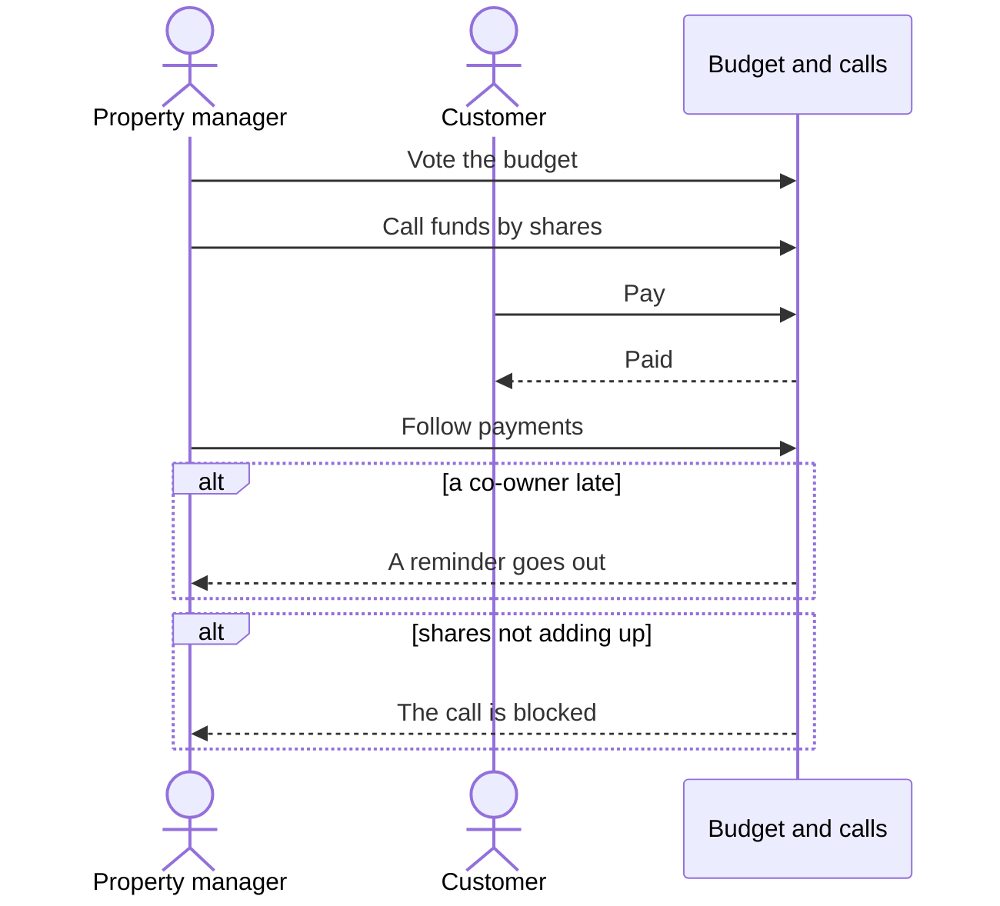

🏠 [Specs](../../../../README.md) › 🏷️ [Sectors](../../../README.md) › 🏘️ [SC10 Real estate](../../README.md) ›
📝 [Use cases](../README.md) › 📝 [Use cases: FL-SC10-05 Co-ownership](README.md) ›
📝 UC-SC10-16 Vote the co-ownership budget and call funds

# 📝 UC-SC10-16 Vote the co-ownership budget and call funds

**Status:** ✅ specified

## Summary

The co-owners vote the budget; the co-ownership manager calls funds by each lot's shares and follows payments.

## Personas

- [U34 Property manager](../../../../01-users/personas/u34-property-manager.md)
- [U09 Customer](../../../../01-users/personas/u09-customer.md)

## Goal

Funds called by shares and paid.

## Trigger

The voted budget, each quarter.

## Frequency

Quarterly.

## Preconditions

- The SC10 sector pack is installed for the company,
  [UC-F14-02](../../../../02-functional/f14-plugin-store/use-cases/01-find-and-install/uc-f14-02-install-a-plugin-or-sector-pack.md),
  and its users have their roles,
  [UC-F1-06](../../../../02-functional/f01-administration/use-cases/04-edit-a-role/uc-f01-06-edit-a-role-and-its-record-rules.md).

## Postconditions

- **Success:** calls are paid.
- **Failed:** late co-owners are reminded.

## Main flow

1. The budget voted at the assembly is recorded on
   [S-SC10-16 Budget and calls](../../screens/05-co-ownership/s-sc10-16-budget-and-calls.md).
2. Calls are split by shares ([BR-SC10-14](../../business-rules/br-sc10-14-calls-for-funds-by-shares.md)).
3. Co-owners pay.
4. Payments go to the co-ownership's account,
   [UC-F8-21](../../../../02-functional/f08-accounting/use-cases/07-client-money-grants-and-non-profits/uc-f08-21-keep-third-party-client-money.md).

## Alternative flows

- 2a. A special call for works: it uses the works decision's key.

## Error flows

- 4e. A co-owner late: a reminder goes out.
- 2e. Shares not adding up: the call is blocked.
- Any step: a call to a service or an outside system fails: it is retried first
  ([BR-F3-32](../../../../02-functional/f03-assistant/business-rules/br-f03-32-retry-before-an-error.md)), then the
  error message pattern ([D122](../../../../06-decisions/ux/d122-error-message-standard.md)) says what failed; what was
  typed is kept.

## Business rules

- [BR-SC10-14 Calls for funds by shares](../../business-rules/br-sc10-14-calls-for-funds-by-shares.md)

## Entities

- [E-SC10-14 Call for funds](../../data/e-sc10-14-call-for-funds.md)

## Permissions

The property manager and customer roles; the record rules of their role and site apply,
[UC-F1-06](../../../../02-functional/f01-administration/use-cases/04-edit-a-role/uc-f01-06-edit-a-role-and-its-record-rules.md).

## Notifications

None beyond the in-app updates of the records concerned.

## Audit events

Every creation, change and state change of call for funds records, with who, when and the values before and after (T3).

## AI involvement

The AI assistant answers questions on the call for funds records of this use case, with links, and prepares them as
drafts the user confirms. It works within the user's rights,
[BR-F3-34](../../../../02-functional/f03-assistant/business-rules/br-f03-34-every-capability-is-reachable-from-the-assistant.md),
and never deletes or does anything irreversible without the user's confirmation,
[BR-F3-07](../../../../02-functional/f03-assistant/business-rules/br-f03-07-no-deletes-no-irreversible-acts.md).

## API, MCP and A2A exposure

Through the API and webhooks (T5) and the MCP and A2A gateway (T6), with the caller's rights,
[BR-F3-34](../../../../02-functional/f03-assistant/business-rules/br-f03-34-every-capability-is-reachable-from-the-assistant.md),
reading, creating and changing the records of this use case; nothing irreversible without a person's confirmation.

## Screens

- [S-SC10-16 Budget and calls](../../screens/05-co-ownership/s-sc10-16-budget-and-calls.md)

## Flowchart

See [FL-SC10-05 Co-ownership](../../flows/fl-sc10-05-co-ownership.md#flowchart).

## Sequence diagram

## Acceptance criteria

1. **Given** the example estate agency's Les Tilleuls Q1 budget call with lot 12 at 120/10,000 **when** the call is
   10,000 EUR **then** lot 12 is called 120 EUR.
2. **Given** lot 12 unpaid in Q1 **when** the due date passes **then** a reminder goes out.

## Non-functional notes

[D408](../../../../06-decisions/technical/d408-performance-and-profiles.md)'s targets
([performance](../../../../05-non-functional/performance.md)): 95 % of screens within 1 second; lists paged on the
server, the first page within 1 second; reports within 5 seconds or in the background. WCAG 2.2 AA and RGAA
([D46](../../../../06-decisions/ux/d46-accessibility-standard.md)).

## Regulatory references

None specific to this use case; the sector's legal rules are listed in [SC10 regulatory](../../regulatory.md).

## Related use cases

- [UC-SC10-17 Manage the works fund and works](uc-sc10-17-manage-the-works-fund-and-works.md)

## Open questions

None.

---

⬅️ [UC-SC10-15 Run co-owners' general assemblies](uc-sc10-15-run-co-owners-general-assemblies.md) · ⬆️ [Up](README.md) ·
➡️ [UC-SC10-17 Manage the works fund and works](uc-sc10-17-manage-the-works-fund-and-works.md)
