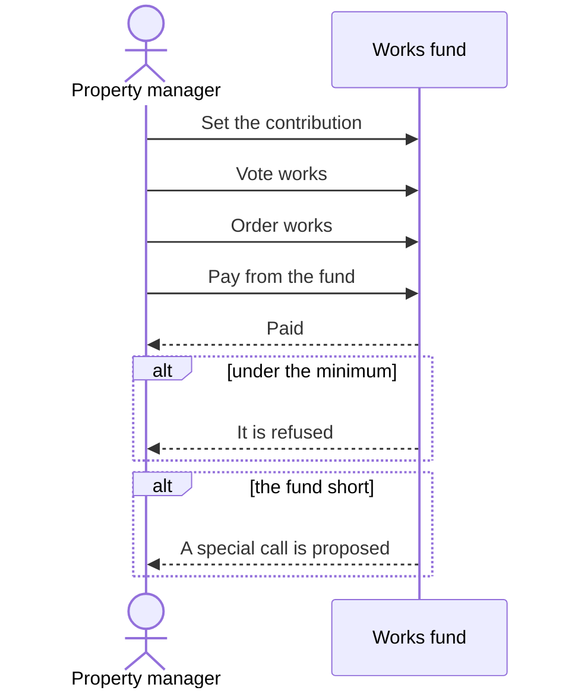

🏠 [Specs](../../../../README.md) › 🏷️ [Sectors](../../../README.md) › 🏘️ [SC10 Real estate](../../README.md) ›
📝 [Use cases](../README.md) › 📝 [Use cases: FL-SC10-05 Co-ownership](README.md) ›
📝 UC-SC10-17 Manage the works fund and works

# 📝 UC-SC10-17 Manage the works fund and works

**Status:** ✅ specified

## Summary

The co-ownership manager sets the works fund contribution at least at the minimum, has works voted and pays them from
the fund.

## Personas

- [U34 Property manager](../../../../01-users/personas/u34-property-manager.md)

## Goal

Works funded from a fund at least at the minimum.

## Trigger

The budget vote or works needs.

## Frequency

Yearly.

## Preconditions

- The SC10 sector pack is installed for the company,
  [UC-F14-02](../../../../02-functional/f14-plugin-store/use-cases/01-find-and-install/uc-f14-02-install-a-plugin-or-sector-pack.md),
  and its users have their roles,
  [UC-F1-06](../../../../02-functional/f01-administration/use-cases/04-edit-a-role/uc-f01-06-edit-a-role-and-its-record-rules.md).

## Postconditions

- **Success:** works are paid from the fund.
- **Failed:** the contribution is refused.

## Main flow

1. The contribution is set on [S-SC10-17 Works fund](../../screens/05-co-ownership/s-sc10-17-works-fund.md)
   ([BR-SC10-13](../../business-rules/br-sc10-13-works-fund-at-least-the-minimum.md)).
2. Works are voted at the assembly.
3. Works are ordered,
   [UC-F7-02](../../../../02-functional/f07-purchasing-and-stock/use-cases/01-procure/uc-f07-02-order-from-a-supplier.md).
4. Invoices are paid from the fund's account.

## Alternative flows

- 2a. Emergency works: the manager orders them and reports at the next assembly.

## Error flows

- 1e. Under the minimum: it is refused.
- 4e. The fund short: a special call is proposed.
- Any step: a call to a service or an outside system fails: it is retried first
  ([BR-F3-32](../../../../02-functional/f03-assistant/business-rules/br-f03-32-retry-before-an-error.md)), then the
  error message pattern ([D122](../../../../06-decisions/ux/d122-error-message-standard.md)) says what failed; what was
  typed is kept.

## Business rules

- [BR-SC10-13 Works fund at least the minimum](../../business-rules/br-sc10-13-works-fund-at-least-the-minimum.md)

## Entities

- [E-SC10-15 Works fund](../../data/e-sc10-15-works-fund.md)

## Permissions

The property manager roles; the record rules of their role and site apply,
[UC-F1-06](../../../../02-functional/f01-administration/use-cases/04-edit-a-role/uc-f01-06-edit-a-role-and-its-record-rules.md).

## Notifications

None beyond the in-app updates of the records concerned.

## Audit events

Every creation, change and state change of works fund records, with who, when and the values before and after (T3).

## AI involvement

The AI assistant answers questions on the works fund records of this use case, with links, and prepares them as drafts
the user confirms. It works within the user's rights,
[BR-F3-34](../../../../02-functional/f03-assistant/business-rules/br-f03-34-every-capability-is-reachable-from-the-assistant.md),
and never deletes or does anything irreversible without the user's confirmation,
[BR-F3-07](../../../../02-functional/f03-assistant/business-rules/br-f03-07-no-deletes-no-irreversible-acts.md).

## API, MCP and A2A exposure

Through the API and webhooks (T5) and the MCP and A2A gateway (T6), with the caller's rights,
[BR-F3-34](../../../../02-functional/f03-assistant/business-rules/br-f03-34-every-capability-is-reachable-from-the-assistant.md),
reading, creating and changing the records of this use case; nothing irreversible without a person's confirmation.

## Screens

- [S-SC10-17 Works fund](../../screens/05-co-ownership/s-sc10-17-works-fund.md)

## Flowchart

See [FL-SC10-05 Co-ownership](../../flows/fl-sc10-05-co-ownership.md#flowchart).

## Sequence diagram

## Acceptance criteria

1. **Given** the example estate agency's Les Tilleuls fund with 14,600 EUR and 2,000 EUR contributed for 2027 **when**
   works of 5,000 EUR are paid **then** the balance becomes 11,600 EUR.
2. **Given** a contribution under the legal minimum **when** it is set **then** it is refused.

## Non-functional notes

[D408](../../../../06-decisions/technical/d408-performance-and-profiles.md)'s targets
([performance](../../../../05-non-functional/performance.md)): 95 % of screens within 1 second; lists paged on the
server, the first page within 1 second; reports within 5 seconds or in the background. WCAG 2.2 AA and RGAA
([D46](../../../../06-decisions/ux/d46-accessibility-standard.md)).

## Regulatory references

Legal values from the France country pack:
[CR-FR-147 Co-ownership works fund](../../../../10-country-packs/france/real-estate/cr-fr-147-works-fund.md).

## Related use cases

- [UC-SC10-16 Vote the co-ownership budget and call funds](uc-sc10-16-vote-the-co-ownership-budget-and-call-funds.md)

## Open questions

None.

---

⬅️ [UC-SC10-16 Vote the co-ownership budget and call funds](uc-sc10-16-vote-the-co-ownership-budget-and-call-funds.md) ·
⬆️ [Up](README.md) ·
➡️ [UC-SC10-18 Keep co-owners' accounts and the register](uc-sc10-18-keep-co-owners-accounts-and-the-register.md)
