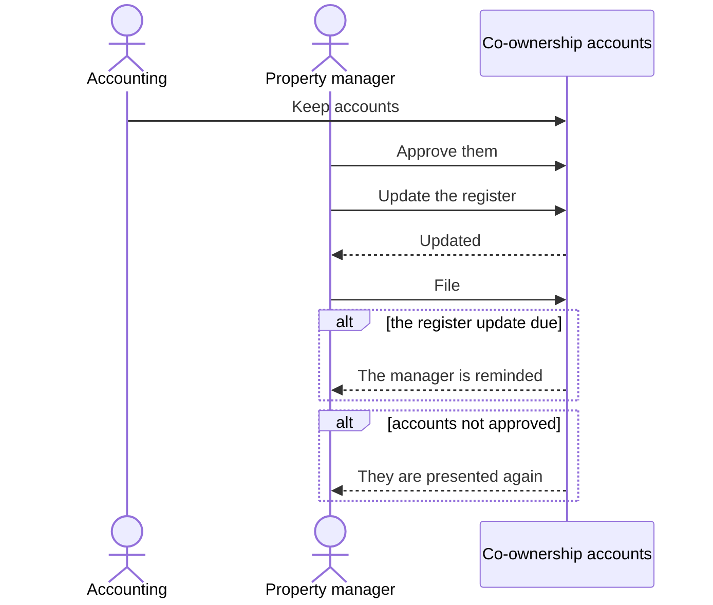

🏠 [Specs](../../../../README.md) › 🏷️ [Sectors](../../../README.md) › 🏘️ [SC10 Real estate](../../README.md) ›
📝 [Use cases](../README.md) › 📝 [Use cases: FL-SC10-05 Co-ownership](README.md) ›
📝 UC-SC10-18 Keep co-owners' accounts and the register

# 📝 UC-SC10-18 Keep co-owners' accounts and the register

**Status:** ✅ specified

## Summary

The co-ownership manager and accounting keep the co-owners' accounts, have them approved, and update the national
register yearly.

## Personas

- [U34 Property manager](../../../../01-users/personas/u34-property-manager.md)
- [U05 Accounting](../../../../01-users/personas/u05-accounting.md)

## Goal

Approved accounts and an up-to-date register.

## Trigger

The year end.

## Frequency

Yearly.

## Preconditions

- The SC10 sector pack is installed for the company,
  [UC-F14-02](../../../../02-functional/f14-plugin-store/use-cases/01-find-and-install/uc-f14-02-install-a-plugin-or-sector-pack.md),
  and its users have their roles,
  [UC-F1-06](../../../../02-functional/f01-administration/use-cases/04-edit-a-role/uc-f01-06-edit-a-role-and-its-record-rules.md).

## Postconditions

- **Success:** accounts approved and the register updated.
- **Failed:** the update is reminded.

## Main flow

1. Accounting keeps the co-ownership's books on
   [S-SC10-18 Co-ownership accounts](../../screens/05-co-ownership/s-sc10-18-co-ownership-accounts.md),
   [UC-F8-15](../../../../02-functional/f08-accounting/use-cases/06-benchmark-additions/uc-f08-15-keep-several-books.md).
2. The assembly approves them.
3. The register is updated ([BR-SC10-15](../../business-rules/br-sc10-15-register-kept-current.md)).
4. The proof is filed.

## Alternative flows

- 1a. A sale of a lot: the seller's and buyer's accounts are split at the date.

## Error flows

- 3e. The register update due: the manager is reminded.
- 2e. Accounts not approved: they are presented again.
- Any step: a call to a service or an outside system fails: it is retried first
  ([BR-F3-32](../../../../02-functional/f03-assistant/business-rules/br-f03-32-retry-before-an-error.md)), then the
  error message pattern ([D122](../../../../06-decisions/ux/d122-error-message-standard.md)) says what failed; what was
  typed is kept.

## Business rules

- [BR-SC10-15 Register kept current](../../business-rules/br-sc10-15-register-kept-current.md)

## Entities

- [E-SC10-16 Co-ownership](../../data/e-sc10-16-co-ownership.md)

## Permissions

The property manager and accounting roles; the record rules of their role and site apply,
[UC-F1-06](../../../../02-functional/f01-administration/use-cases/04-edit-a-role/uc-f01-06-edit-a-role-and-its-record-rules.md).

## Notifications

None beyond the in-app updates of the records concerned.

## Audit events

Every creation, change and state change of co-ownership records, with who, when and the values before and after (T3).

## AI involvement

The AI assistant answers questions on the co-ownership records of this use case, with links, and prepares them as drafts
the user confirms. It works within the user's rights,
[BR-F3-34](../../../../02-functional/f03-assistant/business-rules/br-f03-34-every-capability-is-reachable-from-the-assistant.md),
and never deletes or does anything irreversible without the user's confirmation,
[BR-F3-07](../../../../02-functional/f03-assistant/business-rules/br-f03-07-no-deletes-no-irreversible-acts.md).

## API, MCP and A2A exposure

Through the API and webhooks (T5) and the MCP and A2A gateway (T6), with the caller's rights,
[BR-F3-34](../../../../02-functional/f03-assistant/business-rules/br-f03-34-every-capability-is-reachable-from-the-assistant.md),
reading, creating and changing the records of this use case; nothing irreversible without a person's confirmation.

## Screens

- [S-SC10-18 Co-ownership accounts](../../screens/05-co-ownership/s-sc10-18-co-ownership-accounts.md)

## Flowchart

See [FL-SC10-05 Co-ownership](../../flows/fl-sc10-05-co-ownership.md#flowchart).

## Sequence diagram

## Acceptance criteria

1. **Given** the example estate agency's Les Tilleuls with 24 lots **when** the register is updated **then** the update
   date shows.
2. **Given** AB1-234-567 not updated this year **when** the date passes **then** the manager is reminded.

## Non-functional notes

[D408](../../../../06-decisions/technical/d408-performance-and-profiles.md)'s targets
([performance](../../../../05-non-functional/performance.md)): 95 % of screens within 1 second; lists paged on the
server, the first page within 1 second; reports within 5 seconds or in the background. WCAG 2.2 AA and RGAA
([D46](../../../../06-decisions/ux/d46-accessibility-standard.md)).

## Regulatory references

Legal values from the France country pack:
[CR-FR-148 National register of co-ownerships](../../../../10-country-packs/france/real-estate/cr-fr-148-co-ownership-register.md).

## Related use cases

- [UC-SC10-15 Run co-owners' general assemblies](uc-sc10-15-run-co-owners-general-assemblies.md)

## Open questions

None.

---

⬅️ [UC-SC10-17 Manage the works fund and works](uc-sc10-17-manage-the-works-fund-and-works.md) · ⬆️ [Up](README.md) ·
➡️ [UC-SC10-19](../06-portal-and-assistant/uc-sc10-19-give-landlords-tenants-and-co-owners-their-portal.md)
