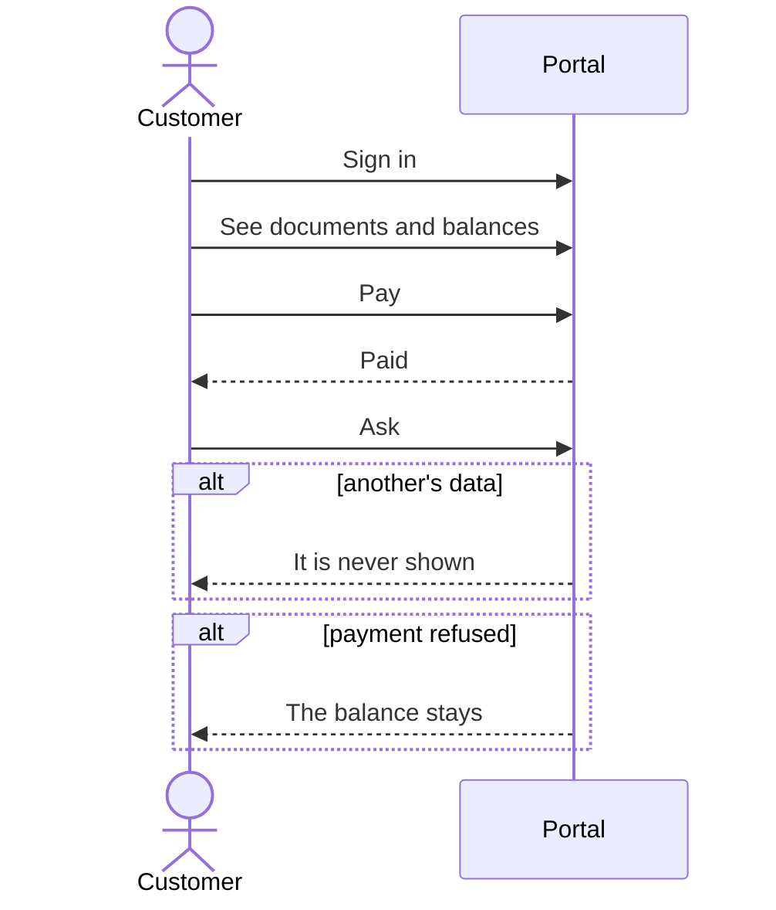

🏠 [Specs](../../../../README.md) › 🏷️ [Sectors](../../../README.md) › 🏘️ [SC10 Real estate](../../README.md) ›
📝 [Use cases](../README.md) › 📝 [Use cases: FL-SC10-06 Portal and assistant](README.md) ›
📝 UC-SC10-19 Give landlords, tenants and co-owners their portal

# 📝 UC-SC10-19 Give landlords, tenants and co-owners their portal

**Status:** ✅ specified

## Summary

Landlords, tenants and co-owners sign in to the portal built on the shared portal capability, see documents and
balances, pay, and send requests.

## Personas

- [U09 Customer](../../../../01-users/personas/u09-customer.md)

## Goal

Clients serve themselves.

## Trigger

A client wants a document or to pay.

## Frequency

Daily.

## Preconditions

- The SC10 sector pack is installed for the company,
  [UC-F14-02](../../../../02-functional/f14-plugin-store/use-cases/01-find-and-install/uc-f14-02-install-a-plugin-or-sector-pack.md),
  and its users have their roles,
  [UC-F1-06](../../../../02-functional/f01-administration/use-cases/04-edit-a-role/uc-f01-06-edit-a-role-and-its-record-rules.md).

## Postconditions

- **Success:** the client sees their own records and acts.
- **Failed:** nothing of others is shown.

## Main flow

1. The client signs in on [S-SC10-19 Portal](../../screens/06-portal-and-assistant/s-sc10-19-portal.md),
   [UC-F1-19](../../../../02-functional/f01-administration/use-cases/12-portal-accounts-and-integrations/uc-f01-19-manage-portal-accounts.md).
2. The portal shows the chosen fields of their own records,
   [UC-F2-20](../../../../02-functional/f02-no-code-configuration/use-cases/09-portals-and-offline-forms/uc-f02-20-expose-a-record-type-on-a-portal.md),
   [BR-F2-20](../../../../02-functional/f02-no-code-configuration/business-rules/br-f02-20-a-portal-shows-only-the-chosen-fields-of-the-persons-own-records.md).
3. The client pays online,
   [UC-F6-07](../../../../02-functional/f06-customers-and-sales/use-cases/03-invoice-and-get-paid/uc-f06-07-get-paid-online-and-reconcile.md).
4. The client sends a request.

## Alternative flows

- 4a. A repair reported: it opens a works task with photos.

## Error flows

- 2e. Another's data: it is never shown.
- 3e. Payment refused: the balance stays.
- Any step: a call to a service or an outside system fails: it is retried first
  ([BR-F3-32](../../../../02-functional/f03-assistant/business-rules/br-f03-32-retry-before-an-error.md)), then the
  error message pattern ([D122](../../../../06-decisions/ux/d122-error-message-standard.md)) says what failed; what was
  typed is kept.

## Business rules

- [BR-SC10-05 Receipts on request](../../business-rules/br-sc10-05-receipts-on-request.md)
- [BR-F2-20 A portal shows only the chosen fields of the person's own records](../../../../02-functional/f02-no-code-configuration/business-rules/br-f02-20-a-portal-shows-only-the-chosen-fields-of-the-persons-own-records.md)

## Entities

- [E-SC10-09 Rent call](../../data/e-sc10-09-rent-call.md)
- [E-SC10-11 Landlord statement](../../data/e-sc10-11-landlord-statement.md)
- [E-SC10-16 Co-ownership](../../data/e-sc10-16-co-ownership.md)

## Permissions

The customer roles; the record rules of their role and site apply,
[UC-F1-06](../../../../02-functional/f01-administration/use-cases/04-edit-a-role/uc-f01-06-edit-a-role-and-its-record-rules.md).

## Notifications

None beyond the in-app updates of the records concerned.

## Audit events

Every creation, change and state change of rent call, landlord statement, co-ownership records, with who, when and the
values before and after (T3).

## AI involvement

The AI assistant answers questions on the rent call, landlord statement, co-ownership records of this use case, with
links, and prepares them as drafts the user confirms. It works within the user's rights,
[BR-F3-34](../../../../02-functional/f03-assistant/business-rules/br-f03-34-every-capability-is-reachable-from-the-assistant.md),
and never deletes or does anything irreversible without the user's confirmation,
[BR-F3-07](../../../../02-functional/f03-assistant/business-rules/br-f03-07-no-deletes-no-irreversible-acts.md).

## API, MCP and A2A exposure

Through the API and webhooks (T5) and the MCP and A2A gateway (T6), with the caller's rights,
[BR-F3-34](../../../../02-functional/f03-assistant/business-rules/br-f03-34-every-capability-is-reachable-from-the-assistant.md),
reading, creating and changing the records of this use case; nothing irreversible without a person's confirmation.

## Screens

- [S-SC10-19 Portal](../../screens/06-portal-and-assistant/s-sc10-19-portal.md)

## Flowchart

See [FL-SC10-06 Portal and assistant](../../flows/fl-sc10-06-portal-and-assistant.md#flowchart).

## Sequence diagram

## Acceptance criteria

1. **Given** the example estate agency's S. Roux **when** he signs in **then** he sees his December receipt only.
2. **Given** S. Roux **when** he opens another tenant's receipt **then** it is never shown.

## Non-functional notes

[D408](../../../../06-decisions/technical/d408-performance-and-profiles.md)'s targets
([performance](../../../../05-non-functional/performance.md)): 95 % of screens within 1 second; lists paged on the
server, the first page within 1 second; reports within 5 seconds or in the background. WCAG 2.2 AA and RGAA
([D46](../../../../06-decisions/ux/d46-accessibility-standard.md)).

## Regulatory references

None specific to this use case; the sector's legal rules are listed in [SC10 regulatory](../../regulatory.md).

## Related use cases

- [UC-SC10-12 Pay landlords and send statements](../04-rents-and-landlords/uc-sc10-12-pay-landlords-and-send-statements.md)

## Open questions

None.

---

⬅️ [UC-SC10-18](../05-co-ownership/uc-sc10-18-keep-co-owners-accounts-and-the-register.md) · ⬆️ [Up](README.md) ·
➡️ [UC-SC10-20 Ask the AI assistant about the portfolio](uc-sc10-20-ask-the-assistant-about-the-portfolio.md)
