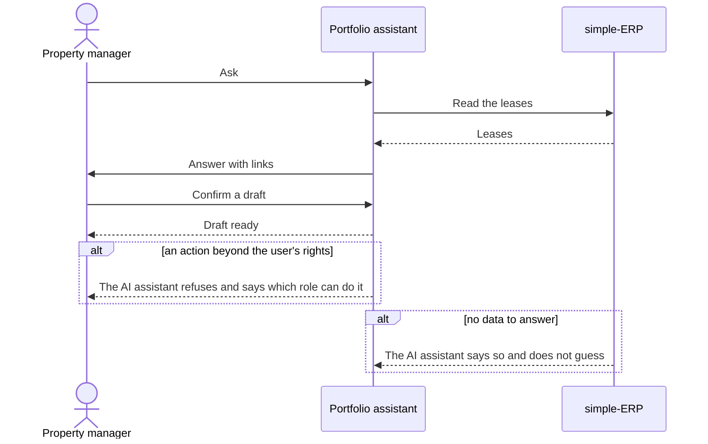

🏠 [Specs](../../../../README.md) › 🏷️ [Sectors](../../../README.md) › 🏘️ [SC10 Real estate](../../README.md) ›
📝 [Use cases](../README.md) › 📝 [Use cases: FL-SC10-06 Portal and assistant](README.md) ›
📝 UC-SC10-20 Ask the AI assistant about the portfolio

# 📝 UC-SC10-20 Ask the AI assistant about the portfolio

**Status:** ✅ specified

## Summary

The property manager or agent asks the AI assistant about unpaid rents, leases to index or a building's works, within
their role's rights.

## Personas

- [U34 Property manager](../../../../01-users/personas/u34-property-manager.md)
- [U35 Real-estate agent](../../../../01-users/personas/u35-real-estate-agent.md)

## Goal

Answers without hunting through screens.

## Trigger

A question to the AI assistant.

## Frequency

Daily.

## Preconditions

- The SC10 sector pack is installed for the company,
  [UC-F14-02](../../../../02-functional/f14-plugin-store/use-cases/01-find-and-install/uc-f14-02-install-a-plugin-or-sector-pack.md),
  and its users have their roles,
  [UC-F1-06](../../../../02-functional/f01-administration/use-cases/04-edit-a-role/uc-f01-06-edit-a-role-and-its-record-rules.md).

## Postconditions

- **Success:** the answer cites the records, or the draft is confirmed.
- **Failed:** the AI assistant says it cannot answer or act, and why.

## Main flow

1. The property manager asks on
   [S-SC10-20 Portfolio assistant](../../screens/06-portal-and-assistant/s-sc10-20-portfolio-assistant.md): "Which
   leases are due for indexation in January?".
2. The AI assistant reads leases within the user's rights.
3. The AI assistant lists them.
4. The manager asks for an assembly notice; the AI assistant drafts it,
   [UC-F3-04](../../../../02-functional/f03-assistant/use-cases/04-summarise-or-draft/uc-f03-04-summarise-and-draft.md).

## Alternative flows

- 1a. The agent asks for viewings this week: the AI assistant lists them.

## Error flows

- 4e. An action beyond the user's rights: the AI assistant refuses and says which role can do it.
- 2e. No data to answer: the AI assistant says so and does not guess.
- Any step: a call to a service or an outside system fails: it is retried first
  ([BR-F3-32](../../../../02-functional/f03-assistant/business-rules/br-f03-32-retry-before-an-error.md)), then the
  error message pattern ([D122](../../../../06-decisions/ux/d122-error-message-standard.md)) says what failed; what was
  typed is kept.

## Business rules

- [BR-SC10-01 Real estate follows the country pack](../../business-rules/br-sc10-01-real-estate-follows-the-country-pack.md)
- [BR-F3-34 All capabilities via the AI assistant](../../../../02-functional/f03-assistant/business-rules/br-f03-34-every-capability-is-reachable-from-the-assistant.md)
- [BR-F3-07 No deletes, no irreversible acts](../../../../02-functional/f03-assistant/business-rules/br-f03-07-no-deletes-no-irreversible-acts.md)

## Entities

- [E-SC10-07 Lease](../../data/e-sc10-07-lease.md)
- [E-SC10-13 Co-owners' assembly](../../data/e-sc10-13-co-owners-assembly.md)

## Permissions

The property manager and real-estate agent roles; the record rules of their role and site apply,
[UC-F1-06](../../../../02-functional/f01-administration/use-cases/04-edit-a-role/uc-f01-06-edit-a-role-and-its-record-rules.md).

## Notifications

None beyond the in-app updates of the records concerned.

## Audit events

Every creation, change and state change of lease, co-owners' assembly records, with who, when and the values before and
after (T3).

## AI involvement

The AI assistant answers questions on the lease, co-owners' assembly records of this use case, with links, and prepares
them as drafts the user confirms. It works within the user's rights,
[BR-F3-34](../../../../02-functional/f03-assistant/business-rules/br-f03-34-every-capability-is-reachable-from-the-assistant.md),
and never deletes or does anything irreversible without the user's confirmation,
[BR-F3-07](../../../../02-functional/f03-assistant/business-rules/br-f03-07-no-deletes-no-irreversible-acts.md).

## API, MCP and A2A exposure

Through the API and webhooks (T5) and the MCP and A2A gateway (T6), with the caller's rights,
[BR-F3-34](../../../../02-functional/f03-assistant/business-rules/br-f03-34-every-capability-is-reachable-from-the-assistant.md),
reading, creating and changing the records of this use case; nothing irreversible without a person's confirmation.

## Screens

- [S-SC10-20 Portfolio assistant](../../screens/06-portal-and-assistant/s-sc10-20-portfolio-assistant.md)

## Flowchart

See [FL-SC10-06 Portal and assistant](../../flows/fl-sc10-06-portal-and-assistant.md#flowchart).

## Sequence diagram

## Acceptance criteria

1. **Given** the example estate agency's 14 leases due in January **when** the manager asks **then** the AI assistant
   lists the 14.
2. **Given** an agent asking to pay a landlord **when** he asks **then** the AI assistant refuses and says which role
   can do it.

## Non-functional notes

[D408](../../../../06-decisions/technical/d408-performance-and-profiles.md)'s targets
([performance](../../../../05-non-functional/performance.md)): 95 % of screens within 1 second; lists paged on the
server, the first page within 1 second; reports within 5 seconds or in the background. WCAG 2.2 AA and RGAA
([D46](../../../../06-decisions/ux/d46-accessibility-standard.md)).

## Regulatory references

None specific to this use case; the sector's legal rules are listed in [SC10 regulatory](../../regulatory.md).

## Related use cases

- [UC-SC10-09 Index rents within the caps](../04-rents-and-landlords/uc-sc10-09-index-rents-within-the-caps.md)

## Open questions

None.

---

⬅️ [UC-SC10-19](uc-sc10-19-give-landlords-tenants-and-co-owners-their-portal.md) · ⬆️ [Up](README.md) ·
➡️ [UC-SC10-21](../07-short-stays-commercial-and-coworking/uc-sc10-21-manage-short-term-rentals.md)
