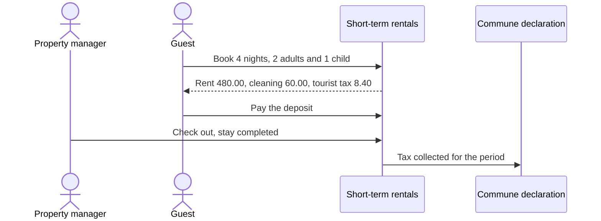

🏠 [Specs](../../../../README.md) › 🏷️ [Sectors](../../../README.md) › 🏘️ [SC10 Real estate](../../README.md) ›
📝 [Use cases](../README.md) › 📝 [Use cases: FL-SC10-07 Short stays, commercial leases, LMNP and coworking](README.md) ›
📝 UC-SC10-21 Manage short-term rentals

# 📝 UC-SC10-21 Manage short-term rentals

**Status:** ✅ specified

## Summary

A property manager lets furnished homes for short stays. Each stay has its dates, guests and price; the guest receives
the booking, the check-in details and the cleaning and tourist tax lines on the invoice. The tourist tax is counted per
night and per guest who owes it, shown apart, and paid to the commune on its dates.

## Personas

- [U34 Property manager](../../../../01-users/personas/u34-property-manager.md)
- [U09 Customer](../../../../01-users/personas/u09-customer.md)

## Goal

Every stay is booked without overlap, invoiced with the tourist tax counted per night and guest, and the tax collected
is ready to be declared and paid.

## Trigger

A guest books, a stay starts or ends, or the commune's declaration date comes.

## Frequency

Several stays a week per property; one tourist tax declaration per period.

## Preconditions

- The property is a listing of the portfolio ([E-SC10-02 Property listing](../../data/e-sc10-02-property-listing.md))
  with its nightly price and its commune.
- The commune's tourist tax rate and exemptions are in the country pack.

## Postconditions

- **Succeeded:** the stay is saved ([E-SC10-17 Stay](../../data/e-sc10-17-stay.md)) with its nights, guests and tax; the
  invoice shows the tax apart and the declaration lists it.
- **Failed:** no stay is booked over an existing one; the missing declaration number or guest detail is shown.

## Main flow

1. The property manager opens the short-term rentals screen
   ([S-SC10-21](../../screens/07-short-stays-commercial-and-coworking/s-sc10-21-short-term-rentals.md)) and sees the
   calendar of the properties.
2. A guest books online or the manager books by phone: dates, number of guests, which of them are minors or exempt, and
   the price per night.
3. SimpleERP counts the tourist tax per night and per guest who owes it
   ([BR-SC10-16](../../business-rules/br-sc10-16-the-tourist-tax-is-collected-per-night-and-guest.md)) and shows it
   apart from the rent and the cleaning fee.
4. The guest pays a deposit online
   [UC-F6-07](../../../../02-functional/f06-customers-and-sales/use-cases/03-invoice-and-get-paid/uc-f06-07-get-paid-online-and-reconcile.md)
   and receives the booking and the check-in details on the phone.
5. At the end of the stay, the manager checks the property, the stay is Completed and the final invoice is issued
   [UC-F6-06](../../../../02-functional/f06-customers-and-sales/use-cases/03-invoice-and-get-paid/uc-f06-06-invoice-deposits-progress-and-final.md).
6. At the commune's date, the manager prepares the declaration of the tax collected and pays it.

## Alternative flows

- 2a. The booking comes from a platform that collects the tourist tax itself: the stay shows the tax as collected by the
  platform and the manager does not count it again.
- 2b. The home is the owner's main residence: the nights of the year are counted against the yearly limit the commune
  sets.
- 5a. The guest leaves earlier: the nights not stayed are cancelled with the cancellation terms and the tax is
  recomputed.

## Error flows

- 2e. The dates overlap another stay: the booking is refused and the free dates are shown.
- 2e. The commune requires a declaration number and the property has none: the stay cannot be published and the missing
  number is shown.
- 3e. No tourist tax rate is known for the commune: the tax is not computed and the manager is asked to load the rate.
- Any step: a service does not answer; the call is retried first
  ([BR-F3-32](../../../../02-functional/f03-assistant/business-rules/br-f03-32-retry-before-an-error.md)), then the
  message follows the error pattern ([D122](../../../../06-decisions/ux/d122-error-message-standard.md)) and what the
  user typed stays on the screen.

## Business rules

- [BR-SC10-16](../../business-rules/br-sc10-16-the-tourist-tax-is-collected-per-night-and-guest.md)
- [BR-SC10-05 Receipts on request](../../business-rules/br-sc10-05-receipts-on-request.md)

## Entities

- [E-SC10-17 Stay](../../data/e-sc10-17-stay.md): created, changed
- [E-SC10-02 Property listing](../../data/e-sc10-02-property-listing.md): read, the property and its commune
- [E-F6-05 Invoice](../../../../02-functional/f06-customers-and-sales/data/e-f06-05-invoice.md): created, the invoice of
  the stay
- [E-F6-01](../../../../02-functional/f06-customers-and-sales/data/e-f06-01-customer-record.md): read, the guest

## Permissions

Property manager books, changes and invoices stays and declares the tax; the guest sees their own stay. The
owner of the property reads the stays and the statement.

## Notifications

The guest, by email and on the phone: booking confirmed, check-in details, reminder before arrival. The property
manager: a declaration date comes in 7 days.

## Audit events

Each stay booked, changed, cancelled and completed, each tax computed with its rate, nights and guests, each
declaration; who and when.

## AI involvement

No AI step of its own. The AI assistant may open the screen and prefill it from the user's words; the user checks and
confirms
[BR-F3-07](../../../../02-functional/f03-assistant/business-rules/br-f03-07-no-deletes-no-irreversible-acts.md).

## API, MCP and A2A exposure

T5 operations of the capability for the personas above: create, read, update and list. The MCP tool of the
capability may read and propose, never confirm alone. No A2A skill.

## Screens

- [S-SC10-21](../../screens/07-short-stays-commercial-and-coworking/s-sc10-21-short-term-rentals.md)

## Flowchart

See
[FL-SC10-07 Short stays, commercial leases, LMNP and coworking](../../flows/fl-sc10-07-short-stays-commercial-and-coworking.md#flowchart).

## Sequence diagram

## Acceptance criteria

1. **Given** a stay of 4 nights, 2 adults who owe the tax and 1 child who does not, at 1.05 EUR per night and guest
   **when** the manager books it **then** the tourist tax is 8.40 EUR and is shown apart.
2. **Given** a stay that overlaps another one on the same property **when** the manager books it **then** it is refused.
3. **Given** a platform that collects the tax itself **when** the stay is booked **then** the tax shows as collected by
   the platform and is not counted again.
4. **Given** a commune with no rate loaded **when** the tax is asked for **then** it is not computed and the rate is
   requested.

## Non-functional notes

The screen answers within 2 seconds for 10,000 records; every change is audited.

## Regulatory references

A furnished tourist rental collects the tourist tax per night and per guest who owes it, at the rate the
commune sets, shows it apart, and pays it to the commune on its dates; minors and some other guests are exempt. The
commune may require a declaration number for the home and limit the nights a main residence is let in a year. Platforms
may collect the tax on the manager's behalf. The France-pack rules are [CR-FR-288 Furnished tourist rentals](../../../../10-country-packs/france/real-estate/cr-fr-288-furnished-tourist-rentals.md), [CR-FR-111 Tourist tax (taxe de séjour)](../../../../10-country-packs/france/tax-and-vat/cr-fr-111-tourist-tax.md) and [CR-FR-282 Police form for foreign guests](../../../../10-country-packs/france/hospitality/cr-fr-282-police-form-for-foreign-guests.md). Related:
[CR-FR-111](../../../../10-country-packs/france/tax-and-vat/cr-fr-111-tourist-tax.md).

## Related use cases

- [UC-SC10-22 Manage commercial leases](uc-sc10-22-manage-commercial-leases.md)
- [UC-SC10-07 Let a property](../03-lettings/uc-sc10-07-let-a-property.md)
- [UC-SC10-10](../03-lettings/uc-sc10-10-manage-deposits-and-their-return.md)

## Open questions

None.

---

⬅️ [UC-SC10-20](../06-portal-and-assistant/uc-sc10-20-ask-the-assistant-about-the-portfolio.md) · ⬆️ [Up](README.md) ·
➡️ [UC-SC10-22 Manage commercial leases](uc-sc10-22-manage-commercial-leases.md)
