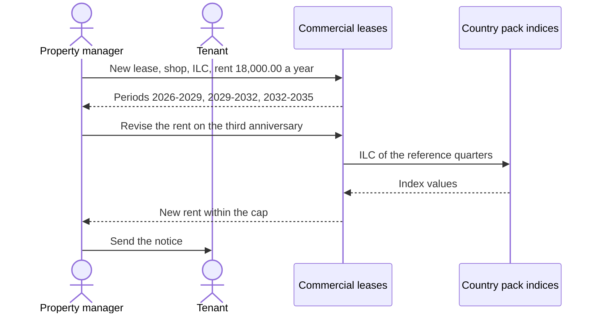

🏠 [Specs](../../../../README.md) › 🏷️ [Sectors](../../../README.md) › 🏘️ [SC10 Real estate](../../README.md) ›
📝 [Use cases](../README.md) › 📝 [Use cases: FL-SC10-07 Short stays, commercial leases, LMNP and coworking](README.md) ›
📝 UC-SC10-22 Manage commercial leases

# 📝 UC-SC10-22 Manage commercial leases

**Status:** 🔄 waiting for the owner

## Summary

A property manager looks after leases of shops, offices and workshops. A commercial lease runs in three-year periods
(the 3-6-9 lease): the tenant may leave at the end of each period, and the rent is revised on the index the lease names.
The manager sees the dates of each lease, revises the rent within the caps, and prepares the renewal.

## Personas

- [U34 Property manager](../../../../01-users/personas/u34-property-manager.md)

## Goal

Every commercial lease shows its periods, its break dates and its next revision, and each revision uses the right index
within the caps the law and the lease set.

## Trigger

A lease is signed, a revision date or a break date comes, or a new index is published.

## Frequency

One revision a year per lease at most; one renewal every nine years.

## Preconditions

- The premises are in the portfolio ([E-SC10-02 Property listing](../../data/e-sc10-02-property-listing.md)) and the
  tenant is a customer ([E-F6-01](../../../../02-functional/f06-customers-and-sales/data/e-f06-01-customer-record.md)).
- The index series of the country pack (ILC, ILAT) are loaded.

## Postconditions

- **Succeeded:** the lease is saved ([E-SC10-18 Commercial lease](../../data/e-sc10-18-commercial-lease.md)) with its
  periods and its index; each revision is kept with the index and its caps.
- **Failed:** no revision is applied; the missing index or the cap exceeded is shown.

## Main flow

1. The property manager opens the commercial leases screen
   ([S-SC10-22](../../screens/07-short-stays-commercial-and-coworking/s-sc10-22-commercial-leases.md)) and creates the
   lease: tenant, premises, activity, start date, rent, charges and the index named in the lease.
2. simple-ERP sets the three-year periods and the break dates from the start date.
3. At each revision date, the manager asks for the revision; simple-ERP reads the index and computes the new rent
   ([BR-SC10-17](../../business-rules/br-sc10-17-rents-are-indexed-on-ilc-or-ilat-within-the-caps.md)).
4. The manager checks the new rent against the caps and sends the notice to the tenant.
5. The rent calls follow the new rent
   ([UC-SC10-08](../04-rents-and-landlords/uc-sc10-08-call-rents-and-issue-receipts.md)).
6. Before the end of a period, the manager sees the break date, the tenant's notice if any, and prepares the renewal or
   the end of the lease.

## Alternative flows

- 3a. The lease names no index: the manager chooses the index from the activity, retail or craft on one series and
  offices or services on the other, and the choice is recorded.
- 6a. The tenant gives notice at a break date: the lease becomes Notice given and the end date is shown.
- 3b. The lease has a rent step: the steps are computed from the dates in the lease.

## Error flows

- 3e. The revision would raise the rent above the cap: the new rent is cut to the cap and the difference is shown.
- 3e. The index of the revision month is not published: the revision waits and the manager is told when it comes.
- 6e. A notice arrives after the legal delay before the break date: it is flagged and the manager decides whether to
  accept.
- Any step: a service does not answer; the call is retried first
  ([BR-F3-32](../../../../02-functional/f03-assistant/business-rules/br-f03-32-retry-before-an-error.md)), then the
  message follows the error pattern ([D122](../../../../06-decisions/ux/d122-error-message-standard.md)) and what the
  user typed stays on the screen.

## Business rules

- [BR-SC10-17](../../business-rules/br-sc10-17-rents-are-indexed-on-ilc-or-ilat-within-the-caps.md)
- [BR-SC10-06](../../business-rules/br-sc10-06-rent-revised-by-the-index.md)
- [BR-SC10-09 Charges settled yearly](../../business-rules/br-sc10-09-charges-settled-yearly.md)
- [BR-SC10-11 Unpaid rent steps](../../business-rules/br-sc10-11-unpaid-rent-steps.md)

## Entities

- [E-SC10-18 Commercial lease](../../data/e-sc10-18-commercial-lease.md): created, changed, closed
- [E-SC10-09 Rent call](../../data/e-sc10-09-rent-call.md): created, the rent call at the new rent
- [E-SC10-08 Deposit](../../data/e-sc10-08-deposit.md): read, the deposit of the lease
- [E-F6-01](../../../../02-functional/f06-customers-and-sales/data/e-f06-01-customer-record.md): read, the tenant

## Permissions

Property manager creates leases and revises rents; accounting reads the calls. The tenant sees their lease
and notices in the portal.

## Notifications

The property manager, in the app: a revision or a break date comes in 90 days, a notice arrives. The tenant: the
revision notice.

## Audit events

Each lease created, revised, renewed or ended, each index used with its series, month and value, each notice; who and
when.

## AI involvement

No AI step of its own. The AI assistant may open the screen and prefill it from the user's words; the user checks and
confirms
[BR-F3-07](../../../../02-functional/f03-assistant/business-rules/br-f03-07-no-deletes-no-irreversible-acts.md).

## API, MCP and A2A exposure

T5 operations of the capability for the personas above: create, read, update and list. The MCP tool of the
capability may read and propose, never confirm alone. No A2A skill.

## Screens

- [S-SC10-22](../../screens/07-short-stays-commercial-and-coworking/s-sc10-22-commercial-leases.md)

## Flowchart

See
[FL-SC10-07 Short stays, commercial leases, LMNP and coworking](../../flows/fl-sc10-07-short-stays-commercial-and-coworking.md#flowchart).

## Sequence diagram

## Acceptance criteria

1. **Given** a lease of a shop, rent 18,000.00 EUR, with the ILC and an index rise of 2.0 % **when** the revision is
   asked **then** the new rent is 18,360.00 EUR.
2. **Given** a revision above the cap of the lease or the law **when** the manager asks for it **then** the rent is cut
   to the cap and the difference is shown.
3. **Given** a lease with the first break date in 90 days **when** the day comes **then** the manager is told in the
   app.
4. **Given** a lease that names an index the pack does not hold **when** the revision is asked **then** it is refused
   and the index is requested.

## Non-functional notes

The screen answers within 2 seconds for 10,000 records; every change is audited.

## Regulatory references

A commercial lease runs in three-year periods, and the tenant may leave at the end of each; the rent is
revised on the index the lease names, the commercial rents index for shops and crafts or the index of tertiary
activities for offices and services, and the rent at renewal is capped as the law says. The France-pack rule is listed
below. Related: [CR-FR-142](../../../../10-country-packs/france/real-estate/cr-fr-142-rent-revision-irl.md) (the index
of home rents, a different index),
[CR-FR-141](../../../../10-country-packs/france/real-estate/cr-fr-141-rent-receipts.md).

- France-pack rule, (Proposed) until its law is read:
  [CR-FR-239 Commercial leases (3-6-9, ILC/ILAT)](../../../../10-country-packs/france/real-estate/cr-fr-239-commercial-leases.md)

## Related use cases

- [UC-SC10-21 Manage short-term rentals](uc-sc10-21-manage-short-term-rentals.md)
- [UC-SC10-23 Keep furnished rental figures](uc-sc10-23-keep-furnished-rental-figures.md)
- [UC-SC10-09](../04-rents-and-landlords/uc-sc10-09-index-rents-within-the-caps.md)
- [UC-SC10-07 Let a property](../03-lettings/uc-sc10-07-let-a-property.md)

## Open questions

None.

---

⬅️ [UC-SC10-21 Manage short-term rentals](uc-sc10-21-manage-short-term-rentals.md) · ⬆️ [Up](README.md) ·
➡️ [UC-SC10-23 Keep furnished rental figures](uc-sc10-23-keep-furnished-rental-figures.md)
