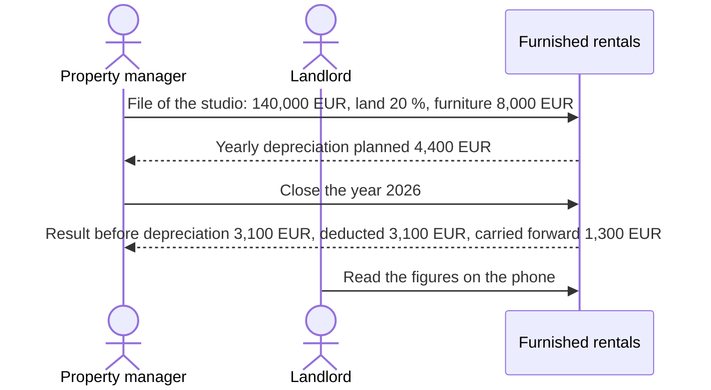

🏠 [Specs](../../../../README.md) › 🏷️ [Sectors](../../../README.md) › 🏘️ [SC10 Real estate](../../README.md) ›
📝 [Use cases](../README.md) › 📝 [Use cases: FL-SC10-07 Short stays, commercial leases, LMNP and coworking](README.md) ›
📝 UC-SC10-23 Keep furnished rental figures

# 📝 UC-SC10-23 Keep furnished rental figures

**Status:** ✅ specified

## Summary

A landlord lets a furnished home and wants the figures of the year in the form the tax return needs. The property
manager records the price of the home, the land share and the furniture, sets the depreciation plan, and the screen
computes the rental result with the depreciation that can be deducted. The landlord sees the figures on the phone.

## Personas

- [U34 Property manager](../../../../01-users/personas/u34-property-manager.md)
- [U09 Customer](../../../../01-users/personas/u09-customer.md)

## Goal

The yearly figures of a furnished rental are ready for the return, with depreciation deducted only up to the rental
result and the excess carried forward.

## Trigger

A furnished home is acquired, the year ends, or the landlord asks for their figures.

## Frequency

One computation a year per property; entries all year.

## Preconditions

- The property is in the portfolio ([E-SC10-02 Property listing](../../data/e-sc10-02-property-listing.md)) and its
  landlord is a customer
  ([E-F6-01](../../../../02-functional/f06-customers-and-sales/data/e-f06-01-customer-record.md)).
- The rent calls and the charges of the year are recorded ([E-SC10-09 Rent call](../../data/e-sc10-09-rent-call.md)).

## Postconditions

- **Succeeded:** the figures are saved ([E-SC10-19 Furnished property](../../data/e-sc10-19-furnished-property.md)):
  income, charges, depreciation allowed and carried forward, and the result.
- **Failed:** no figure is final; the missing price, land share or furniture value is listed.

## Main flow

1. The property manager opens the furnished rentals screen
   ([S-SC10-23](../../screens/07-short-stays-commercial-and-coworking/s-sc10-23-furnished-rentals.md)) and creates the
   property's tax file: acquisition price, land share, furniture and works.
2. The manager sets the depreciation plan: the years for the building, the furniture and the works.
3. During the year, the rents received come from the rent calls
   ([UC-SC10-08](../04-rents-and-landlords/uc-sc10-08-call-rents-and-issue-receipts.md)) and the charges paid from the
   accounts.
4. At the year end, the screen computes the result before depreciation and the depreciation that may be deducted
   ([BR-SC10-18](../../business-rules/br-sc10-18-depreciation-never-creates-a-rental-loss.md)).
5. The part of depreciation above the result is carried forward to the next years.
6. The landlord reads the figures on the phone, and the manager exports them for the return.

## Alternative flows

- 2a. The landlord chooses the simplified regime: no depreciation is computed and the allowance is shown instead.
- 4a. A component is replaced during the year: its depreciation stops and a new one starts.
- 5a. The property is sold: the file is closed with the sale date and the figures are kept.

## Error flows

- 1e. The land share is missing: the depreciation of the building cannot be computed and the missing value is listed.
- 4e. The depreciation planned is above the result: it is cut to the result and the excess is carried forward, never
  deducted.
- 3e. A charge has no supporting document: it is listed and kept out of the figures until it has one.
- Any step: a service does not answer; the call is retried first
  ([BR-F3-32](../../../../02-functional/f03-assistant/business-rules/br-f03-32-retry-before-an-error.md)), then the
  message follows the error pattern ([D122](../../../../06-decisions/ux/d122-error-message-standard.md)) and what the
  user typed stays on the screen.

## Business rules

- [BR-SC10-18](../../business-rules/br-sc10-18-depreciation-never-creates-a-rental-loss.md)
- [BR-SC10-09 Charges settled yearly](../../business-rules/br-sc10-09-charges-settled-yearly.md)
- [BR-SC10-10](../../business-rules/br-sc10-10-landlords-paid-with-statements.md)

## Entities

- [E-SC10-19 Furnished property](../../data/e-sc10-19-furnished-property.md): created, changed, closed
- [E-SC10-09 Rent call](../../data/e-sc10-09-rent-call.md): read, the rents received
- [E-SC10-11 Landlord statement](../../data/e-sc10-11-landlord-statement.md): read, the landlord's statement
- [E-F6-01](../../../../02-functional/f06-customers-and-sales/data/e-f06-01-customer-record.md): read, the landlord

## Permissions

Property manager keeps the file; the landlord reads their own file. The external accountant reads the file
with the landlord's consent.

## Notifications

The landlord, on the phone: the figures of the year are ready. The manager: a file is missing a value 30 days before the
return date.

## Audit events

Each acquisition value, depreciation plan, computation and carry-forward, with who, when and the values.

## AI involvement

No AI step of its own. The AI assistant may open the screen and prefill it from the user's words; the user checks and
confirms
[BR-F3-07](../../../../02-functional/f03-assistant/business-rules/br-f03-07-no-deletes-no-irreversible-acts.md).

## API, MCP and A2A exposure

T5 operations of the capability for the personas above: create, read, update and list. The MCP tool of the
capability may read and propose, never confirm alone. No A2A skill.

## Screens

- [S-SC10-23](../../screens/07-short-stays-commercial-and-coworking/s-sc10-23-furnished-rentals.md)

## Flowchart

See
[FL-SC10-07 Short stays, commercial leases, LMNP and coworking](../../flows/fl-sc10-07-short-stays-commercial-and-coworking.md#flowchart).

## Sequence diagram

## Acceptance criteria

1. **Given** a result before depreciation of 3,100.00 EUR and a depreciation planned of 4,400.00 EUR **when** the year
   is closed **then** 3,100.00 EUR is deducted and 1,300.00 EUR is carried forward.
2. **Given** a negative result before depreciation **when** the year is closed **then** no depreciation is deducted and
   the whole amount is carried forward.
3. **Given** a missing land share **when** the depreciation is computed **then** it is refused and the missing value is
   listed.
4. **Given** a carried-forward amount of 1,300.00 EUR and a result of 5,000.00 EUR next year **when** the year is closed
   **then** the carry-forward is used up to the result.

## Non-functional notes

The screen answers within 2 seconds for 10,000 records; every change is audited.

## Regulatory references

A landlord who lets a furnished home as a non-professional renter may deduct the depreciation of the
building, the furniture and the works, but the depreciation may not create or increase a rental loss: the part above the
result is carried forward without limit of time. The simplified regime has an allowance instead. The values of the year
(ceilings, allowance) are data of the France pack ([CR-FR-240](../../../../10-country-packs/france/tax-and-vat/cr-fr-240-furnished-rentals-lmnp.md)). Related:
[CR-FR-006](../../../../10-country-packs/france/accounting/cr-fr-006-chart-of-accounts.md),
[CR-FR-064](../../../../10-country-packs/france/accounting/cr-fr-064-accounting-frameworks.md).

- France-pack rule:
  [CR-FR-240 Furnished rentals (LMNP)](../../../../10-country-packs/france/tax-and-vat/cr-fr-240-furnished-rentals-lmnp.md)

## Related use cases

- [UC-SC10-22 Manage commercial leases](uc-sc10-22-manage-commercial-leases.md)
- [UC-SC10-24 Run a coworking space](uc-sc10-24-run-a-coworking-space.md)
- [UC-SC10-12](../04-rents-and-landlords/uc-sc10-12-pay-landlords-and-send-statements.md)
- [UC-SC10-08](../04-rents-and-landlords/uc-sc10-08-call-rents-and-issue-receipts.md)
- [UC-F8-08](../../../../02-functional/f08-accounting/use-cases/04-tax-assets-and-analytics/uc-f08-08-manage-fixed-assets-and-deferrals.md)

## Open questions

None.

---

⬅️ [UC-SC10-22 Manage commercial leases](uc-sc10-22-manage-commercial-leases.md) · ⬆️ [Up](README.md) ·
➡️ [UC-SC10-24 Run a coworking space](uc-sc10-24-run-a-coworking-space.md)
