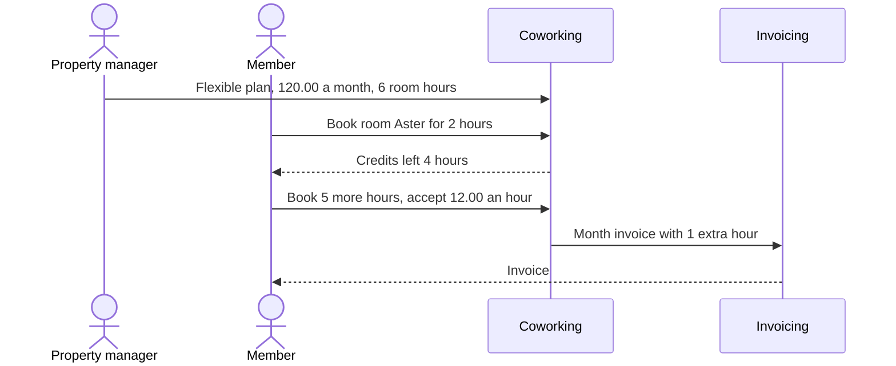

🏠 [Specs](../../../../README.md) › 🏷️ [Sectors](../../../README.md) › 🏘️ [SC10 Real estate](../../README.md) ›
📝 [Use cases](../README.md) › 📝 [Use cases: FL-SC10-07 Short stays, commercial leases, LMNP and coworking](README.md) ›
📝 UC-SC10-24 Run a coworking space

# 📝 UC-SC10-24 Run a coworking space

**Status:** ✅ specified

## Summary

A coworking space sells memberships (a desk, a flexible seat, a private office) with a monthly fee and credits of
meeting-room hours. Members book rooms and desks on the phone; simple-ERP counts the credits used, bills the hours above
the credits, and shows the manager the occupancy.

## Personas

- [U34 Property manager](../../../../01-users/personas/u34-property-manager.md)
- [U09 Customer](../../../../01-users/personas/u09-customer.md)

## Goal

Every booking is made within the member's credits or billed beyond them, and the manager sees the occupancy and the
monthly fees.

## Trigger

A member joins, books a room, or a month ends.

## Frequency

Dozens of bookings a day; one invoice per member per month.

## Preconditions

- The rooms and desks are resources of the space
  ([E-SC10-02 Property listing](../../data/e-sc10-02-property-listing.md)).
- The member is a customer
  ([E-F6-01](../../../../02-functional/f06-customers-and-sales/data/e-f06-01-customer-record.md)) with a payment method.

## Postconditions

- **Succeeded:** the membership is saved ([E-SC10-20 Membership](../../data/e-sc10-20-membership.md)) with its plan,
  credits and used hours; the month's invoice shows the fee and any hours above the credits.
- **Failed:** no booking is accepted beyond the credits without the member's agreement to pay; the reason is shown.

## Main flow

1. The property manager opens the coworking screen
   ([S-SC10-24](../../screens/07-short-stays-commercial-and-coworking/s-sc10-24-coworking.md)) and creates the
   membership: member, plan, monthly fee, monthly credits and start date.
2. The member books a meeting room on the phone; the screen shows the free slots and the credits left.
3. simple-ERP checks the booking against the credits
   ([BR-SC10-19](../../business-rules/br-sc10-19-rooms-are-booked-within-the-memberships-credits.md)) and takes the
   hours from them.
4. When the credits are used up, the member may book more and agrees to pay the extra hours at the room's price.
5. At the month end, simple-ERP issues the invoice with the fee and the extra hours
   [UC-F6-06](../../../../02-functional/f06-customers-and-sales/use-cases/03-invoice-and-get-paid/uc-f06-06-invoice-deposits-progress-and-final.md).
6. The manager sees the occupancy of rooms and desks and the members who use few credits.

## Alternative flows

- 3a. A booking is cancelled in time: the credits are returned; cancelled late, they are kept.
- 1a. The member pauses the plan for a month: the membership is Paused and no fee is billed.
- 5a. Unused credits at the month end: they expire or carry over as the plan says.

## Error flows

- 3e. The room is already booked at that time: the booking is refused and free slots are shown.
- 4e. The member refuses to pay the extra hours: the booking is not made.
- 5e. The card of the member is refused: the usual reminders start
  [UC-F6-08](../../../../02-functional/f06-customers-and-sales/use-cases/03-invoice-and-get-paid/uc-f06-08-remind-late-payers.md)
  and the access is flagged.
- Any step: a service does not answer; the call is retried first
  ([BR-F3-32](../../../../02-functional/f03-assistant/business-rules/br-f03-32-retry-before-an-error.md)), then the
  message follows the error pattern ([D122](../../../../06-decisions/ux/d122-error-message-standard.md)) and what the
  user typed stays on the screen.

## Business rules

- [BR-SC10-19](../../business-rules/br-sc10-19-rooms-are-booked-within-the-memberships-credits.md)
- [BR-SC10-05 Receipts on request](../../business-rules/br-sc10-05-receipts-on-request.md)

## Entities

- [E-SC10-20 Membership](../../data/e-sc10-20-membership.md): created, changed, closed
- [E-SC10-02 Property listing](../../data/e-sc10-02-property-listing.md): read, the rooms and desks
- [E-F6-05 Invoice](../../../../02-functional/f06-customers-and-sales/data/e-f06-05-invoice.md): created, the monthly
  invoice
- [E-F6-01](../../../../02-functional/f06-customers-and-sales/data/e-f06-01-customer-record.md): read, the member

## Permissions

Property manager creates and changes memberships; the member books and sees their own credits. A member sees
the room calendar without the other members' names.

## Notifications

The member, on the phone: a booking is confirmed, credits are almost used up, the month's invoice. The manager: an
unpaid invoice.

## Audit events

Each membership created, paused or ended; each booking, cancellation and credit used; who and when.

## AI involvement

No AI step of its own. The AI assistant may open the screen and prefill it from the user's words; the user checks and
confirms
[BR-F3-07](../../../../02-functional/f03-assistant/business-rules/br-f03-07-no-deletes-no-irreversible-acts.md).

## API, MCP and A2A exposure

T5 operations of the capability for the personas above: create, read, update and list. The MCP tool of the
capability may read and propose, never confirm alone. No A2A skill.

## Screens

- [S-SC10-24](../../screens/07-short-stays-commercial-and-coworking/s-sc10-24-coworking.md)

## Flowchart

See
[FL-SC10-07 Short stays, commercial leases, LMNP and coworking](../../flows/fl-sc10-07-short-stays-commercial-and-coworking.md#flowchart).

## Sequence diagram

## Acceptance criteria

1. **Given** 6 hours of credits and a booking of 2 hours **when** the member books **then** 4 hours are left.
2. **Given** 0 hours left and a booking of 1 hour at 12.00 EUR **when** the member agrees to pay **then** the booking is
   made and 12.00 EUR is added to the month's invoice.
3. **Given** a booking cancelled in time **when** the member cancels **then** the credits are returned.
4. **Given** two bookings for the same room and slot **when** the second is made **then** it is refused.

## Non-functional notes

The screen answers within 2 seconds for 10,000 records; every change is audited.

## Regulatory references

None specific beyond the invoicing rules; the conditions of the membership are in the member's agreement
([CR-FR-015](../../../../10-country-packs/france/invoicing/cr-fr-015-invoice-mandatory-mentions.md)).

## Related use cases

- [UC-SC10-23 Keep furnished rental figures](uc-sc10-23-keep-furnished-rental-figures.md)
- [UC-SC10-03 Organise viewings](../02-sales/uc-sc10-03-organise-viewings.md)
- [UC-SC10-19](../06-portal-and-assistant/uc-sc10-19-give-landlords-tenants-and-co-owners-their-portal.md)

## Open questions

None.

---

⬅️ [UC-SC10-23 Keep furnished rental figures](uc-sc10-23-keep-furnished-rental-figures.md) · ⬆️ [Up](README.md)
