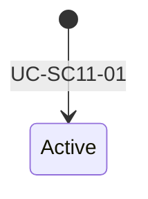

🏠 [Specs](../../../README.md) › 🏷️ [Sectors](../../README.md) › ⚖️ [SC11 Professional firms](../README.md) ›
🗃️ [Data](README.md) › 🗃️ E-SC11-01 Client identity

# 🗃️ E-SC11-01 Client identity

**Status:** ✅ specified

## Purpose

A client's identity and risk.

## Fields

| Name | Type | Required | Validation | Default | Example | Personal data | Custom fields |
|---|---|---|---|---|---|---|---|
| client, kind | records | yes | BR-SC11-02 | - | Acme SA, company | yes | no |
| documents, risk | files, level | yes | - | - | ID, high | yes | no |

## Relations

As its use cases.

## Lifecycle

## Indexes and search

By number, date, partner.

## Retention

5 years from the end of the relationship (Code monétaire et financier L561-12);
[CR-FR-149 Anti-money-laundering vigilance](../../../10-country-packs/france/professional-firms/cr-fr-149-aml-vigilance.md).

## Audit

Every change.

## Import and export

CSV, FEC where relevant.

## Used by

- [UC-SC11-01](../use-cases/01-client-intake/uc-sc11-01-open-a-client-file-and-check-identity.md)
- [UC-SC11-15](../use-cases/05-compliance-and-secrecy/uc-sc11-15-run-anti-money-laundering-vigilance.md)

## Open questions

None.

---

⬆️ [Up](README.md) · ➡️ [E-SC11-02 Beneficial owner](e-sc11-02-beneficial-owner.md)
