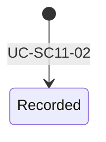

🏠 [Specs](../../../README.md) › 🏷️ [Sectors](../../README.md) › ⚖️ [SC11 Professional firms](../README.md) ›
🗃️ [Data](README.md) › 🗃️ E-SC11-03 Conflict check

# 🗃️ E-SC11-03 Conflict check

**Status:** 🔄 waiting for the owner

## Purpose

A search for conflicts.

## Fields

| Name | Type | Required | Validation | Default | Example | Personal data | Custom fields |
|---|---|---|---|---|---|---|---|
| matter, parties | records | yes | BR-SC11-03 | - | M-221, Beta | no | no |
| result, decision | text | yes | - | - | clear | no | no |

## Relations

(Proposed) As its use cases.

## Lifecycle

## Indexes and search

(Proposed) By number, date, partner.

## Retention

Kept for the period of its kind of record in the country pack (D293), or else its kind's default in the
[retention schedule](../../../05-non-functional/data-retention.md).

## Audit

Every change.

## Import and export

(Proposed) CSV, FEC where relevant.

## Used by

- [UC-SC11-02](../use-cases/01-client-intake/uc-sc11-02-check-conflicts-of-interest.md)

## Open questions

None.

---

⬅️ [E-SC11-02 Beneficial owner](e-sc11-02-beneficial-owner.md) · ⬆️ [Up](README.md) ·
➡️ [E-SC11-04 Engagement letter](e-sc11-04-engagement-letter.md)
