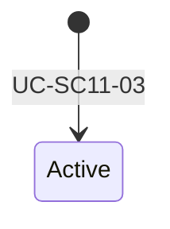

🏠 [Specs](../../../README.md) › 🏷️ [Sectors](../../README.md) › ⚖️ [SC11 Professional firms](../README.md) ›
🗃️ [Data](README.md) › 🗃️ E-SC11-04 Engagement letter

# 🗃️ E-SC11-04 Engagement letter

**Status:** 🔄 waiting for the owner

## Purpose

The agreement with the client.

## Fields

| Name | Type | Required | Validation | Default | Example | Personal data | Custom fields |
|---|---|---|---|---|---|---|---|
| client, matter, fees | records | yes | BR-SC11-04 | - | Acme, M-221, hourly 250 | no | no |
| signed | date | no | - | - | 3 Nov | no | no |

## Relations

(Proposed) As its use cases.

## Lifecycle

## Indexes and search

(Proposed) By number, date, partner.

## Retention

Kept for the period of its kind of record in the country pack (D293), or else its kind's default in the
[retention schedule](../../../05-non-functional/data-retention.md).

## Audit

Every change.

## Import and export

(Proposed) CSV, FEC where relevant.

## Used by

- [UC-SC11-03](../use-cases/01-client-intake/uc-sc11-03-sign-the-engagement-letter-and-fee-agreement.md)

## Open questions

None.

---

⬅️ [E-SC11-03 Conflict check](e-sc11-03-conflict-check.md) · ⬆️ [Up](README.md) ·
➡️ [E-SC11-05 Matter](e-sc11-05-matter.md)
