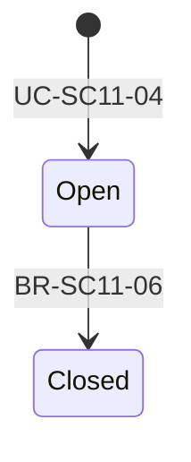

🏠 [Specs](../../../README.md) › 🏷️ [Sectors](../../README.md) › ⚖️ [SC11 Professional firms](../README.md) ›
🗃️ [Data](README.md) › 🗃️ E-SC11-05 Matter

# 🗃️ E-SC11-05 Matter

**Status:** 🔄 waiting for the owner

## Purpose

A client matter.

## Fields

| Name | Type | Required | Validation | Default | Example | Personal data | Custom fields |
|---|---|---|---|---|---|---|---|
| reference, client, team | records | yes | BR-SC11-06 | auto | M-221, Acme, 3 | no | no |
| walled | yes, no | yes | - | no | yes | no | no |
| state | open, closed | yes | - | open | open | no | no |

## Relations

(Proposed) As its use cases.

## Lifecycle

## Indexes and search

(Proposed) By number, date, partner.

## Retention

Kept for the period of its kind of record in the country pack (D293), or else its kind's default in the
[retention schedule](../../../05-non-functional/data-retention.md).

## Audit

Every change.

## Import and export

(Proposed) CSV, FEC where relevant.

## Used by

- [UC-SC11-04](../use-cases/02-matters-and-documents/uc-sc11-04-open-and-organise-matters.md)
- [UC-SC11-13](../use-cases/02-matters-and-documents/uc-sc11-13-run-architects-and-engineers-projects-by-phase.md)
- [UC-SC11-20](../use-cases/02-matters-and-documents/uc-sc11-20-ask-the-assistant-about-a-matter.md)

## Open questions

None.

---

⬅️ [E-SC11-04 Engagement letter](e-sc11-04-engagement-letter.md) · ⬆️ [Up](README.md) ·
➡️ [E-SC11-06 Time entry](e-sc11-06-time-entry.md)
