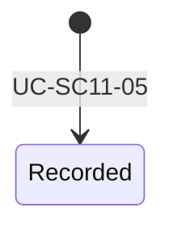

🏠 [Specs](../../../README.md) › 🏷️ [Sectors](../../README.md) › ⚖️ [SC11 Professional firms](../README.md) ›
🗃️ [Data](README.md) › 🗃️ E-SC11-06 Time entry

# 🗃️ E-SC11-06 Time entry

**Status:** 🔄 waiting for the owner

## Purpose

Time or a disbursement.

## Fields

| Name | Type | Required | Validation | Default | Example | Personal data | Custom fields |
|---|---|---|---|---|---|---|---|
| matter, person, date | records | yes | - | - | M-221, U36, 12 Nov | yes | no |
| hours, rate, cost | numbers | yes | BR-SC11-08 | - | 2.5, 250 | no | no |

## Relations

(Proposed) As its use cases.

## Lifecycle

## Indexes and search

(Proposed) By number, date, partner.

## Retention

As an accounting record:
[CR-FR-002 Accounting records kept 10 years](../../../10-country-packs/france/accounting/cr-fr-002-accounting-records-kept-ten-years.md).

## Audit

Every change.

## Import and export

(Proposed) CSV, FEC where relevant.

## Used by

- [UC-SC11-05](../use-cases/03-time-and-billing/uc-sc11-05-record-time-and-disbursements.md)
- [UC-SC11-14](../use-cases/06-firm-management/uc-sc11-14-follow-work-in-progress-and-the-recovery-rate.md)

## Open questions

None.

---

⬅️ [E-SC11-05 Matter](e-sc11-05-matter.md) · ⬆️ [Up](README.md) · ➡️ [E-SC11-07 Fee bill](e-sc11-07-fee-bill.md)
