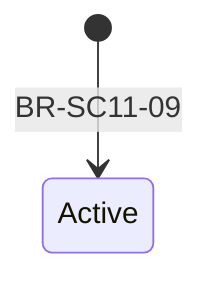

🏠 [Specs](../../../README.md) › 🏷️ [Sectors](../../README.md) › ⚖️ [SC11 Professional firms](../README.md) ›
🗃️ [Data](README.md) › 🗃️ E-SC11-07 Fee bill

# 🗃️ E-SC11-07 Fee bill

**Status:** ✅ specified

## Purpose

A bill or advance.

## Fields

| Name | Type | Required | Validation | Default | Example | Personal data | Custom fields |
|---|---|---|---|---|---|---|---|
| matter, kind | records | yes | BR-SC11-09 | - | M-221, advance | no | no |
| amount, write-off | amounts | yes | - | - | 3 000, 0 | no | no |

## Relations

As its use cases.

## Lifecycle

## Indexes and search

By number, date, partner.

## Retention

As an accounting record:
[CR-FR-002 Accounting records kept 10 years](../../../10-country-packs/france/accounting/cr-fr-002-accounting-records-kept-ten-years.md).

## Audit

Every change.

## Import and export

CSV, FEC where relevant.

## Used by

- [UC-SC11-06](../use-cases/03-time-and-billing/uc-sc11-06-bill-fees-and-request-advances.md)
- [UC-SC11-13](../use-cases/02-matters-and-documents/uc-sc11-13-run-architects-and-engineers-projects-by-phase.md)
- [UC-SC11-14](../use-cases/06-firm-management/uc-sc11-14-follow-work-in-progress-and-the-recovery-rate.md)
- [UC-SC11-19](../use-cases/06-firm-management/uc-sc11-19-report-the-firm-s-performance.md)

## Open questions

None.

---

⬅️ [E-SC11-06 Time entry](e-sc11-06-time-entry.md) · ⬆️ [Up](README.md) ·
➡️ [E-SC11-08 Trust movement](e-sc11-08-trust-movement.md)
