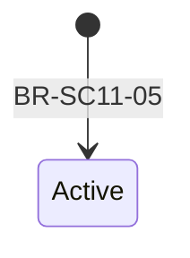

🏠 [Specs](../../../README.md) › 🏷️ [Sectors](../../README.md) › ⚖️ [SC11 Professional firms](../README.md) ›
🗃️ [Data](README.md) › 🗃️ E-SC11-08 Trust movement

# 🗃️ E-SC11-08 Trust movement

**Status:** ✅ specified

## Purpose

A movement of client money on a matter; the client ledger is the shared
[E-F8-17 Client money ledger](../../../02-functional/f08-accounting/data/e-f08-17-client-money-ledger.md),
[UC-F8-21](../../../02-functional/f08-accounting/use-cases/07-client-money-grants-and-non-profits/uc-f08-21-keep-third-party-client-money.md).

## Fields

| Name | Type | Required | Validation | Default | Example | Personal data | Custom fields |
|---|---|---|---|---|---|---|---|
| client, matter, amount | records | yes | BR-SC11-05 | - | Acme, M-221, 40 000 | yes | no |
| account | trust account | yes | - | - | CARPA | no | no |

## Relations

As its use cases.

## Lifecycle

## Indexes and search

By number, date, partner.

## Retention

As an accounting record:
[CR-FR-002 Accounting records kept 10 years](../../../10-country-packs/france/accounting/cr-fr-002-accounting-records-kept-ten-years.md).

## Audit

Every change.

## Import and export

CSV, FEC where relevant.

## Used by

- [UC-SC11-07](../use-cases/03-time-and-billing/uc-sc11-07-hold-client-funds-on-trust-accounts.md)

## Open questions

None.

---

⬅️ [E-SC11-07 Fee bill](e-sc11-07-fee-bill.md) · ⬆️ [Up](README.md) · ➡️ [E-SC11-09 Deadline](e-sc11-09-deadline.md)
