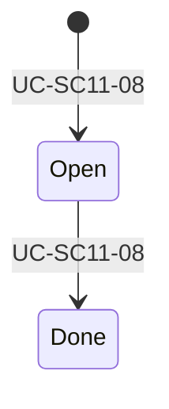

🏠 [Specs](../../../README.md) › 🏷️ [Sectors](../../README.md) › ⚖️ [SC11 Professional firms](../README.md) ›
🗃️ [Data](README.md) › 🗃️ E-SC11-09 Deadline

# 🗃️ E-SC11-09 Deadline

**Status:** ✅ specified

## Purpose

A deadline or hearing.

## Fields

| Name | Type | Required | Validation | Default | Example | Personal data | Custom fields |
|---|---|---|---|---|---|---|---|
| matter, date, kind | records | yes | BR-SC11-07 | - | M-221, 20 Nov, appeal | no | no |
| owner, state | person, state | yes | - | - | U36, open | no | no |

## Relations

As its use cases.

## Lifecycle

## Indexes and search

By number, date, partner.

## Retention

Kept for the period of its kind of record in the country pack (D293), or else its kind's default in the
[retention schedule](../../../05-non-functional/data-retention.md).

## Audit

Every change.

## Import and export

CSV, FEC where relevant.

## Used by

- [UC-SC11-08](../use-cases/04-deadlines-and-filings/uc-sc11-08-follow-deadlines-hearings-and-limitation-periods.md)
- [UC-SC11-20](../use-cases/02-matters-and-documents/uc-sc11-20-ask-the-assistant-about-a-matter.md)

## Open questions

None.

---

⬅️ [E-SC11-08 Trust movement](e-sc11-08-trust-movement.md) · ⬆️ [Up](README.md) ·
➡️ [E-SC11-10 Matter document](e-sc11-10-matter-document.md)
