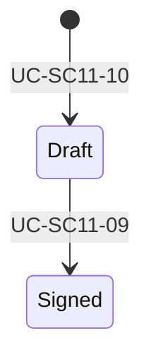

🏠 [Specs](../../../README.md) › 🏷️ [Sectors](../../README.md) › ⚖️ [SC11 Professional firms](../README.md) ›
🗃️ [Data](README.md) › 🗃️ E-SC11-10 Matter document

# 🗃️ E-SC11-10 Matter document

**Status:** 🔄 waiting for the owner

## Purpose

A document and its versions.

## Fields

| Name | Type | Required | Validation | Default | Example | Personal data | Custom fields |
|---|---|---|---|---|---|---|---|
| matter, title, version | records | yes | BR-SC11-10 | - | M-221, contract, v4 | no | no |
| signed | yes, no | yes | - | no | yes | no | no |

## Relations

(Proposed) As its use cases.

## Lifecycle

## Indexes and search

(Proposed) By number, date, partner.

## Retention

Kept for the period of its kind of record in the country pack (D293), or else its kind's default in the
[retention schedule](../../../05-non-functional/data-retention.md).

## Audit

Every change.

## Import and export

(Proposed) CSV, FEC where relevant.

## Used by

- [UC-SC11-09](../use-cases/02-matters-and-documents/uc-sc11-09-manage-documents-with-versions-and-e-signature.md)
- [UC-SC11-10](../use-cases/02-matters-and-documents/uc-sc11-10-exchange-securely-with-the-client-in-the-portal.md)
- [UC-SC11-12](../use-cases/04-deadlines-and-filings/uc-sc11-12-prepare-client-filings-and-their-evidence.md)

## Open questions

None.

---

⬅️ [E-SC11-09 Deadline](e-sc11-09-deadline.md) · ⬆️ [Up](README.md) · ➡️ [E-SC11-11 Filing](e-sc11-11-filing.md)
