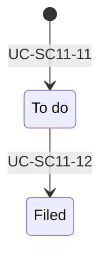

🏠 [Specs](../../../README.md) › 🏷️ [Sectors](../../README.md) › ⚖️ [SC11 Professional firms](../README.md) ›
🗃️ [Data](README.md) › 🗃️ E-SC11-11 Filing

# 🗃️ E-SC11-11 Filing

**Status:** 🔄 waiting for the owner

## Purpose

A client filing due.

## Fields

| Name | Type | Required | Validation | Default | Example | Personal data | Custom fields |
|---|---|---|---|---|---|---|---|
| client, kind, due | records | yes | BR-SC11-12 | - | Beta, VAT, 24 Nov | no | no |
| state | to do, filed | yes | - | to do | filed | no | no |

## Relations

(Proposed) As its use cases.

## Lifecycle

## Indexes and search

(Proposed) By number, date, partner.

## Retention

Kept for the period of its kind of record in the country pack (D293), or else its kind's default in the
[retention schedule](../../../05-non-functional/data-retention.md).

## Audit

Every change.

## Import and export

(Proposed) CSV, FEC where relevant.

## Used by

- [UC-SC11-11](../use-cases/04-deadlines-and-filings/uc-sc11-11-run-an-accountant-s-client-portfolio-and-tax-calendar.md)
- [UC-SC11-12](../use-cases/04-deadlines-and-filings/uc-sc11-12-prepare-client-filings-and-their-evidence.md)

## Open questions

None.

---

⬅️ [E-SC11-10 Matter document](e-sc11-10-matter-document.md) · ⬆️ [Up](README.md) ·
➡️ [E-SC11-12 Vigilance record](e-sc11-12-vigilance-record.md)
