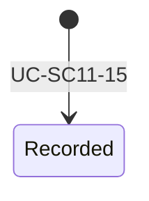

🏠 [Specs](../../../README.md) › 🏷️ [Sectors](../../README.md) › ⚖️ [SC11 Professional firms](../README.md) ›
🗃️ [Data](README.md) › 🗃️ E-SC11-12 Vigilance record

# 🗃️ E-SC11-12 Vigilance record

**Status:** 🔄 waiting for the owner

## Purpose

A risk review or suspicion.

## Fields

| Name | Type | Required | Validation | Default | Example | Personal data | Custom fields |
|---|---|---|---|---|---|---|---|
| client, date, kind | records | yes | BR-SC11-14 | - | Acme, 12 Nov, suspicion | yes | no |
| access | restricted | yes | - | - | compliance only | no | no |

## Relations

(Proposed) As its use cases.

## Lifecycle

## Indexes and search

(Proposed) By number, date, partner.

## Retention

(Proposed) For the anti-money-laundering period after the relationship ends;
[CR-FR-149 Anti-money-laundering vigilance](../../../10-country-packs/france/professional-firms/cr-fr-149-aml-vigilance.md).

## Audit

Every change.

## Import and export

(Proposed) CSV, FEC where relevant.

## Used by

- [UC-SC11-15](../use-cases/05-compliance-and-secrecy/uc-sc11-15-run-anti-money-laundering-vigilance.md)

## Open questions

None.

---

⬅️ [E-SC11-11 Filing](e-sc11-11-filing.md) · ⬆️ [Up](README.md) · ➡️ [E-SC11-13 Access wall](e-sc11-13-access-wall.md)
