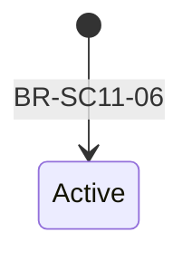

🏠 [Specs](../../../README.md) › 🏷️ [Sectors](../../README.md) › ⚖️ [SC11 Professional firms](../README.md) ›
🗃️ [Data](README.md) › 🗃️ E-SC11-13 Access wall

# 🗃️ E-SC11-13 Access wall

**Status:** ✅ specified

## Purpose

A wall around a matter.

## Fields

| Name | Type | Required | Validation | Default | Example | Personal data | Custom fields |
|---|---|---|---|---|---|---|---|
| matter, allowed people | records | yes | BR-SC11-06 | - | M-221, 3 | yes | no |
| access log | list | yes | - | - | 14 views | yes | no |

## Relations

As its use cases.

## Lifecycle

## Indexes and search

By number, date, partner.

## Retention

Kept for the period of its kind of record in the country pack (D293), or else its kind's default in the
[retention schedule](../../../05-non-functional/data-retention.md).

## Audit

Every change.

## Import and export

CSV, FEC where relevant.

## Used by

- [UC-SC11-16](../use-cases/05-compliance-and-secrecy/uc-sc11-16-keep-secrecy-with-access-walls.md)

## Open questions

None.

---

⬅️ [E-SC11-12 Vigilance record](e-sc11-12-vigilance-record.md) · ⬆️ [Up](README.md) ·
➡️ [E-SC11-14 Partner share](e-sc11-14-partner-share.md)
