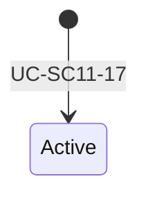

🏠 [Specs](../../../README.md) › 🏷️ [Sectors](../../README.md) › ⚖️ [SC11 Professional firms](../README.md) ›
🗃️ [Data](README.md) › 🗃️ E-SC11-14 Partner share

# 🗃️ E-SC11-14 Partner share

**Status:** ✅ specified

## Purpose

A partner's yearly target and profit share; the target itself is the shared
[E-F6-18 Commission plan and target](../../../02-functional/f06-customers-and-sales/data/e-f06-18-commission-plan-and-target.md),
[UC-F6-25](../../../02-functional/f06-customers-and-sales/use-cases/09-sell-on-the-road-and-steer-sales/uc-f06-25-set-sales-targets-and-pay-commissions.md).

## Fields

| Name | Type | Required | Validation | Default | Example | Personal data | Custom fields |
|---|---|---|---|---|---|---|---|
| partner, year | records | yes | - | - | U13, 2026 | yes | no |
| target, share | amount, points | no | - | - | 600 000, 42 | no | no |

## Relations

As its use cases.

## Lifecycle

## Indexes and search

By number, date, partner.

## Retention

Kept for the period of its kind of record in the country pack (D293), or else its kind's default in the
[retention schedule](../../../05-non-functional/data-retention.md).

## Audit

Every change.

## Import and export

CSV, FEC where relevant.

## Used by

- [UC-SC11-17](../use-cases/06-firm-management/uc-sc11-17-manage-partners-targets-and-profit-shares.md)
- [UC-SC11-19](../use-cases/06-firm-management/uc-sc11-19-report-the-firm-s-performance.md)

## Open questions

None.

---

⬅️ [E-SC11-13 Access wall](e-sc11-13-access-wall.md) · ⬆️ [Up](README.md) ·
➡️ [E-SC11-15 Training record](e-sc11-15-training-record.md)
