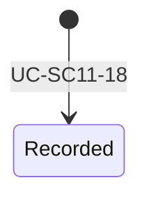

🏠 [Specs](../../../README.md) › 🏷️ [Sectors](../../README.md) › ⚖️ [SC11 Professional firms](../README.md) ›
🗃️ [Data](README.md) › 🗃️ E-SC11-15 Training record

# 🗃️ E-SC11-15 Training record

**Status:** 🔄 waiting for the owner

## Purpose

Training hours.

## Fields

| Name | Type | Required | Validation | Default | Example | Personal data | Custom fields |
|---|---|---|---|---|---|---|---|
| professional, course, hours | records | yes | BR-SC11-15 | - | U36, tax update, 7 | yes | no |

## Relations

(Proposed) As its use cases.

## Lifecycle

## Indexes and search

(Proposed) By number, date, partner.

## Retention

Kept for the period of its kind of record in the country pack (D293), or else its kind's default in the
[retention schedule](../../../05-non-functional/data-retention.md).

## Audit

Every change.

## Import and export

(Proposed) CSV, FEC where relevant.

## Used by

- [UC-SC11-18](../use-cases/06-firm-management/uc-sc11-18-track-continuing-professional-training.md)

## Open questions

None.

---

⬅️ [E-SC11-14 Partner share](e-sc11-14-partner-share.md) · ⬆️ [Up](README.md) · ➡️ [E-SC11-16 Deed](e-sc11-16-deed.md)
