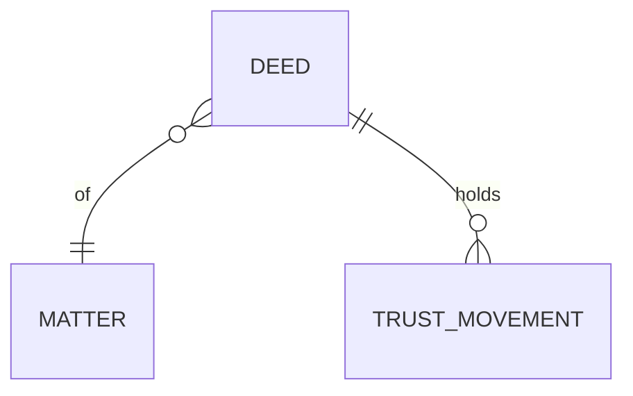
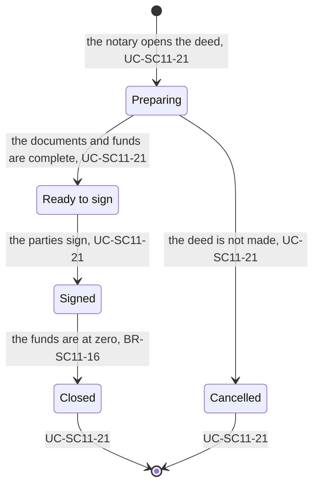

🏠 [Specs](../../../README.md) › 🏷️ [Sectors](../../README.md) › ⚖️ [SC11 Professional firms](../README.md) ›
🗃️ [Data](README.md) › 🗃️ E-SC11-16 Deed

# 🗃️ E-SC11-16 Deed

**Status:** ✅ specified

## Purpose

A deed prepared and signed by the notary: its kind, parties, documents, funds and signature
([D555](../../../06-decisions/sectors/d555-benchmark-gaps-sc11-professional-firms.md)). The matter
([E-SC11-05 Matter](e-sc11-05-matter.md)) is the file of work for a client; the deed is the authentic act the matter
leads to, with the funds held for it ([E-SC11-08 Trust movement](e-sc11-08-trust-movement.md)).

## Fields

| Name | Type | Required | Validation | Default | Example | Personal data | Custom fields |
|---|---|---|---|---|---|---|---|
| kind | choice | yes | sale, mortgage, will, company, other | - | sale | no | no |
| matter | matter (E-SC11-05) | yes | a matter of the firm | - | M-2026-0417 | no | no |
| parties | client identities (E-SC11-01) | yes | at least two for a sale | - | Mrs Roux, Mr Gil | yes | no |
| subject | text | yes | the property or company | - | 12 Rue des Lilas | no | no |
| price | amount | no | 0 or more | - | 300,000.00 EUR | no | no |
| funds received | amount | yes | 0 or more | 0 | 312,500.00 EUR | no | no |
| funds paid | amount | yes | not above funds received | 0 | 0.00 EUR | no | no |
| signed on | date | no | set at the signature | - | 2026-12-12 | no | no |
| closed on | date | no | funds at zero | - | - | no | no |
| state | Preparing, Ready to sign, Signed, Closed, Cancelled | yes | the lifecycle below | Preparing | Ready to sign | no | no |
| owner | user | yes | a user of the company | the creator | Claire P. | yes | no |

## Relations

- [E-SC11-01 Client identity](e-sc11-01-client-identity.md)
- [E-SC11-05 Matter](e-sc11-05-matter.md)
- [E-SC11-08 Trust movement](e-sc11-08-trust-movement.md)

## Lifecycle

## Indexes and search

By kind, party, matter, state and signature date. Parties are searched only by users with a client role.

## Retention

The deed and its funds records are kept for the period the profession's rules set, long after the signature
([CR-FR-002](../../../10-country-packs/france/accounting/cr-fr-002-accounting-records-kept-ten-years.md)).

## Audit

Every deed created, signed and closed, every fund received and paid with who approved it, every refusal.

## Import and export

Export of the deed's funds statement for the parties; no import.

## Used by

- [UC-SC11-21](../use-cases/07-notaries-brokers-officers-and-auditors/uc-sc11-21-run-a-notarys-office.md)
- [UC-SC11-07](../use-cases/03-time-and-billing/uc-sc11-07-hold-client-funds-on-trust-accounts.md)

## Open questions

None.

---

⬅️ [E-SC11-15 Training record](e-sc11-15-training-record.md) · ⬆️ [Up](README.md) ·
➡️ [E-SC11-17 Policy](e-sc11-17-policy.md)
