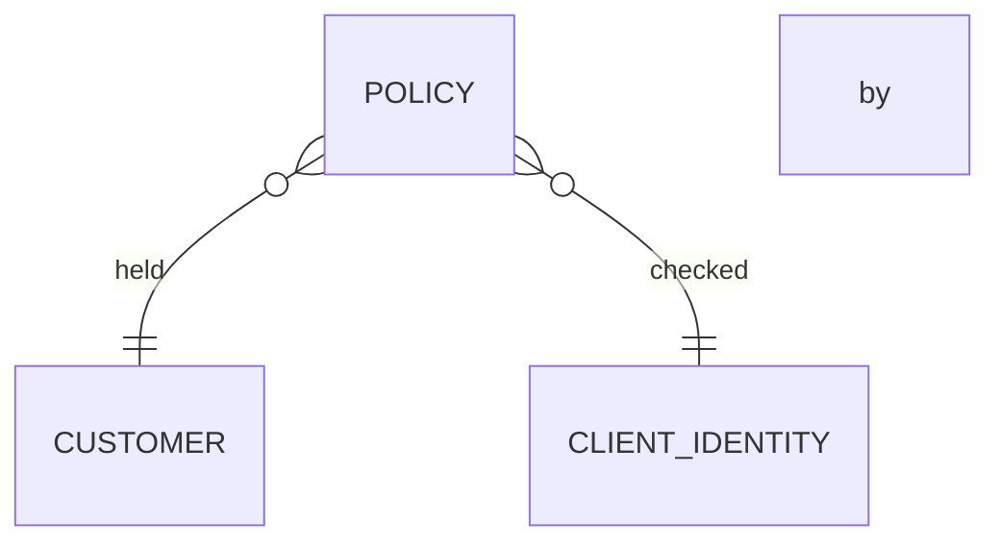
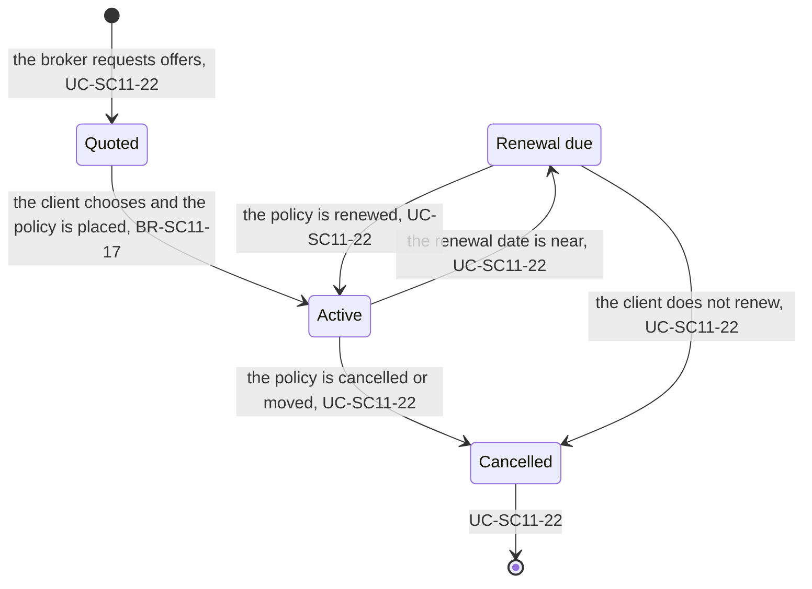

🏠 [Specs](../../../README.md) › 🏷️ [Sectors](../../README.md) › ⚖️ [SC11 Professional firms](../README.md) ›
🗃️ [Data](README.md) › 🗃️ E-SC11-17 Policy

# 🗃️ E-SC11-17 Policy

**Status:** ✅ specified

## Purpose

An insurance policy placed by the brokerage for a client: its insurer, cover, premium, commission and renewal date
([D555](../../../06-decisions/sectors/d555-benchmark-gaps-sc11-professional-firms.md)). It is the broker's record of the
contract and its earnings; the client's own identity is in [E-SC11-01 Client identity](e-sc11-01-client-identity.md).

## Fields

| Name | Type | Required | Validation | Default | Example | Personal data | Custom fields |
|---|---|---|---|---|---|---|---|
| client | customer (E-F6-01) | yes | a customer of the firm | - | Mr Faure | yes | no |
| branch | choice | yes | a branch of insurance | - | tenant's insurance | no | no |
| insurer | text | yes | an insurer of the brokerage's list | - | Insurer 2 | no | no |
| cover | text | yes | - | - | contents 30,000 | no | no |
| premium | amount | yes | above 0 | - | 480.00 EUR | no | no |
| commission | percentage | yes | 0 to 100 | from the insurer | 12 % | no | no |
| start date | date | yes | - | today | 2026-12-01 | no | no |
| renewal date | date | yes | after the start | start plus one year | 2027-12-01 | no | no |
| registration checked on | date | no | set at the placement | - | 2026-11-14 | no | no |
| state | Quoted, Active, Renewal due, Cancelled | yes | the lifecycle below | Quoted | Active | no | no |
| owner | user | yes | a user of the company | the creator | Claire P. | yes | no |

## Relations

- [E-SC11-01 Client identity](e-sc11-01-client-identity.md)
- [E-F6-01](../../../02-functional/f06-customers-and-sales/data/e-f06-01-customer-record.md)

## Lifecycle

## Indexes and search

By client, insurer, branch, renewal date and state.

## Retention

Kept for the years the brokerage's rules and the limitation period require
([CR-FR-002](../../../10-country-packs/france/accounting/cr-fr-002-accounting-records-kept-ten-years.md)).

## Audit

Every offer, placement, renewal, cancellation and registration check, with who, when and the values.

## Import and export

Import of an insurer's statement of commissions; export of the portfolio as a CSV.

## Used by

- [UC-SC11-22](../use-cases/07-notaries-brokers-officers-and-auditors/uc-sc11-22-run-an-insurance-brokerage.md)
- [UC-SC11-03](../use-cases/01-client-intake/uc-sc11-03-sign-the-engagement-letter-and-fee-agreement.md)

## Open questions

None.

---

⬅️ [E-SC11-16 Deed](e-sc11-16-deed.md) · ⬆️ [Up](README.md) · ➡️ [E-SC11-18 Service act](e-sc11-18-service-act.md)
