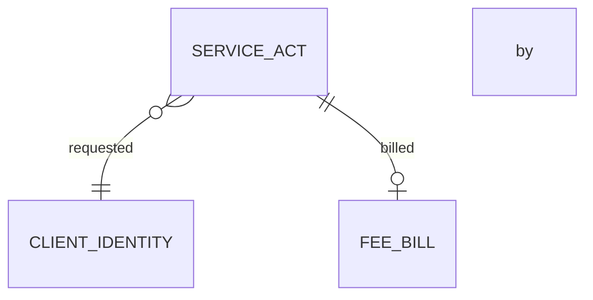
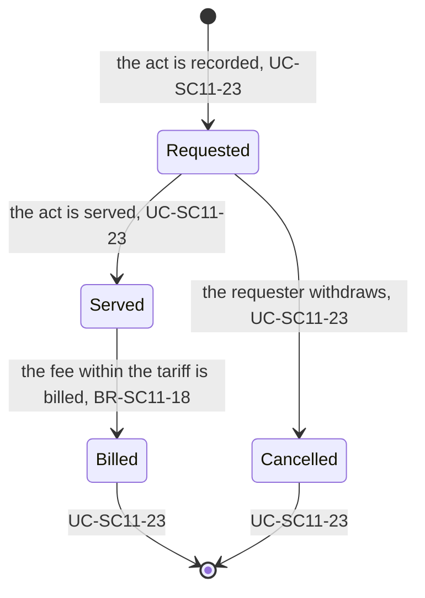

🏠 [Specs](../../../README.md) › 🏷️ [Sectors](../../README.md) › ⚖️ [SC11 Professional firms](../README.md) ›
🗃️ [Data](README.md) › 🗃️ E-SC11-18 Service act

# 🗃️ E-SC11-18 Service act

**Status:** ✅ specified

## Purpose

An act of the judicial officer's office: its type, requester, recipient, service and fee
([D555](../../../06-decisions/sectors/d555-benchmark-gaps-sc11-professional-firms.md)). The fee bill
([E-SC11-07 Fee bill](e-sc11-07-fee-bill.md)) is the general bill of a firm; this record holds the tariff line and the
service, which the bill is built from.

## Fields

| Name | Type | Required | Validation | Default | Example | Personal data | Custom fields |
|---|---|---|---|---|---|---|---|
| type | choice | yes | an act of the tariff | - | summons to appear | no | no |
| requester | client identity (E-SC11-01) | yes | a checked client | - | Mrs Roux | yes | no |
| recipient | text, address | yes | a person or company | - | Mr Gil, 4 Rue Neuve | yes | no |
| served on | date and time | no | set when served | - | 2026-11-14 10:15 | no | no |
| served how | choice | no | in person, at the home, at the office, other | - | in person | no | no |
| tariff line | text | yes | from the tariff of the act's date | from the type | line 4 | no | no |
| fee | amount | yes | not above the tariff | from the tariff | 78.50 EUR | no | no |
| travel | amount | no | 0 or more | from the tariff | 12.00 EUR | no | no |
| disbursements | amount | no | 0 or more | 0 | 6.20 EUR | no | no |
| deadline | deadline (E-SC11-09) | no | a deadline of the case | - | 2026-11-30 | no | no |
| state | Requested, Served, Billed, Cancelled | yes | the lifecycle below | Requested | Served | no | no |
| owner | user | yes | a user of the company | the creator | Claire P. | yes | no |

## Relations

- [E-SC11-01 Client identity](e-sc11-01-client-identity.md)
- [E-SC11-07 Fee bill](e-sc11-07-fee-bill.md)
- [E-SC11-09 Deadline](e-sc11-09-deadline.md)

## Lifecycle

## Indexes and search

By requester, recipient, type, service date and state.

## Retention

Kept for the period the profession's rules set
([CR-FR-002](../../../10-country-packs/france/accounting/cr-fr-002-accounting-records-kept-ten-years.md)).

## Audit

Every act recorded, served, billed or cancelled, every fee cut, with who, when and the amounts.

## Import and export

Export of the acts of a case as a file for the requester; no import.

## Used by

- [UC-SC11-23](../use-cases/07-notaries-brokers-officers-and-auditors/uc-sc11-23-run-a-judicial-officers-office.md)
- [UC-SC11-06](../use-cases/03-time-and-billing/uc-sc11-06-bill-fees-and-request-advances.md)

## Open questions

None.

---

⬅️ [E-SC11-17 Policy](e-sc11-17-policy.md) · ⬆️ [Up](README.md) ·
➡️ [E-SC11-19 Audit engagement](e-sc11-19-audit-engagement.md)
