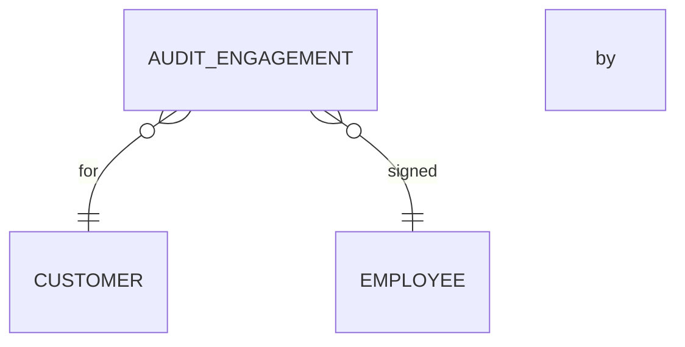
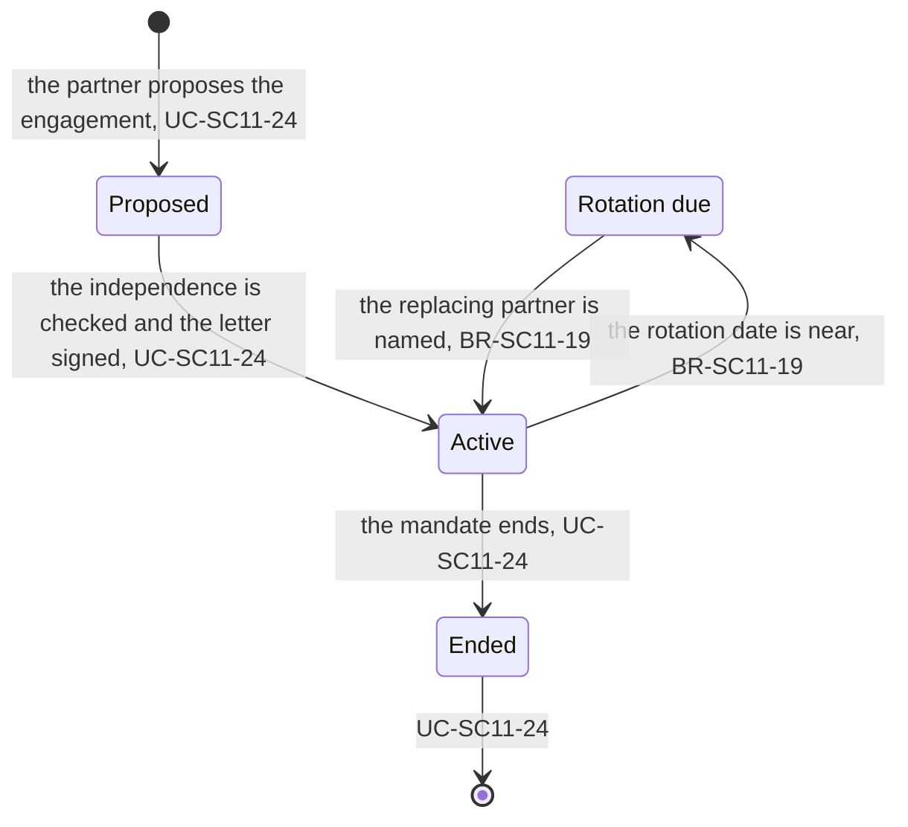

🏠 [Specs](../../../README.md) › 🏷️ [Sectors](../../README.md) › ⚖️ [SC11 Professional firms](../README.md) ›
🗃️ [Data](README.md) › 🗃️ E-SC11-19 Audit engagement

# 🗃️ E-SC11-19 Audit engagement

**Status:** ✅ specified

## Purpose

A statutory audit mandate for one client: its years, signing partner, rotation date and team
([D555](../../../06-decisions/sectors/d555-benchmark-gaps-sc11-professional-firms.md)). The engagement letter
([E-SC11-04 Engagement letter](e-sc11-04-engagement-letter.md)) is the contract; this record follows the mandate over
its years and the partners who sign.

## Fields

| Name | Type | Required | Validation | Default | Example | Personal data | Custom fields |
|---|---|---|---|---|---|---|---|
| client | customer (E-F6-01) | yes | a customer of the firm | - | Tuileries SA | no | no |
| first year | year | yes | - | - | 2026 | no | no |
| length in years | number | yes | above 0 | from the pack | 6 | no | no |
| entity kind | public interest, other | yes | one of the two | other | public interest | no | no |
| signing partner | employee (E-F9-01) | yes | a partner of the firm | - | Mrs Girard | no | no |
| partner since | year | yes | not after the first year of signing | first year | 2026 | no | no |
| rotation date | date | yes | from the pack | computed | 2033-12-31 | no | no |
| independence checked on | date | yes | before Active | - | 2026-09-02 | no | no |
| requests | list | no | requests of the year | - | 12 of 14 answered | no | no |
| state | Proposed, Active, Rotation due, Ended | yes | the lifecycle below | Proposed | Active | no | no |
| owner | user | yes | a user of the company | the creator | Claire P. | yes | no |

## Relations

- [E-SC11-03 Conflict check](e-sc11-03-conflict-check.md)
- [E-SC11-04 Engagement letter](e-sc11-04-engagement-letter.md)
- [E-F6-01](../../../02-functional/f06-customers-and-sales/data/e-f06-01-customer-record.md)
- [E-F9-01](../../../02-functional/f09-hr-and-projects/data/e-f09-01-employee-record.md)

## Lifecycle

## Indexes and search

By client, signing partner, rotation date and state.

## Retention

Kept for the period the profession's rules set, after the end of the mandate
([CR-FR-002](../../../10-country-packs/france/accounting/cr-fr-002-accounting-records-kept-ten-years.md)).

## Audit

Every engagement change, rotation, independence check, request and opinion, with who, when and the partner.

## Import and export

Export of the requests of the year as a list for the client; no import.

## Used by

- [UC-SC11-24](../use-cases/07-notaries-brokers-officers-and-auditors/uc-sc11-24-run-a-statutory-audit-firm.md)
- [UC-SC11-02](../use-cases/01-client-intake/uc-sc11-02-check-conflicts-of-interest.md)

## Open questions

None.

---

⬅️ [E-SC11-18 Service act](e-sc11-18-service-act.md) · ⬆️ [Up](README.md)
