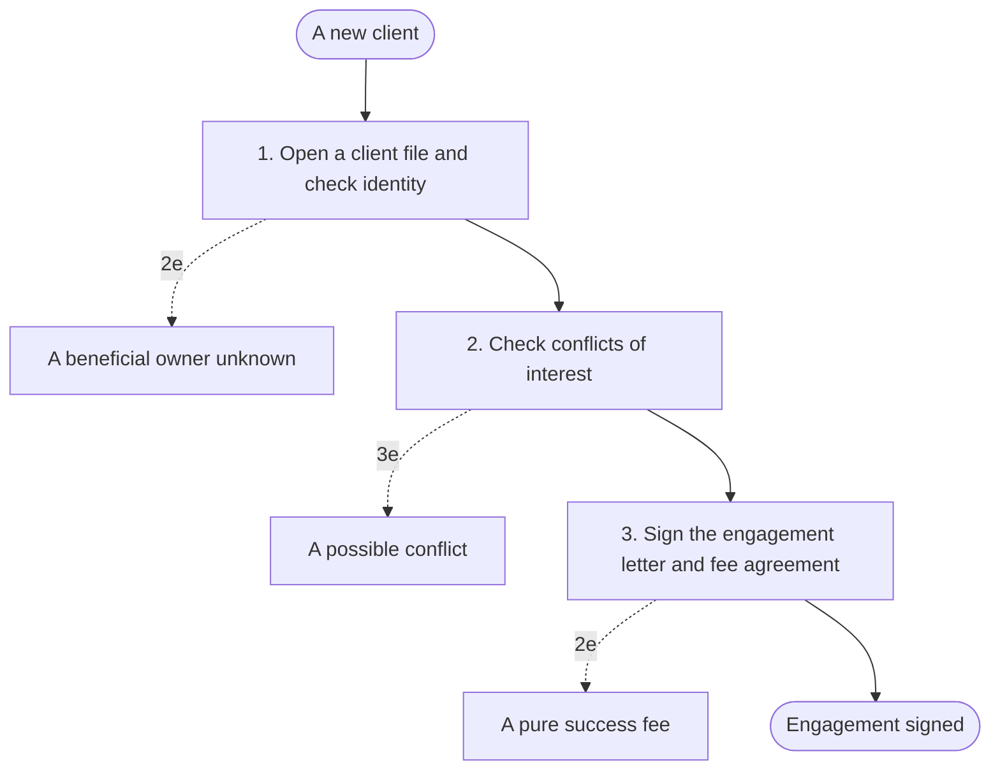

🏠 [Specs](../../../README.md) › 🏷️ [Sectors](../../README.md) › ⚖️ [SC11 Professional firms](../README.md) ›
🔀 [Flows](README.md) › 🔀 FL-SC11-01 Client intake

# 🔀 FL-SC11-01 Client intake

**Status:** ✅ specified

## Summary

Client intake: identity, conflicts and the engagement letter. It covers
[UC-SC11-01 Open a client file and check identity](../use-cases/01-client-intake/uc-sc11-01-open-a-client-file-and-check-identity.md),
[UC-SC11-02 Check conflicts of interest](../use-cases/01-client-intake/uc-sc11-02-check-conflicts-of-interest.md),
[UC-SC11-03 Sign the engagement letter and fee agreement](../use-cases/01-client-intake/uc-sc11-03-sign-the-engagement-letter-and-fee-agreement.md).

## Personas

- [U09 Customer](../../../01-users/personas/u09-customer.md)
- [U36 Professional](../../../01-users/personas/u36-professional.md)
- [U37 Professional's assistant](../../../01-users/personas/u37-assistant.md)

## Flowchart

## Sequence diagram

See each use case.

## Steps

| Step | Persona | Screen | Use case | What happens |
|---|---|---|---|---|
| 1 | U37, U36 | [S-SC11-01](../screens/01-client-intake/s-sc11-01-client-intake.md) | [UC-SC11-01](../use-cases/01-client-intake/uc-sc11-01-open-a-client-file-and-check-identity.md) | The professional's assistant collects a new client's identity documents and beneficial owners, the professional rates the risk and approves the client before any work |
| 2 | U37, U36 | [S-SC11-02](../screens/01-client-intake/s-sc11-02-conflict-check.md) | [UC-SC11-02](../use-cases/01-client-intake/uc-sc11-02-check-conflicts-of-interest.md) | The professional's assistant enters the parties of a new matter, SimpleERP searches all clients and opposing parties, a partner decides on a possible conflict |
| 3 | U36, U09 | [S-SC11-03](../screens/01-client-intake/s-sc11-03-engagement.md) | [UC-SC11-03](../use-cases/01-client-intake/uc-sc11-03-sign-the-engagement-letter-and-fee-agreement.md) | The professional drafts the engagement letter and fee agreement, sends them and has the client sign before work |

### Entities and screens

| Entity | States in this flow | Shown at step and screen | Aggregated view |
|---|---|---|---|
| [E-SC11-01 Client identity](../data/e-sc11-01-client-identity.md) | Active | 1 [S-SC11-01](../screens/01-client-intake/s-sc11-01-client-intake.md) | Client identities |
| [E-SC11-02 Beneficial owner](../data/e-sc11-02-beneficial-owner.md) | Active | 1 [S-SC11-01](../screens/01-client-intake/s-sc11-01-client-intake.md) | Beneficial owners |
| [E-SC11-03 Conflict check](../data/e-sc11-03-conflict-check.md) | Recorded | 2 [S-SC11-02](../screens/01-client-intake/s-sc11-02-conflict-check.md) | Conflict checks |
| [E-SC11-04 Engagement letter](../data/e-sc11-04-engagement-letter.md) | Active | 3 [S-SC11-03](../screens/01-client-intake/s-sc11-03-engagement.md) | Engagement letters |

## Errors

- [UC-SC11-01](../use-cases/01-client-intake/uc-sc11-01-open-a-client-file-and-check-identity.md) 2e. A beneficial owner
  unknown: the client is blocked.
- [UC-SC11-01](../use-cases/01-client-intake/uc-sc11-01-open-a-client-file-and-check-identity.md) 3e. A high risk: a
  partner's approval is needed.
- [UC-SC11-02](../use-cases/01-client-intake/uc-sc11-02-check-conflicts-of-interest.md) 3e. A possible conflict: a
  partner decides.
- [UC-SC11-02](../use-cases/01-client-intake/uc-sc11-02-check-conflicts-of-interest.md) 4e. A partner refuses: the
  matter is not opened.
- [UC-SC11-03](../use-cases/01-client-intake/uc-sc11-03-sign-the-engagement-letter-and-fee-agreement.md) 2e. A pure
  success fee: it is refused.
- [UC-SC11-03](../use-cases/01-client-intake/uc-sc11-03-sign-the-engagement-letter-and-fee-agreement.md) 4e. Not signed:
  the matter waits.

## Images

Every step and error, for each persona taking part, in light and dark mode (D120). Steps are numbered as in the Steps
table; E rows are the error cases.

| Step | Persona | Device | Light | Dark |
|---|---|---|---|---|
| 1 | U37 | desktop | [light](../images/01-client-intake/u37-assistant/1-identity-desktop-light.png) | [dark](../images/01-client-intake/u37-assistant/1-identity-desktop-dark.png) |
| 1 | U36 | desktop | [light](../images/01-client-intake/u36-professional/1-identity-desktop-light.png) | [dark](../images/01-client-intake/u36-professional/1-identity-desktop-dark.png) |
| 1 | U36 | phone | [light](../images/01-client-intake/u36-professional/1-identity-phone-light.png) | [dark](../images/01-client-intake/u36-professional/1-identity-phone-dark.png) |
| 2 | U37 | desktop | [light](../images/01-client-intake/u37-assistant/2-conflicts-desktop-light.png) | [dark](../images/01-client-intake/u37-assistant/2-conflicts-desktop-dark.png) |
| 2 | U36 | desktop | [light](../images/01-client-intake/u36-professional/2-conflicts-desktop-light.png) | [dark](../images/01-client-intake/u36-professional/2-conflicts-desktop-dark.png) |
| 2 | U36 | phone | [light](../images/01-client-intake/u36-professional/2-conflicts-phone-light.png) | [dark](../images/01-client-intake/u36-professional/2-conflicts-phone-dark.png) |
| 3 | U36 | desktop | [light](../images/01-client-intake/u36-professional/3-engagement-desktop-light.png) | [dark](../images/01-client-intake/u36-professional/3-engagement-desktop-dark.png) |
| 3 | U36 | phone | [light](../images/01-client-intake/u36-professional/3-engagement-phone-light.png) | [dark](../images/01-client-intake/u36-professional/3-engagement-phone-dark.png) |
| 3 | U09 | phone | [light](../images/01-client-intake/u09-customer/3-engagement-phone-light.png) | [dark](../images/01-client-intake/u09-customer/3-engagement-phone-dark.png) |
| E1 | U37 | desktop | [light](../images/01-client-intake/u37-assistant/e1-owner-unknown-desktop-light.png) | [dark](../images/01-client-intake/u37-assistant/e1-owner-unknown-desktop-dark.png) |

## Open questions

None.

---

⬆️ [Up](README.md) · ➡️ [FL-SC11-02 Matters and documents](fl-sc11-02-matters-and-documents.md)
