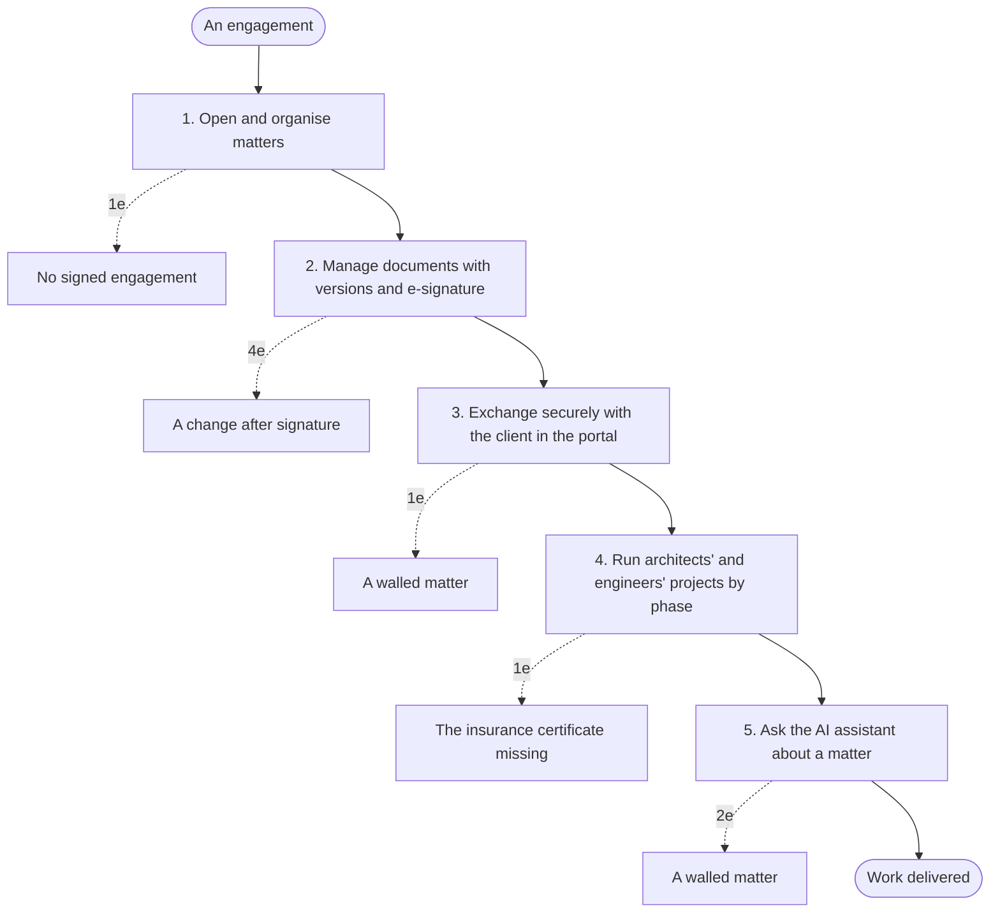

🏠 [Specs](../../../README.md) › 🏷️ [Sectors](../../README.md) › ⚖️ [SC11 Professional firms](../README.md) ›
🔀 [Flows](README.md) › 🔀 FL-SC11-02 Matters and documents

# 🔀 FL-SC11-02 Matters and documents

**Status:** ✅ specified

## Summary

Matters, documents, the client portal, phases and the AI assistant. It covers
[UC-SC11-04 Open and organise matters](../use-cases/02-matters-and-documents/uc-sc11-04-open-and-organise-matters.md),
[UC-SC11-09 Manage documents with versions and e-signature](../use-cases/02-matters-and-documents/uc-sc11-09-manage-documents-with-versions-and-e-signature.md),
[UC-SC11-10 Exchange securely with the client in the portal](../use-cases/02-matters-and-documents/uc-sc11-10-exchange-securely-with-the-client-in-the-portal.md),
[UC-SC11-13 Run architects' and engineers' projects by phase](../use-cases/02-matters-and-documents/uc-sc11-13-run-architects-and-engineers-projects-by-phase.md),
[UC-SC11-20 Ask the AI assistant about a matter](../use-cases/02-matters-and-documents/uc-sc11-20-ask-the-assistant-about-a-matter.md).

## Personas

- [U09 Customer](../../../01-users/personas/u09-customer.md)
- [U36 Professional](../../../01-users/personas/u36-professional.md)
- [U37 Professional's assistant](../../../01-users/personas/u37-assistant.md)

## Flowchart

## Sequence diagram

See each use case.

## Steps

| Step | Persona | Screen | Use case | What happens |
|---|---|---|---|---|
| 1 | U36, U37 | [S-SC11-04](../screens/02-matters-and-documents/s-sc11-04-matters.md) | [UC-SC11-04](../use-cases/02-matters-and-documents/uc-sc11-04-open-and-organise-matters.md) | The professional opens the matter with its team, parties and steps, only the team sees it |
| 2 | U36, U37 | [S-SC11-09](../screens/02-matters-and-documents/s-sc11-09-documents.md) | [UC-SC11-09](../use-cases/02-matters-and-documents/uc-sc11-09-manage-documents-with-versions-and-e-signature.md) | The professional drafts, reviews and has documents signed, each keeps its versions and signed ones are locked |
| 3 | U09, U36 | [S-SC11-10](../screens/02-matters-and-documents/s-sc11-10-client-portal.md) | [UC-SC11-10](../use-cases/02-matters-and-documents/uc-sc11-10-exchange-securely-with-the-client-in-the-portal.md) | The professional shares documents, messages and bills with the client in the portal, and holds client video meetings, walled matters stay with their team |
| 4 | U36, U09 | [S-SC11-13](../screens/02-matters-and-documents/s-sc11-13-phases.md) | [UC-SC11-13](../use-cases/02-matters-and-documents/uc-sc11-13-run-architects-and-engineers-projects-by-phase.md) | An architect plans the project's phases, delivers each, and bills its fees per phase, insurance applies |
| 5 | U36, U37 | [S-SC11-20](../screens/02-matters-and-documents/s-sc11-20-matter-assistant.md) | [UC-SC11-20](../use-cases/02-matters-and-documents/uc-sc11-20-ask-the-assistant-about-a-matter.md) | The professional or the professional's assistant asks the AI assistant about deadlines, time or a draft, within their role's rights and walls |

### Entities and screens

| Entity | States in this flow | Shown at step and screen | Aggregated view |
|---|---|---|---|
| [E-SC11-04 Engagement letter](../data/e-sc11-04-engagement-letter.md) | Active | Shown elsewhere: [S-SC11-03 Engagement](../screens/01-client-intake/s-sc11-03-engagement.md) | Engagement letters |
| [E-SC11-05 Matter](../data/e-sc11-05-matter.md) | Open | 1 [S-SC11-04](../screens/02-matters-and-documents/s-sc11-04-matters.md); 4 [S-SC11-13](../screens/02-matters-and-documents/s-sc11-13-phases.md); 5 [S-SC11-20](../screens/02-matters-and-documents/s-sc11-20-matter-assistant.md) | Matters |
| [E-SC11-10 Matter document](../data/e-sc11-10-matter-document.md) | Draft, Signed | 2 [S-SC11-09](../screens/02-matters-and-documents/s-sc11-09-documents.md); 3 [S-SC11-10](../screens/02-matters-and-documents/s-sc11-10-client-portal.md) | Matter documents |
| [E-F2-14 Signature request](../../../02-functional/f02-no-code-configuration/data/e-f02-14-signature-request.md) | Sent, Signed | Shown elsewhere: [S-F2-14 Signature requests](../../../02-functional/f02-no-code-configuration/screens/07-benchmark-additions/s-f02-14-signature-requests.md) | Signature requests |
| [E-F10-03 Point of sale order](../../../02-functional/f10-point-of-sale/data/e-f10-03-point-of-sale-order.md) | Draft | Shown elsewhere: [S-F10-17 Delivery orders](../../../02-functional/f10-point-of-sale/screens/06-mobile-and-delivery/s-f10-17-delivery-orders.md) | Point of sale orders |
| [E-F1-17 Portal account](../../../02-functional/f01-administration/data/e-f01-17-portal-account.md) | Blocked | Shown elsewhere: [S-F1-19 Portal accounts](../../../02-functional/f01-administration/screens/12-portal-accounts-and-integrations/s-f01-19-portal-accounts.md) | Portal accounts |
| [E-F9-18 Project and task](../../../02-functional/f09-hr-and-projects/data/e-f09-18-project-and-task.md) | New, Delivered | Shown elsewhere: [S-F9-17 Projects](../../../02-functional/f09-hr-and-projects/screens/06-plan-and-deliver-work/s-f09-17-projects.md) | Project and tasks |
| [E-F4-16 Client video meeting](../../../02-functional/f04-meetings/data/e-f04-16-client-video-meeting.md) | Planned, Waiting, Live, Ended | Shown elsewhere: [S-F4-21 Client video meeting](../../../02-functional/f04-meetings/screens/12-rooms-and-client-video/s-f04-21-client-video-meeting.md) | Client video meetings |

## Errors

- [UC-SC11-04](../use-cases/02-matters-and-documents/uc-sc11-04-open-and-organise-matters.md) 1e. No signed engagement:
  the matter is blocked.
- [UC-SC11-04](../use-cases/02-matters-and-documents/uc-sc11-04-open-and-organise-matters.md) 2e. A team member outside
  the wall: they cannot be added.
- [UC-SC11-09](../use-cases/02-matters-and-documents/uc-sc11-09-manage-documents-with-versions-and-e-signature.md) 4e. A
  change after signature: a new version is made; the signed one stays locked.
- [UC-SC11-09](../use-cases/02-matters-and-documents/uc-sc11-09-manage-documents-with-versions-and-e-signature.md) 3e. A
  signer refuses: the document goes back to draft.
- [UC-SC11-10](../use-cases/02-matters-and-documents/uc-sc11-10-exchange-securely-with-the-client-in-the-portal.md) 1e.
  A walled matter: only its team can share.
- [UC-SC11-10](../use-cases/02-matters-and-documents/uc-sc11-10-exchange-securely-with-the-client-in-the-portal.md) 2e.
  The client not signed in: a reminder is sent.
- [UC-SC11-13](../use-cases/02-matters-and-documents/uc-sc11-13-run-architects-and-engineers-projects-by-phase.md) 1e.
  The insurance certificate missing: the architect is warned.
- [UC-SC11-13](../use-cases/02-matters-and-documents/uc-sc11-13-run-architects-and-engineers-projects-by-phase.md) 3e. A
  phase not accepted: it is not billed.
- [UC-SC11-20](../use-cases/02-matters-and-documents/uc-sc11-20-ask-the-assistant-about-a-matter.md) 2e. A walled
  matter: the AI assistant refuses.
- [UC-SC11-20](../use-cases/02-matters-and-documents/uc-sc11-20-ask-the-assistant-about-a-matter.md) 4e. An action
  beyond the user's rights: the AI assistant refuses.

## Images

Every step and error, for each persona taking part, in light and dark mode (D120). Steps are numbered as in the Steps
table; E rows are the error cases.

| Step | Persona | Device | Light | Dark |
|---|---|---|---|---|
| 1 | U36 | desktop | [light](../images/02-matters-and-documents/u36-professional/1-matter-desktop-light.png) | [dark](../images/02-matters-and-documents/u36-professional/1-matter-desktop-dark.png) |
| 1 | U36 | phone | [light](../images/02-matters-and-documents/u36-professional/1-matter-phone-light.png) | [dark](../images/02-matters-and-documents/u36-professional/1-matter-phone-dark.png) |
| 1 | U37 | desktop | [light](../images/02-matters-and-documents/u37-assistant/1-matter-desktop-light.png) | [dark](../images/02-matters-and-documents/u37-assistant/1-matter-desktop-dark.png) |
| 2 | U36 | desktop | [light](../images/02-matters-and-documents/u36-professional/2-documents-desktop-light.png) | [dark](../images/02-matters-and-documents/u36-professional/2-documents-desktop-dark.png) |
| 2 | U36 | phone | [light](../images/02-matters-and-documents/u36-professional/2-documents-phone-light.png) | [dark](../images/02-matters-and-documents/u36-professional/2-documents-phone-dark.png) |
| 2 | U37 | desktop | [light](../images/02-matters-and-documents/u37-assistant/2-documents-desktop-light.png) | [dark](../images/02-matters-and-documents/u37-assistant/2-documents-desktop-dark.png) |
| 3 | U09 | phone | [light](../images/02-matters-and-documents/u09-customer/3-portal-phone-light.png) | [dark](../images/02-matters-and-documents/u09-customer/3-portal-phone-dark.png) |
| 3 | U36 | desktop | [light](../images/02-matters-and-documents/u36-professional/3-portal-desktop-light.png) | [dark](../images/02-matters-and-documents/u36-professional/3-portal-desktop-dark.png) |
| 3 | U36 | phone | [light](../images/02-matters-and-documents/u36-professional/3-portal-phone-light.png) | [dark](../images/02-matters-and-documents/u36-professional/3-portal-phone-dark.png) |
| 4 | U36 | desktop | [light](../images/02-matters-and-documents/u36-professional/4-phases-desktop-light.png) | [dark](../images/02-matters-and-documents/u36-professional/4-phases-desktop-dark.png) |
| 4 | U36 | phone | [light](../images/02-matters-and-documents/u36-professional/4-phases-phone-light.png) | [dark](../images/02-matters-and-documents/u36-professional/4-phases-phone-dark.png) |
| 4 | U09 | phone | [light](../images/02-matters-and-documents/u09-customer/4-phases-phone-light.png) | [dark](../images/02-matters-and-documents/u09-customer/4-phases-phone-dark.png) |
| 5 | U36 | desktop | [light](../images/02-matters-and-documents/u36-professional/5-assistant-desktop-light.png) | [dark](../images/02-matters-and-documents/u36-professional/5-assistant-desktop-dark.png) |
| 5 | U36 | phone | [light](../images/02-matters-and-documents/u36-professional/5-assistant-phone-light.png) | [dark](../images/02-matters-and-documents/u36-professional/5-assistant-phone-dark.png) |
| 5 | U37 | desktop | [light](../images/02-matters-and-documents/u37-assistant/5-assistant-desktop-light.png) | [dark](../images/02-matters-and-documents/u37-assistant/5-assistant-desktop-dark.png) |
| E1 | U37 | desktop | [light](../images/02-matters-and-documents/u37-assistant/e1-walled-desktop-light.png) | [dark](../images/02-matters-and-documents/u37-assistant/e1-walled-desktop-dark.png) |

## Open questions

None.

---

⬅️ [FL-SC11-01 Client intake](fl-sc11-01-client-intake.md) · ⬆️ [Up](README.md) ·
➡️ [FL-SC11-03 Time and billing](fl-sc11-03-time-and-billing.md)
