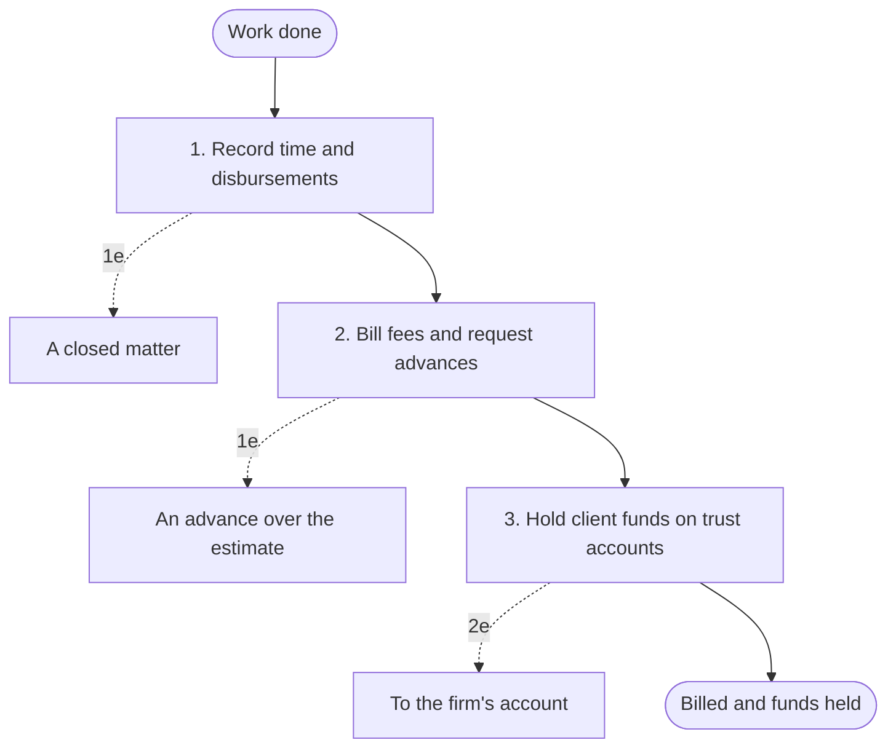

🏠 [Specs](../../../README.md) › 🏷️ [Sectors](../../README.md) › ⚖️ [SC11 Professional firms](../README.md) ›
🔀 [Flows](README.md) › 🔀 FL-SC11-03 Time and billing

# 🔀 FL-SC11-03 Time and billing

**Status:** ✅ specified

## Summary

Time, bills and client funds on the shared client money. It covers
[UC-SC11-05 Record time and disbursements](../use-cases/03-time-and-billing/uc-sc11-05-record-time-and-disbursements.md),
[UC-SC11-06 Bill fees and request advances](../use-cases/03-time-and-billing/uc-sc11-06-bill-fees-and-request-advances.md),
[UC-SC11-07 Hold client funds on trust accounts](../use-cases/03-time-and-billing/uc-sc11-07-hold-client-funds-on-trust-accounts.md).

## Personas

- [U05 Accounting](../../../01-users/personas/u05-accounting.md)
- [U36 Professional](../../../01-users/personas/u36-professional.md)
- [U37 Professional's assistant](../../../01-users/personas/u37-assistant.md)

## Flowchart

## Sequence diagram

See each use case.

## Steps

| Step | Persona | Screen | Use case | What happens |
|---|---|---|---|---|
| 1 | U36 | [S-SC11-05](../screens/03-time-and-billing/s-sc11-05-time.md) | [UC-SC11-05](../use-cases/03-time-and-billing/uc-sc11-05-record-time-and-disbursements.md) | The professional records time and disbursements per matter, reviews and submits them |
| 2 | U37, U36 | [S-SC11-06](../screens/03-time-and-billing/s-sc11-06-fees.md) | [UC-SC11-06](../use-cases/03-time-and-billing/uc-sc11-06-bill-fees-and-request-advances.md) | The AI assistant prepares bills by the fee model and advance requests within the estimate, the professional approves and sends them |
| 3 | U05, U36 | [S-SC11-07](../screens/03-time-and-billing/s-sc11-07-client-funds.md) | [UC-SC11-07](../use-cases/03-time-and-billing/uc-sc11-07-hold-client-funds-on-trust-accounts.md) | Accounting receives client funds onto the trust account with the shared third-party client money, books them per client and matter, and pays them out |

### Entities and screens

| Entity | States in this flow | Shown at step and screen | Aggregated view |
|---|---|---|---|
| [E-SC11-06 Time entry](../data/e-sc11-06-time-entry.md) | Recorded | 1 [S-SC11-05](../screens/03-time-and-billing/s-sc11-05-time.md) | Time entries |
| [E-SC11-05 Matter](../data/e-sc11-05-matter.md) | Closed | Shown elsewhere: [S-SC11-04 Matters](../screens/02-matters-and-documents/s-sc11-04-matters.md) | Matters |
| [E-SC11-07 Fee bill](../data/e-sc11-07-fee-bill.md) | Active | 2 [S-SC11-06](../screens/03-time-and-billing/s-sc11-06-fees.md) | Fee bills |
| [E-SC10-05 Client fund](../../sc10-real-estate/data/e-sc10-05-client-fund.md) | Active | Shown elsewhere: [S-SC10-05 Client funds](../../sc10-real-estate/screens/02-sales/s-sc10-05-client-funds.md) | Client funds |
| [E-SC11-08 Trust movement](../data/e-sc11-08-trust-movement.md) | Active | 3 [S-SC11-07](../screens/03-time-and-billing/s-sc11-07-client-funds.md) | Trust movements |
| [E-F8-01 Account](../../../02-functional/f08-accounting/data/e-f08-01-account.md) | Active | Shown elsewhere: [S-F8-01 Books setup](../../../02-functional/f08-accounting/screens/01-set-up-and-post/s-f08-01-books-setup.md) | Accounts |

## Errors

- [UC-SC11-05](../use-cases/03-time-and-billing/uc-sc11-05-record-time-and-disbursements.md) 1e. A closed matter: the
  entry is refused.
- [UC-SC11-05](../use-cases/03-time-and-billing/uc-sc11-05-record-time-and-disbursements.md) 2e. A receipt missing: the
  disbursement is held.
- [UC-SC11-06](../use-cases/03-time-and-billing/uc-sc11-06-bill-fees-and-request-advances.md) 1e. An advance over the
  estimate: the professional is warned.
- [UC-SC11-06](../use-cases/03-time-and-billing/uc-sc11-06-bill-fees-and-request-advances.md) 2e. Time not submitted: it
  is listed.
- [UC-SC11-07](../use-cases/03-time-and-billing/uc-sc11-07-hold-client-funds-on-trust-accounts.md) 2e. To the firm's
  account: it is refused ([BR-SC11-05](../business-rules/br-sc11-05-client-funds-through-the-trust-account.md)).
- [UC-SC11-07](../use-cases/03-time-and-billing/uc-sc11-07-hold-client-funds-on-trust-accounts.md) 4e. Over the client's
  balance: it is refused.

## Images

Every step and error, for each persona taking part, in light and dark mode (D120). Steps are numbered as in the Steps
table; E rows are the error cases.

| Step | Persona | Device | Light | Dark |
|---|---|---|---|---|
| 1 | U36 | desktop | [light](../images/03-time-and-billing/u36-professional/1-time-desktop-light.png) | [dark](../images/03-time-and-billing/u36-professional/1-time-desktop-dark.png) |
| 1 | U36 | phone | [light](../images/03-time-and-billing/u36-professional/1-time-phone-light.png) | [dark](../images/03-time-and-billing/u36-professional/1-time-phone-dark.png) |
| 2 | U37 | desktop | [light](../images/03-time-and-billing/u37-assistant/2-bill-desktop-light.png) | [dark](../images/03-time-and-billing/u37-assistant/2-bill-desktop-dark.png) |
| 2 | U36 | desktop | [light](../images/03-time-and-billing/u36-professional/2-bill-desktop-light.png) | [dark](../images/03-time-and-billing/u36-professional/2-bill-desktop-dark.png) |
| 2 | U36 | phone | [light](../images/03-time-and-billing/u36-professional/2-bill-phone-light.png) | [dark](../images/03-time-and-billing/u36-professional/2-bill-phone-dark.png) |
| 3 | U05 | desktop | [light](../images/03-time-and-billing/u05-accounting/3-trust-desktop-light.png) | [dark](../images/03-time-and-billing/u05-accounting/3-trust-desktop-dark.png) |
| 3 | U36 | desktop | [light](../images/03-time-and-billing/u36-professional/3-trust-desktop-light.png) | [dark](../images/03-time-and-billing/u36-professional/3-trust-desktop-dark.png) |
| 3 | U36 | phone | [light](../images/03-time-and-billing/u36-professional/3-trust-phone-light.png) | [dark](../images/03-time-and-billing/u36-professional/3-trust-phone-dark.png) |
| E1 | U36 | desktop | [light](../images/03-time-and-billing/u36-professional/e1-quota-litis-desktop-light.png) | [dark](../images/03-time-and-billing/u36-professional/e1-quota-litis-desktop-dark.png) |
| E1 | U36 | phone | [light](../images/03-time-and-billing/u36-professional/e1-quota-litis-phone-light.png) | [dark](../images/03-time-and-billing/u36-professional/e1-quota-litis-phone-dark.png) |

## Open questions

None.

---

⬅️ [FL-SC11-02 Matters and documents](fl-sc11-02-matters-and-documents.md) · ⬆️ [Up](README.md) ·
➡️ [FL-SC11-04 Deadlines and filings](fl-sc11-04-deadlines-and-filings.md)
