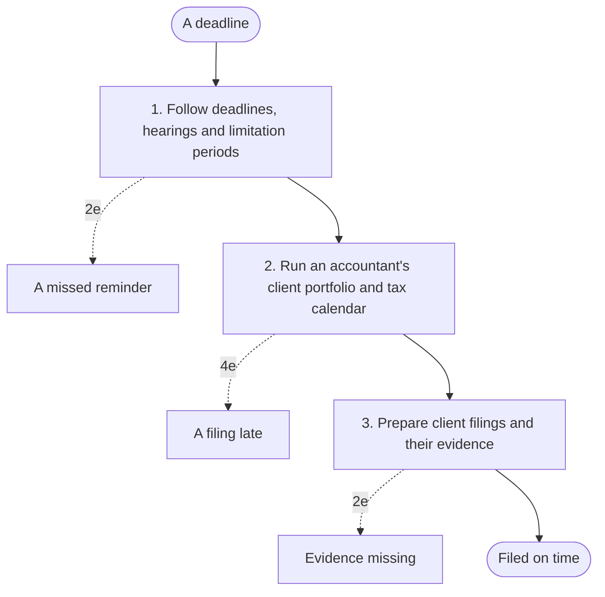

🏠 [Specs](../../../README.md) › 🏷️ [Sectors](../../README.md) › ⚖️ [SC11 Professional firms](../README.md) ›
🔀 [Flows](README.md) › 🔀 FL-SC11-04 Deadlines and filings

# 🔀 FL-SC11-04 Deadlines and filings

**Status:** ✅ specified

## Summary

Deadlines and accountants' filings. It covers
[UC-SC11-08 Follow deadlines, hearings and limitation periods](../use-cases/04-deadlines-and-filings/uc-sc11-08-follow-deadlines-hearings-and-limitation-periods.md),
[UC-SC11-11 Run an accountant's client portfolio and tax calendar](../use-cases/04-deadlines-and-filings/uc-sc11-11-run-an-accountant-s-client-portfolio-and-tax-calendar.md),
[UC-SC11-12 Prepare client filings and their evidence](../use-cases/04-deadlines-and-filings/uc-sc11-12-prepare-client-filings-and-their-evidence.md).

## Personas

- [U36 Professional](../../../01-users/personas/u36-professional.md)
- [U37 Professional's assistant](../../../01-users/personas/u37-assistant.md)

## Flowchart

## Sequence diagram

See each use case.

## Steps

| Step | Persona | Screen | Use case | What happens |
|---|---|---|---|---|
| 1 | U37, U36 | [S-SC11-08](../screens/04-deadlines-and-filings/s-sc11-08-deadlines.md) | [UC-SC11-08](../use-cases/04-deadlines-and-filings/uc-sc11-08-follow-deadlines-hearings-and-limitation-periods.md) | The professional's assistant enters deadlines, reminders go to their owner, a missed reminder escalates |
| 2 | U36, U37 | [S-SC11-11](../screens/04-deadlines-and-filings/s-sc11-11-client-portfolio.md) | [UC-SC11-11](../use-cases/04-deadlines-and-filings/uc-sc11-11-run-an-accountant-s-client-portfolio-and-tax-calendar.md) | The professional loads accounting clients and their assignments, builds each one's filing calendar and follows it |
| 3 | U36 | [S-SC11-12](../screens/04-deadlines-and-filings/s-sc11-12-filings.md) | [UC-SC11-12](../use-cases/04-deadlines-and-filings/uc-sc11-12-prepare-client-filings-and-their-evidence.md) | The professional prepares a client's filing with its evidence, reviews and files it |

### Entities and screens

| Entity | States in this flow | Shown at step and screen | Aggregated view |
|---|---|---|---|
| [E-SC11-09 Deadline](../data/e-sc11-09-deadline.md) | Open, Done | 1 [S-SC11-08](../screens/04-deadlines-and-filings/s-sc11-08-deadlines.md) | Deadlines |
| [E-T10-02 Notification](../../../03-technical/t10-translations-and-notifications/data/e-t10-02-notification.md) | Active | Shown elsewhere: [S-T10-02 Notification](../../../03-technical/t10-translations-and-notifications/screens/s-t10-02-notification.md), from the admin list [S-T10-L02](../../../03-technical/t10-translations-and-notifications/screens/00-lists/s-t10-l02-notifications.md) | Notifications |
| [E-SC11-11 Filing](../data/e-sc11-11-filing.md) | To do, Filed | 2 [S-SC11-11](../screens/04-deadlines-and-filings/s-sc11-11-client-portfolio.md); 3 [S-SC11-12](../screens/04-deadlines-and-filings/s-sc11-12-filings.md) | Filings |

## Errors

- [UC-SC11-08](../use-cases/04-deadlines-and-filings/uc-sc11-08-follow-deadlines-hearings-and-limitation-periods.md) 2e.
  A missed reminder: the partner is alerted.
- [UC-SC11-08](../use-cases/04-deadlines-and-filings/uc-sc11-08-follow-deadlines-hearings-and-limitation-periods.md) 1e.
  No owner: it is refused.
-
  [UC-SC11-11](../use-cases/04-deadlines-and-filings/uc-sc11-11-run-an-accountant-s-client-portfolio-and-tax-calendar.md)
  4e. A filing late: the owner and partner are alerted.
-
  [UC-SC11-11](../use-cases/04-deadlines-and-filings/uc-sc11-11-run-an-accountant-s-client-portfolio-and-tax-calendar.md)
  1e. An assignment without letter: it is flagged
  ([BR-SC11-11](../business-rules/br-sc11-11-engagement-letter-per-assignment.md)).
- [UC-SC11-12](../use-cases/04-deadlines-and-filings/uc-sc11-12-prepare-client-filings-and-their-evidence.md) 2e.
  Evidence missing: it is listed.
- [UC-SC11-12](../use-cases/04-deadlines-and-filings/uc-sc11-12-prepare-client-filings-and-their-evidence.md) 4e. Filing
  refused: the reason is shown.

## Images

Every step and error, for each persona taking part, in light and dark mode (D120). Steps are numbered as in the Steps
table; E rows are the error cases.

| Step | Persona | Device | Light | Dark |
|---|---|---|---|---|
| 1 | U37 | desktop | [light](../images/04-deadlines-and-filings/u37-assistant/1-deadlines-desktop-light.png) | [dark](../images/04-deadlines-and-filings/u37-assistant/1-deadlines-desktop-dark.png) |
| 1 | U36 | desktop | [light](../images/04-deadlines-and-filings/u36-professional/1-deadlines-desktop-light.png) | [dark](../images/04-deadlines-and-filings/u36-professional/1-deadlines-desktop-dark.png) |
| 1 | U36 | phone | [light](../images/04-deadlines-and-filings/u36-professional/1-deadlines-phone-light.png) | [dark](../images/04-deadlines-and-filings/u36-professional/1-deadlines-phone-dark.png) |
| 2 | U36 | desktop | [light](../images/04-deadlines-and-filings/u36-professional/2-portfolio-desktop-light.png) | [dark](../images/04-deadlines-and-filings/u36-professional/2-portfolio-desktop-dark.png) |
| 2 | U36 | phone | [light](../images/04-deadlines-and-filings/u36-professional/2-portfolio-phone-light.png) | [dark](../images/04-deadlines-and-filings/u36-professional/2-portfolio-phone-dark.png) |
| 2 | U37 | desktop | [light](../images/04-deadlines-and-filings/u37-assistant/2-portfolio-desktop-light.png) | [dark](../images/04-deadlines-and-filings/u37-assistant/2-portfolio-desktop-dark.png) |
| 3 | U36 | desktop | [light](../images/04-deadlines-and-filings/u36-professional/3-filing-desktop-light.png) | [dark](../images/04-deadlines-and-filings/u36-professional/3-filing-desktop-dark.png) |
| 3 | U36 | phone | [light](../images/04-deadlines-and-filings/u36-professional/3-filing-phone-light.png) | [dark](../images/04-deadlines-and-filings/u36-professional/3-filing-phone-dark.png) |
| E1 | U36 | desktop | [light](../images/04-deadlines-and-filings/u36-professional/e1-missed-reminder-desktop-light.png) | [dark](../images/04-deadlines-and-filings/u36-professional/e1-missed-reminder-desktop-dark.png) |
| E1 | U36 | phone | [light](../images/04-deadlines-and-filings/u36-professional/e1-missed-reminder-phone-light.png) | [dark](../images/04-deadlines-and-filings/u36-professional/e1-missed-reminder-phone-dark.png) |

## Open questions

None.

---

⬅️ [FL-SC11-03 Time and billing](fl-sc11-03-time-and-billing.md) · ⬆️ [Up](README.md) ·
➡️ [FL-SC11-05 Compliance and secrecy](fl-sc11-05-compliance-and-secrecy.md)
