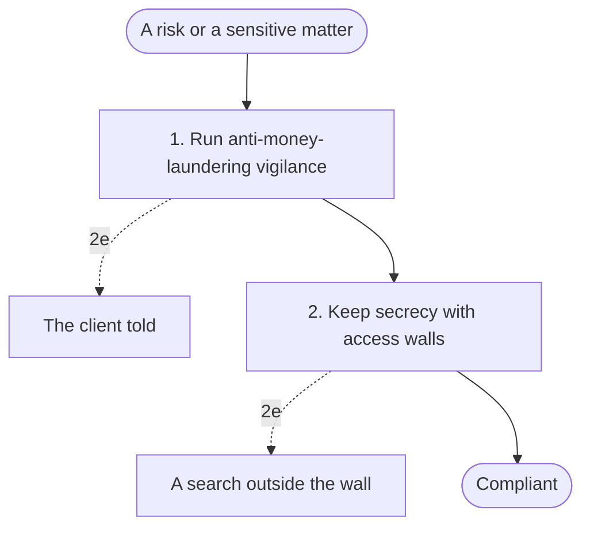

🏠 [Specs](../../../README.md) › 🏷️ [Sectors](../../README.md) › ⚖️ [SC11 Professional firms](../README.md) ›
🔀 [Flows](README.md) › 🔀 FL-SC11-05 Compliance and secrecy

# 🔀 FL-SC11-05 Compliance and secrecy

**Status:** ✅ specified

## Summary

Vigilance and secrecy. It covers
[UC-SC11-15 Run anti-money-laundering vigilance](../use-cases/05-compliance-and-secrecy/uc-sc11-15-run-anti-money-laundering-vigilance.md),
[UC-SC11-16 Keep secrecy with access walls](../use-cases/05-compliance-and-secrecy/uc-sc11-16-keep-secrecy-with-access-walls.md).

## Personas

- [U13 Owner](../../../01-users/personas/u13-owner.md)
- [U36 Professional](../../../01-users/personas/u36-professional.md)

## Flowchart

## Sequence diagram

See each use case.

## Steps

| Step | Persona | Screen | Use case | What happens |
|---|---|---|---|---|
| 1 | U36, U13 | [S-SC11-15](../screens/05-compliance-and-secrecy/s-sc11-15-vigilance.md) | [UC-SC11-15](../use-cases/05-compliance-and-secrecy/uc-sc11-15-run-anti-money-laundering-vigilance.md) | The professional reviews client risks, records a suspicion confidentially and reports it through the profession's channel, never telling the client |
| 2 | U13, U36 | [S-SC11-16](../screens/05-compliance-and-secrecy/s-sc11-16-access-walls.md) | [UC-SC11-16](../use-cases/05-compliance-and-secrecy/uc-sc11-16-keep-secrecy-with-access-walls.md) | The owner sets access walls on sensitive matters, checks who can see them and reviews logs |

### Entities and screens

| Entity | States in this flow | Shown at step and screen | Aggregated view |
|---|---|---|---|
| [E-SC11-05 Matter](../data/e-sc11-05-matter.md) | Open, Closed | Shown elsewhere: [S-SC11-04 Matters](../screens/02-matters-and-documents/s-sc11-04-matters.md) | Matters |
| [E-SC11-12 Vigilance record](../data/e-sc11-12-vigilance-record.md) | Recorded | 1 [S-SC11-15](../screens/05-compliance-and-secrecy/s-sc11-15-vigilance.md) | Vigilance records |
| [E-SC11-13 Access wall](../data/e-sc11-13-access-wall.md) | Active | 2 [S-SC11-16](../screens/05-compliance-and-secrecy/s-sc11-16-access-walls.md) | Access walls |

## Errors

- [UC-SC11-15](../use-cases/05-compliance-and-secrecy/uc-sc11-15-run-anti-money-laundering-vigilance.md) 2e. The client
  told: never: no client-facing message can mention it.
- [UC-SC11-15](../use-cases/05-compliance-and-secrecy/uc-sc11-15-run-anti-money-laundering-vigilance.md) 1e. Evidence
  outdated: it is asked again.
- [UC-SC11-16](../use-cases/05-compliance-and-secrecy/uc-sc11-16-keep-secrecy-with-access-walls.md) 2e. A search outside
  the wall: the matter is hidden.
- [UC-SC11-16](../use-cases/05-compliance-and-secrecy/uc-sc11-16-keep-secrecy-with-access-walls.md) 3e. An unexpected
  access: the owner is alerted.

## Images

Every step and error, for each persona taking part, in light and dark mode (D120). Steps are numbered as in the Steps
table; E rows are the error cases.

| Step | Persona | Device | Light | Dark |
|---|---|---|---|---|
| 1 | U13 | desktop | [light](../images/05-compliance-and-secrecy/u13-owner/1-vigilance-desktop-light.png) | [dark](../images/05-compliance-and-secrecy/u13-owner/1-vigilance-desktop-dark.png) |
| 1 | U13 | phone | [light](../images/05-compliance-and-secrecy/u13-owner/1-vigilance-phone-light.png) | [dark](../images/05-compliance-and-secrecy/u13-owner/1-vigilance-phone-dark.png) |
| 1 | U36 | desktop | [light](../images/05-compliance-and-secrecy/u36-professional/1-vigilance-desktop-light.png) | [dark](../images/05-compliance-and-secrecy/u36-professional/1-vigilance-desktop-dark.png) |
| 1 | U36 | phone | [light](../images/05-compliance-and-secrecy/u36-professional/1-vigilance-phone-light.png) | [dark](../images/05-compliance-and-secrecy/u36-professional/1-vigilance-phone-dark.png) |
| 2 | U13 | desktop | [light](../images/05-compliance-and-secrecy/u13-owner/2-walls-desktop-light.png) | [dark](../images/05-compliance-and-secrecy/u13-owner/2-walls-desktop-dark.png) |
| 2 | U13 | phone | [light](../images/05-compliance-and-secrecy/u13-owner/2-walls-phone-light.png) | [dark](../images/05-compliance-and-secrecy/u13-owner/2-walls-phone-dark.png) |
| 2 | U36 | desktop | [light](../images/05-compliance-and-secrecy/u36-professional/2-walls-desktop-light.png) | [dark](../images/05-compliance-and-secrecy/u36-professional/2-walls-desktop-dark.png) |
| 2 | U36 | phone | [light](../images/05-compliance-and-secrecy/u36-professional/2-walls-phone-light.png) | [dark](../images/05-compliance-and-secrecy/u36-professional/2-walls-phone-dark.png) |
| E1 | U36 | desktop | [light](../images/05-compliance-and-secrecy/u36-professional/e1-tell-client-desktop-light.png) | [dark](../images/05-compliance-and-secrecy/u36-professional/e1-tell-client-desktop-dark.png) |
| E1 | U36 | phone | [light](../images/05-compliance-and-secrecy/u36-professional/e1-tell-client-phone-light.png) | [dark](../images/05-compliance-and-secrecy/u36-professional/e1-tell-client-phone-dark.png) |

## Open questions

None.

---

⬅️ [FL-SC11-04 Deadlines and filings](fl-sc11-04-deadlines-and-filings.md) · ⬆️ [Up](README.md) ·
➡️ [FL-SC11-06 Firm management](fl-sc11-06-firm-management.md)
