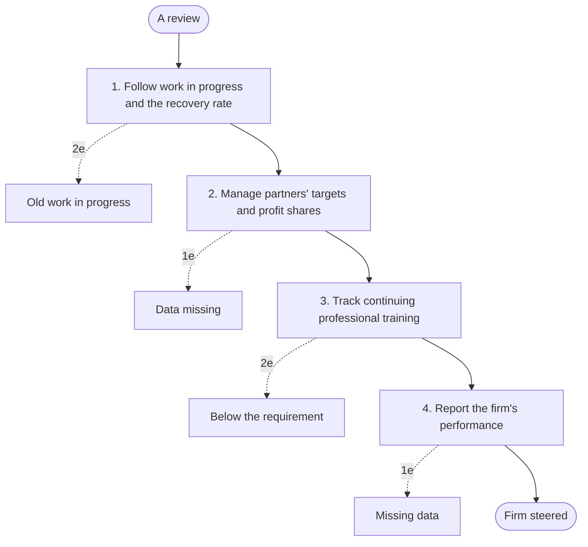

🏠 [Specs](../../../README.md) › 🏷️ [Sectors](../../README.md) › ⚖️ [SC11 Professional firms](../README.md) ›
🔀 [Flows](README.md) › 🔀 FL-SC11-06 Firm management

# 🔀 FL-SC11-06 Firm management

**Status:** ✅ specified

## Summary

Firm management: work in progress, partners, training, performance. It covers
[UC-SC11-14 Follow work in progress and the recovery rate](../use-cases/06-firm-management/uc-sc11-14-follow-work-in-progress-and-the-recovery-rate.md),
[UC-SC11-17 Manage partners' targets and profit shares](../use-cases/06-firm-management/uc-sc11-17-manage-partners-targets-and-profit-shares.md),
[UC-SC11-18 Track continuing professional training](../use-cases/06-firm-management/uc-sc11-18-track-continuing-professional-training.md),
[UC-SC11-19 Report the firm's performance](../use-cases/06-firm-management/uc-sc11-19-report-the-firm-s-performance.md).

## Personas

- [U05 Accounting](../../../01-users/personas/u05-accounting.md)
- [U13 Owner](../../../01-users/personas/u13-owner.md)
- [U36 Professional](../../../01-users/personas/u36-professional.md)

## Flowchart

## Sequence diagram

See each use case.

## Steps

| Step | Persona | Screen | Use case | What happens |
|---|---|---|---|---|
| 1 | U13, U36 | [S-SC11-14](../screens/06-firm-management/s-sc11-14-work-in-progress.md) | [UC-SC11-14](../use-cases/06-firm-management/uc-sc11-14-follow-work-in-progress-and-the-recovery-rate.md) | The owner and professionals follow unbilled time and the share of time value recovered |
| 2 | U13 | [S-SC11-17](../screens/06-firm-management/s-sc11-17-partners.md) | [UC-SC11-17](../use-cases/06-firm-management/uc-sc11-17-manage-partners-targets-and-profit-shares.md) | The owner sets partners' targets with the shared targets capability, follows them and shares the profit by the firm's key |
| 3 | U36 | [S-SC11-18](../screens/06-firm-management/s-sc11-18-training.md) | [UC-SC11-18](../use-cases/06-firm-management/uc-sc11-18-track-continuing-professional-training.md) | Professionals record training hours against the yearly requirement, reminders go below it |
| 4 | U13, U05 | [S-SC11-19](../screens/06-firm-management/s-sc11-19-performance.md) | [UC-SC11-19](../use-cases/06-firm-management/uc-sc11-19-report-the-firm-s-performance.md) | The owner and accounting follow fees, time, recovery and clients, compare and export |

### Entities and screens

| Entity | States in this flow | Shown at step and screen | Aggregated view |
|---|---|---|---|
| [E-SC11-06 Time entry](../data/e-sc11-06-time-entry.md) | Recorded | 1 [S-SC11-14](../screens/06-firm-management/s-sc11-14-work-in-progress.md) | Time entries |
| [E-SC11-14 Partner share](../data/e-sc11-14-partner-share.md) | Active | 2 [S-SC11-17](../screens/06-firm-management/s-sc11-17-partners.md); 4 [S-SC11-19](../screens/06-firm-management/s-sc11-19-performance.md) | Partner shares |
| [E-SC11-15 Training record](../data/e-sc11-15-training-record.md) | Recorded | 3 [S-SC11-18](../screens/06-firm-management/s-sc11-18-training.md) | Training records |

## Errors

- [UC-SC11-14](../use-cases/06-firm-management/uc-sc11-14-follow-work-in-progress-and-the-recovery-rate.md) 2e. Old work
  in progress: it alerts.
- [UC-SC11-14](../use-cases/06-firm-management/uc-sc11-14-follow-work-in-progress-and-the-recovery-rate.md) 1e. Time not
  submitted: it is shown apart.
- [UC-SC11-17](../use-cases/06-firm-management/uc-sc11-17-manage-partners-targets-and-profit-shares.md) 1e. Data
  missing: it is shown.
- [UC-SC11-17](../use-cases/06-firm-management/uc-sc11-17-manage-partners-targets-and-profit-shares.md) 3e. Shares not
  adding up: they are refused.
- [UC-SC11-18](../use-cases/06-firm-management/uc-sc11-18-track-continuing-professional-training.md) 2e. Below the
  requirement: a reminder is sent.
- [UC-SC11-18](../use-cases/06-firm-management/uc-sc11-18-track-continuing-professional-training.md) 1e. No certificate:
  hours are pending.
- [UC-SC11-19](../use-cases/06-firm-management/uc-sc11-19-report-the-firm-s-performance.md) 1e. Missing data: it is
  shown.
- [UC-SC11-19](../use-cases/06-firm-management/uc-sc11-19-report-the-firm-s-performance.md) 4e. A large export: it runs
  in the background.

## Images

Every step and error, for each persona taking part, in light and dark mode (D120). Steps are numbered as in the Steps
table; E rows are the error cases.

| Step | Persona | Device | Light | Dark |
|---|---|---|---|---|
| 1 | U13 | desktop | [light](../images/06-firm-management/u13-owner/1-wip-desktop-light.png) | [dark](../images/06-firm-management/u13-owner/1-wip-desktop-dark.png) |
| 1 | U13 | phone | [light](../images/06-firm-management/u13-owner/1-wip-phone-light.png) | [dark](../images/06-firm-management/u13-owner/1-wip-phone-dark.png) |
| 1 | U36 | desktop | [light](../images/06-firm-management/u36-professional/1-wip-desktop-light.png) | [dark](../images/06-firm-management/u36-professional/1-wip-desktop-dark.png) |
| 1 | U36 | phone | [light](../images/06-firm-management/u36-professional/1-wip-phone-light.png) | [dark](../images/06-firm-management/u36-professional/1-wip-phone-dark.png) |
| 2 | U13 | desktop | [light](../images/06-firm-management/u13-owner/2-partners-desktop-light.png) | [dark](../images/06-firm-management/u13-owner/2-partners-desktop-dark.png) |
| 2 | U13 | phone | [light](../images/06-firm-management/u13-owner/2-partners-phone-light.png) | [dark](../images/06-firm-management/u13-owner/2-partners-phone-dark.png) |
| 3 | U36 | desktop | [light](../images/06-firm-management/u36-professional/3-training-desktop-light.png) | [dark](../images/06-firm-management/u36-professional/3-training-desktop-dark.png) |
| 3 | U36 | phone | [light](../images/06-firm-management/u36-professional/3-training-phone-light.png) | [dark](../images/06-firm-management/u36-professional/3-training-phone-dark.png) |
| 4 | U13 | desktop | [light](../images/06-firm-management/u13-owner/4-performance-desktop-light.png) | [dark](../images/06-firm-management/u13-owner/4-performance-desktop-dark.png) |
| 4 | U13 | phone | [light](../images/06-firm-management/u13-owner/4-performance-phone-light.png) | [dark](../images/06-firm-management/u13-owner/4-performance-phone-dark.png) |
| 4 | U05 | desktop | [light](../images/06-firm-management/u05-accounting/4-performance-desktop-light.png) | [dark](../images/06-firm-management/u05-accounting/4-performance-desktop-dark.png) |
| E1 | U13 | desktop | [light](../images/06-firm-management/u13-owner/e1-old-wip-desktop-light.png) | [dark](../images/06-firm-management/u13-owner/e1-old-wip-desktop-dark.png) |
| E1 | U13 | phone | [light](../images/06-firm-management/u13-owner/e1-old-wip-phone-light.png) | [dark](../images/06-firm-management/u13-owner/e1-old-wip-phone-dark.png) |

## Open questions

None.

---

⬅️ [FL-SC11-05 Compliance and secrecy](fl-sc11-05-compliance-and-secrecy.md) · ⬆️ [Up](README.md) ·
➡️ [FL-SC11-07](fl-sc11-07-notaries-brokers-officers-and-auditors.md)
