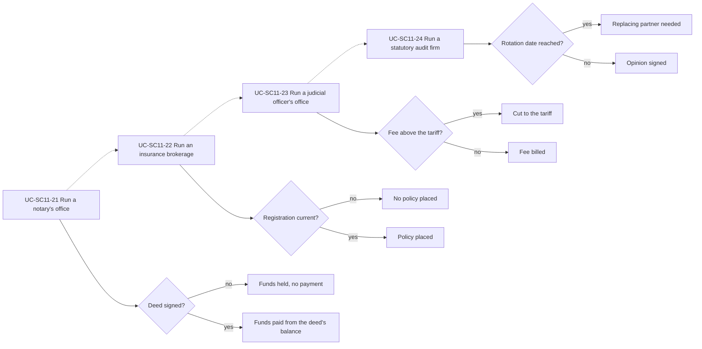
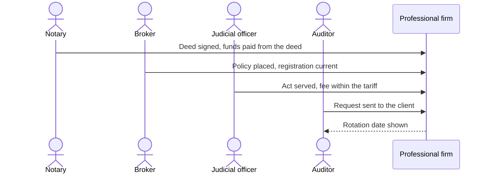

🏠 [Specs](../../../README.md) › 🏷️ [Sectors](../../README.md) › ⚖️ [SC11 Professional firms](../README.md) ›
🔀 [Flows](README.md) › 🔀 FL-SC11-07 Notaries, brokers, judicial officers and audit firms

# 🔀 FL-SC11-07 Notaries, brokers, judicial officers and audit firms

**Status:** ✅ specified

## Summary

Four regulated professions that the firm suites handle: a notary's office with the clients' funds at the state deposit
bank, an insurance brokerage with its registration, a judicial officer's office with the regulated tariff, and a
statutory audit firm with the rotation of the signing partner
([D555](../../../06-decisions/sectors/d555-benchmark-gaps-sc11-professional-firms.md)).

## Personas

- [U36 Professional](../../../01-users/personas/u36-professional.md), who signs, places, serves and runs the mandate
- [U37 Professional's assistant](../../../01-users/personas/u37-assistant.md), who prepares the documents of the deeds
  and acts
- [U09 Customer](../../../01-users/personas/u09-customer.md), who reads their policies
- [U49 Statutory auditor](../../../01-users/personas/u49-statutory-auditor.md), who works on the audit and sends the
  requests

## Flowchart

## Sequence diagram

## Steps

| Step | Persona | Screen | Use case | What happens |
|---|---|---|---|---|
| 1 | [U36](../../../01-users/personas/u36-professional.md) | [S-SC11-21](../screens/07-notaries-brokers-officers-and-auditors/s-sc11-21-notary.md) | [UC-SC11-21](../use-cases/07-notaries-brokers-officers-and-auditors/uc-sc11-21-run-a-notarys-office.md) | The notary opens a deed, the professional's assistant collects the documents and the funds are held at the state deposit bank until the signature |
| 2 | [U36](../../../01-users/personas/u36-professional.md) | [S-SC11-22](../screens/07-notaries-brokers-officers-and-auditors/s-sc11-22-brokerage.md) | [UC-SC11-22](../use-cases/07-notaries-brokers-officers-and-auditors/uc-sc11-22-run-an-insurance-brokerage.md) | The broker compares offers, the registration is checked and the client reads the policy on the phone |
| 3 | [U36](../../../01-users/personas/u36-professional.md) | [S-SC11-23](../screens/07-notaries-brokers-officers-and-auditors/s-sc11-23-judicial-officer.md) | [UC-SC11-23](../use-cases/07-notaries-brokers-officers-and-auditors/uc-sc11-23-run-a-judicial-officers-office.md) | The judicial officer serves the act and the fee is billed within the regulated tariff |
| 4 | [U49](../../../01-users/personas/u49-statutory-auditor.md) | [S-SC11-24](../screens/07-notaries-brokers-officers-and-auditors/s-sc11-24-audit-firm.md) | [UC-SC11-24](../use-cases/07-notaries-brokers-officers-and-auditors/uc-sc11-24-run-a-statutory-audit-firm.md) | The partner opens the audit engagement and the auditor sends the requests while the rotation date is followed |

### Entities and screens

| Entity | States in this flow | Shown at step and screen | Aggregated view |
|---|---|---|---|
| [E-SC11-16 Deed](../data/e-sc11-16-deed.md) | Preparing, Ready to sign, Signed, Closed, Cancelled | 1 [S-SC11-21](../screens/07-notaries-brokers-officers-and-auditors/s-sc11-21-notary.md) | Deeds |
| [E-SC11-17 Policy](../data/e-sc11-17-policy.md) | Quoted, Active, Renewal due, Cancelled | 2 [S-SC11-22](../screens/07-notaries-brokers-officers-and-auditors/s-sc11-22-brokerage.md) | Policies |
| [E-SC11-18 Service act](../data/e-sc11-18-service-act.md) | Requested, Served, Billed, Cancelled | 3 [S-SC11-23](../screens/07-notaries-brokers-officers-and-auditors/s-sc11-23-judicial-officer.md) | Service acts |
| [E-SC11-19 Audit engagement](../data/e-sc11-19-audit-engagement.md) | Proposed, Active, Rotation due, Ended | 4 [S-SC11-24](../screens/07-notaries-brokers-officers-and-auditors/s-sc11-24-audit-firm.md) | Audit engagements |

## Errors

- **E1 The rotation is due.** The signing partner has reached the rotation date; a new opinion cannot be signed by them
  and a replacing partner is asked for
  ([BR-SC11-19](../business-rules/br-sc11-19-partners-rotate-as-the-law-requires.md), step 4).

## Images

Every step and error, for each persona taking part, in light and dark mode (D120). Steps are numbered as in the Steps
table; E rows are the error cases.

| Step | Persona | Device | Light | Dark |
|---|---|---|---|---|
| 1 | U36 | desktop | [light](../images/07-notaries-brokers-officers-and-auditors/u36-professional/1-notary-desktop-light.png) | [dark](../images/07-notaries-brokers-officers-and-auditors/u36-professional/1-notary-desktop-dark.png) |
| 1 | U37 | desktop | [light](../images/07-notaries-brokers-officers-and-auditors/u37-assistant/1-notary-desktop-light.png) | [dark](../images/07-notaries-brokers-officers-and-auditors/u37-assistant/1-notary-desktop-dark.png) |
| 1 | U36 | phone | [light](../images/07-notaries-brokers-officers-and-auditors/u36-professional/1-notary-phone-light.png) | [dark](../images/07-notaries-brokers-officers-and-auditors/u36-professional/1-notary-phone-dark.png) |
| 2 | U36 | desktop | [light](../images/07-notaries-brokers-officers-and-auditors/u36-professional/2-brokerage-desktop-light.png) | [dark](../images/07-notaries-brokers-officers-and-auditors/u36-professional/2-brokerage-desktop-dark.png) |
| 2 | U09 | phone | [light](../images/07-notaries-brokers-officers-and-auditors/u09-customer/2-brokerage-phone-light.png) | [dark](../images/07-notaries-brokers-officers-and-auditors/u09-customer/2-brokerage-phone-dark.png) |
| 2 | U36 | phone | [light](../images/07-notaries-brokers-officers-and-auditors/u36-professional/2-brokerage-phone-light.png) | [dark](../images/07-notaries-brokers-officers-and-auditors/u36-professional/2-brokerage-phone-dark.png) |
| 3 | U36 | desktop | [light](../images/07-notaries-brokers-officers-and-auditors/u36-professional/3-judicial-officer-desktop-light.png) | [dark](../images/07-notaries-brokers-officers-and-auditors/u36-professional/3-judicial-officer-desktop-dark.png) |
| 3 | U37 | desktop | [light](../images/07-notaries-brokers-officers-and-auditors/u37-assistant/3-judicial-officer-desktop-light.png) | [dark](../images/07-notaries-brokers-officers-and-auditors/u37-assistant/3-judicial-officer-desktop-dark.png) |
| 3 | U36 | phone | [light](../images/07-notaries-brokers-officers-and-auditors/u36-professional/3-judicial-officer-phone-light.png) | [dark](../images/07-notaries-brokers-officers-and-auditors/u36-professional/3-judicial-officer-phone-dark.png) |
| 4 | U49 | desktop | [light](../images/07-notaries-brokers-officers-and-auditors/u49-statutory-auditor/4-audit-firm-desktop-light.png) | [dark](../images/07-notaries-brokers-officers-and-auditors/u49-statutory-auditor/4-audit-firm-desktop-dark.png) |
| 4 | U36 | desktop | [light](../images/07-notaries-brokers-officers-and-auditors/u36-professional/4-audit-firm-desktop-light.png) | [dark](../images/07-notaries-brokers-officers-and-auditors/u36-professional/4-audit-firm-desktop-dark.png) |
| E1 | U36 | desktop | [light](../images/07-notaries-brokers-officers-and-auditors/u36-professional/e1-the-rotation-is-due-desktop-light.png) | [dark](../images/07-notaries-brokers-officers-and-auditors/u36-professional/e1-the-rotation-is-due-desktop-dark.png) |
| E1 | U36 | phone | [light](../images/07-notaries-brokers-officers-and-auditors/u36-professional/e1-the-rotation-is-due-phone-light.png) | [dark](../images/07-notaries-brokers-officers-and-auditors/u36-professional/e1-the-rotation-is-due-phone-dark.png) |

## Open questions

None.

---

⬅️ [FL-SC11-06 Firm management](fl-sc11-06-firm-management.md) · ⬆️ [Up](README.md)
