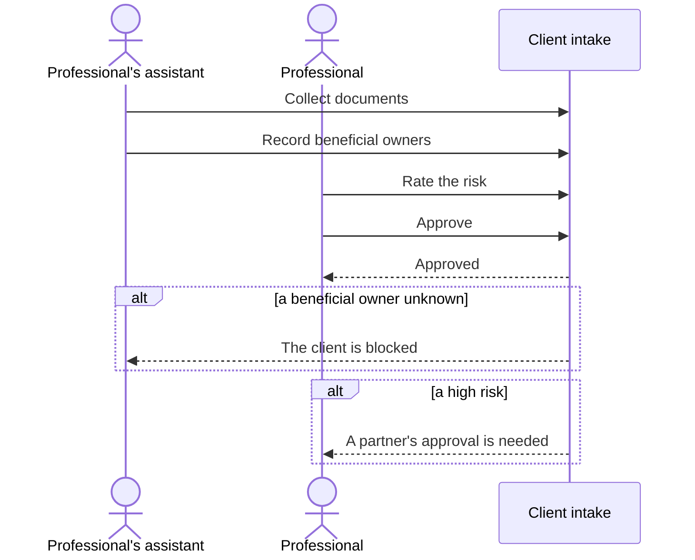

🏠 [Specs](../../../../README.md) › 🏷️ [Sectors](../../../README.md) › ⚖️ [SC11 Professional firms](../../README.md) ›
📝 [Use cases](../README.md) › 📝 [Use cases: FL-SC11-01 Client intake](README.md) ›
📝 UC-SC11-01 Open a client file and check identity

# 📝 UC-SC11-01 Open a client file and check identity

**Status:** ✅ specified

## Summary

The professional's assistant collects a new client's identity documents and beneficial owners; the professional rates
the risk and approves the client before any work.

## Personas

- [U37 Professional's assistant](../../../../01-users/personas/u37-assistant.md)
- [U36 Professional](../../../../01-users/personas/u36-professional.md)

## Goal

No work for a client whose identity and risk are not checked.

## Trigger

A new client.

## Frequency

A few a week.

## Preconditions

- The SC11 sector pack is installed for the company,
  [UC-F14-02](../../../../02-functional/f14-plugin-store/use-cases/01-find-and-install/uc-f14-02-install-a-plugin-or-sector-pack.md),
  and its users have their roles,
  [UC-F1-06](../../../../02-functional/f01-administration/use-cases/04-edit-a-role/uc-f01-06-edit-a-role-and-its-record-rules.md).

## Postconditions

- **Success:** the client is approved with its evidence kept.
- **Failed:** the client stays blocked.

## Main flow

1. The professional's assistant collects identity documents on
   [S-SC11-01 Client intake](../../screens/01-client-intake/s-sc11-01-client-intake.md).
2. The professional's assistant records owners and their shares.
3. The professional rates the risk ([BR-SC11-02](../../business-rules/br-sc11-02-identity-checked-before-work.md)).
4. The professional approves the client.

## Alternative flows

- 2a. A company client: its register extract and owners above the threshold are asked.

## Error flows

- 2e. A beneficial owner unknown: the client is blocked.
- 3e. A high risk: a partner's approval is needed.
- Any step: a call to a service or an outside system fails: it is retried first
  ([BR-F3-32](../../../../02-functional/f03-assistant/business-rules/br-f03-32-retry-before-an-error.md)), then the
  error message pattern ([D122](../../../../06-decisions/ux/d122-error-message-standard.md)) says what failed; what was
  typed is kept.

## Business rules

- [BR-SC11-02 Identity checked before work](../../business-rules/br-sc11-02-identity-checked-before-work.md)

## Entities

- [E-SC11-01 Client identity](../../data/e-sc11-01-client-identity.md)
- [E-SC11-02 Beneficial owner](../../data/e-sc11-02-beneficial-owner.md)

## Permissions

The professional's assistant and professional roles; the record rules of their role and site apply,
[UC-F1-06](../../../../02-functional/f01-administration/use-cases/04-edit-a-role/uc-f01-06-edit-a-role-and-its-record-rules.md).

## Notifications

None beyond the in-app updates of the records concerned.

## Audit events

Every creation, change and state change of client identity, beneficial owner records, with who, when and the values
before and after (T3).

## AI involvement

The AI assistant answers questions on the client identity, beneficial owner records of this use case, with links, and
prepares them as drafts the user confirms. It works within the user's rights,
[BR-F3-34](../../../../02-functional/f03-assistant/business-rules/br-f03-34-every-capability-is-reachable-from-the-assistant.md),
and never deletes or does anything irreversible without the user's confirmation,
[BR-F3-07](../../../../02-functional/f03-assistant/business-rules/br-f03-07-no-deletes-no-irreversible-acts.md).

## API, MCP and A2A exposure

Through the API and webhooks (T5) and the MCP and A2A gateway (T6), with the caller's rights,
[BR-F3-34](../../../../02-functional/f03-assistant/business-rules/br-f03-34-every-capability-is-reachable-from-the-assistant.md),
reading, creating and changing the records of this use case; nothing irreversible without a person's confirmation.

## Screens

- [S-SC11-01 Client intake](../../screens/01-client-intake/s-sc11-01-client-intake.md)

## Flowchart

See [FL-SC11-01 Client intake](../../flows/fl-sc11-01-client-intake.md#flowchart).

## Sequence diagram

## Acceptance criteria

1. **Given** the example firm's Acme SA with M. K. owning 60 % and a high risk **when** a partner approves **then** Acme
   SA is approved with its evidence.
2. **Given** Acme SA with no owner known **when** the professional approves **then** the client is blocked.

## Non-functional notes

[D408](../../../../06-decisions/technical/d408-performance-and-profiles.md)'s targets
([performance](../../../../05-non-functional/performance.md)): 95 % of screens within 1 second; lists paged on the
server, the first page within 1 second; reports within 5 seconds or in the background. WCAG 2.2 AA and RGAA
([D46](../../../../06-decisions/ux/d46-accessibility-standard.md)).

## Regulatory references

Legal values from the France country pack:
[CR-FR-149 Anti-money-laundering vigilance](../../../../10-country-packs/france/professional-firms/cr-fr-149-aml-vigilance.md).

## Related use cases

- [UC-SC11-02 Check conflicts of interest](uc-sc11-02-check-conflicts-of-interest.md)

## Open questions

None.

---

⬆️ [Up](README.md) · ➡️ [UC-SC11-02 Check conflicts of interest](uc-sc11-02-check-conflicts-of-interest.md)
