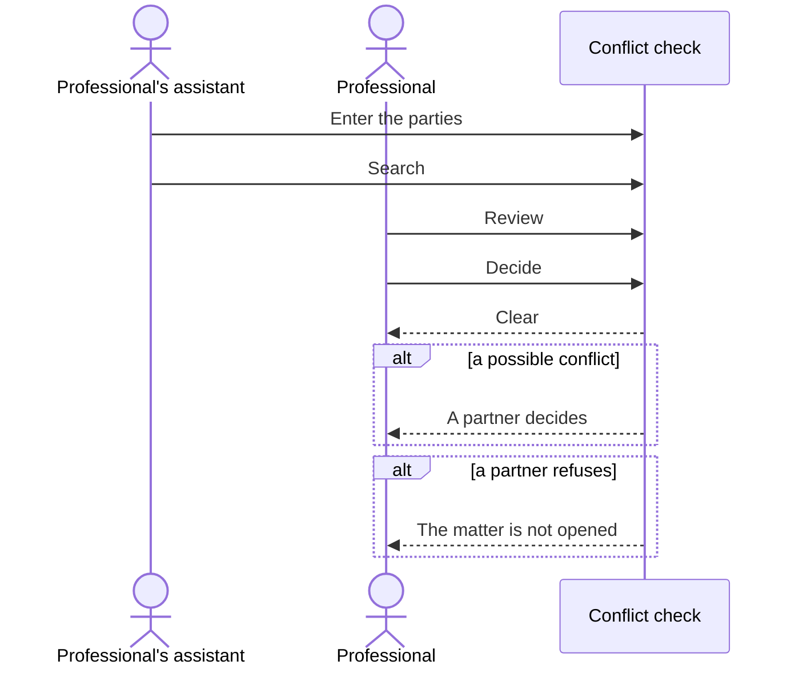

🏠 [Specs](../../../../README.md) › 🏷️ [Sectors](../../../README.md) › ⚖️ [SC11 Professional firms](../../README.md) ›
📝 [Use cases](../README.md) › 📝 [Use cases: FL-SC11-01 Client intake](README.md) ›
📝 UC-SC11-02 Check conflicts of interest

# 📝 UC-SC11-02 Check conflicts of interest

**Status:** ✅ specified

## Summary

The professional's assistant enters the parties of a new matter; SimpleERP searches all clients and opposing parties; a
partner decides on a possible conflict.

## Personas

- [U37 Professional's assistant](../../../../01-users/personas/u37-assistant.md)
- [U36 Professional](../../../../01-users/personas/u36-professional.md)

## Goal

No matter opened against an existing client.

## Trigger

A new matter.

## Frequency

Per matter.

## Preconditions

- The SC11 sector pack is installed for the company,
  [UC-F14-02](../../../../02-functional/f14-plugin-store/use-cases/01-find-and-install/uc-f14-02-install-a-plugin-or-sector-pack.md),
  and its users have their roles,
  [UC-F1-06](../../../../02-functional/f01-administration/use-cases/04-edit-a-role/uc-f01-06-edit-a-role-and-its-record-rules.md).

## Postconditions

- **Success:** the check is clear or decided.
- **Failed:** the matter is refused.

## Main flow

1. The professional's assistant enters parties on
   [S-SC11-02 Conflict check](../../screens/01-client-intake/s-sc11-02-conflict-check.md).
2. SimpleERP searches clients and parties
   ([BR-SC11-03](../../business-rules/br-sc11-03-conflicts-checked-before-opening.md)).
3. The professional reviews hits.
4. The result is recorded.

## Alternative flows

- 2a. A group of companies: related companies are searched too.

## Error flows

- 3e. A possible conflict: a partner decides.
- 4e. A partner refuses: the matter is not opened.
- Any step: a call to a service or an outside system fails: it is retried first
  ([BR-F3-32](../../../../02-functional/f03-assistant/business-rules/br-f03-32-retry-before-an-error.md)), then the
  error message pattern ([D122](../../../../06-decisions/ux/d122-error-message-standard.md)) says what failed; what was
  typed is kept.

## Business rules

- [BR-SC11-03 Conflicts checked before opening](../../business-rules/br-sc11-03-conflicts-checked-before-opening.md)

## Entities

- [E-SC11-03 Conflict check](../../data/e-sc11-03-conflict-check.md)

## Permissions

The professional's assistant and professional roles; the record rules of their role and site apply,
[UC-F1-06](../../../../02-functional/f01-administration/use-cases/04-edit-a-role/uc-f01-06-edit-a-role-and-its-record-rules.md).

## Notifications

None beyond the in-app updates of the records concerned.

## Audit events

Every creation, change and state change of conflict check records, with who, when and the values before and after (T3).

## AI involvement

The AI assistant answers questions on the conflict check records of this use case, with links, and prepares them as
drafts the user confirms. It works within the user's rights,
[BR-F3-34](../../../../02-functional/f03-assistant/business-rules/br-f03-34-every-capability-is-reachable-from-the-assistant.md),
and never deletes or does anything irreversible without the user's confirmation,
[BR-F3-07](../../../../02-functional/f03-assistant/business-rules/br-f03-07-no-deletes-no-irreversible-acts.md).

## API, MCP and A2A exposure

Through the API and webhooks (T5) and the MCP and A2A gateway (T6), with the caller's rights,
[BR-F3-34](../../../../02-functional/f03-assistant/business-rules/br-f03-34-every-capability-is-reachable-from-the-assistant.md),
reading, creating and changing the records of this use case; nothing irreversible without a person's confirmation.

## Screens

- [S-SC11-02 Conflict check](../../screens/01-client-intake/s-sc11-02-conflict-check.md)

## Flowchart

See [FL-SC11-01 Client intake](../../flows/fl-sc11-01-client-intake.md#flowchart).

## Sequence diagram

## Acceptance criteria

1. **Given** the example firm's matter M-221 for Acme against Beta **when** the search finds nothing **then** the check
   is clear.
2. **Given** Beta, opposing party, also a former client **when** the search runs **then** a partner decides.

## Non-functional notes

[D408](../../../../06-decisions/technical/d408-performance-and-profiles.md)'s targets
([performance](../../../../05-non-functional/performance.md)): 95 % of screens within 1 second; lists paged on the
server, the first page within 1 second; reports within 5 seconds or in the background. WCAG 2.2 AA and RGAA
([D46](../../../../06-decisions/ux/d46-accessibility-standard.md)).

## Regulatory references

None specific to this use case; the sector's legal rules are listed in [SC11 regulatory](../../regulatory.md).

## Related use cases

- [UC-SC11-03 Sign the engagement letter and fee agreement](uc-sc11-03-sign-the-engagement-letter-and-fee-agreement.md)

## Open questions

None.

---

⬅️ [UC-SC11-01 Open a client file and check identity](uc-sc11-01-open-a-client-file-and-check-identity.md) ·
⬆️ [Up](README.md) · ➡️ [UC-SC11-03](uc-sc11-03-sign-the-engagement-letter-and-fee-agreement.md)
