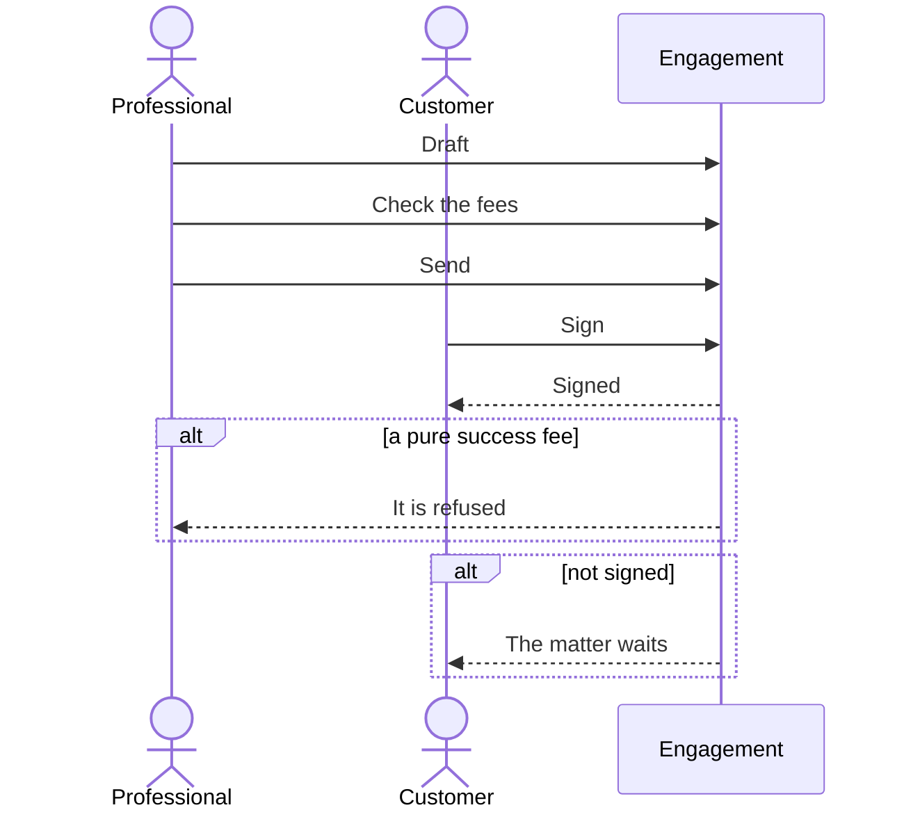

🏠 [Specs](../../../../README.md) › 🏷️ [Sectors](../../../README.md) › ⚖️ [SC11 Professional firms](../../README.md) ›
📝 [Use cases](../README.md) › 📝 [Use cases: FL-SC11-01 Client intake](README.md) ›
📝 UC-SC11-03 Sign the engagement letter and fee agreement

# 📝 UC-SC11-03 Sign the engagement letter and fee agreement

**Status:** ✅ specified

## Summary

The professional drafts the engagement letter and fee agreement, sends them and has the client sign before work.

## Personas

- [U36 Professional](../../../../01-users/personas/u36-professional.md)
- [U09 Customer](../../../../01-users/personas/u09-customer.md)

## Goal

Fees agreed in writing before work.

## Trigger

A cleared matter.

## Frequency

Per matter.

## Preconditions

- The SC11 sector pack is installed for the company,
  [UC-F14-02](../../../../02-functional/f14-plugin-store/use-cases/01-find-and-install/uc-f14-02-install-a-plugin-or-sector-pack.md),
  and its users have their roles,
  [UC-F1-06](../../../../02-functional/f01-administration/use-cases/04-edit-a-role/uc-f01-06-edit-a-role-and-its-record-rules.md).

## Postconditions

- **Success:** the letter is signed.
- **Failed:** the matter cannot open.

## Main flow

1. The professional drafts on [S-SC11-03 Engagement](../../screens/01-client-intake/s-sc11-03-engagement.md).
2. SimpleERP checks the fee terms ([BR-SC11-04](../../business-rules/br-sc11-04-fees-agreed-in-writing.md)).
3. It is sent for e-signature,
   [UC-F2-14](../../../../02-functional/f02-no-code-configuration/use-cases/07-benchmark-additions/uc-f02-14-send-documents-for-e-signature.md).
4. The client signs.

## Alternative flows

- 1a. A legal aid case: the fees follow legal aid.

## Error flows

- 2e. A pure success fee: it is refused.
- 4e. Not signed: the matter waits.
- Any step: a call to a service or an outside system fails: it is retried first
  ([BR-F3-32](../../../../02-functional/f03-assistant/business-rules/br-f03-32-retry-before-an-error.md)), then the
  error message pattern ([D122](../../../../06-decisions/ux/d122-error-message-standard.md)) says what failed; what was
  typed is kept.

## Business rules

- [BR-SC11-04 Fees agreed in writing](../../business-rules/br-sc11-04-fees-agreed-in-writing.md)
- [BR-SC11-11 An engagement letter per assignment](../../business-rules/br-sc11-11-engagement-letter-per-assignment.md)

## Entities

- [E-SC11-04 Engagement letter](../../data/e-sc11-04-engagement-letter.md)

## Permissions

The professional and customer roles; the record rules of their role and site apply,
[UC-F1-06](../../../../02-functional/f01-administration/use-cases/04-edit-a-role/uc-f01-06-edit-a-role-and-its-record-rules.md).

## Notifications

None beyond the in-app updates of the records concerned.

## Audit events

Every creation, change and state change of engagement letter records, with who, when and the values before and after
(T3).

## AI involvement

The AI assistant answers questions on the engagement letter records of this use case, with links, and prepares them as
drafts the user confirms. It works within the user's rights,
[BR-F3-34](../../../../02-functional/f03-assistant/business-rules/br-f03-34-every-capability-is-reachable-from-the-assistant.md),
and never deletes or does anything irreversible without the user's confirmation,
[BR-F3-07](../../../../02-functional/f03-assistant/business-rules/br-f03-07-no-deletes-no-irreversible-acts.md).

## API, MCP and A2A exposure

Through the API and webhooks (T5) and the MCP and A2A gateway (T6), with the caller's rights,
[BR-F3-34](../../../../02-functional/f03-assistant/business-rules/br-f03-34-every-capability-is-reachable-from-the-assistant.md),
reading, creating and changing the records of this use case; nothing irreversible without a person's confirmation.

## Screens

- [S-SC11-03 Engagement](../../screens/01-client-intake/s-sc11-03-engagement.md)

## Flowchart

See [FL-SC11-01 Client intake](../../flows/fl-sc11-01-client-intake.md#flowchart).

## Sequence diagram

## Acceptance criteria

1. **Given** the example firm's letter for Acme on M-221 at 250 EUR an hour **when** it is signed on 3 November **then**
   the matter can open.
2. **Given** fees of 20 % of the result only **when** the draft is checked **then** it is refused.

## Non-functional notes

[D408](../../../../06-decisions/technical/d408-performance-and-profiles.md)'s targets
([performance](../../../../05-non-functional/performance.md)): 95 % of screens within 1 second; lists paged on the
server, the first page within 1 second; reports within 5 seconds or in the background. WCAG 2.2 AA and RGAA
([D46](../../../../06-decisions/ux/d46-accessibility-standard.md)).

## Regulatory references

Legal values from the France country pack:
[CR-FR-150 Lawyers' fee agreement](../../../../10-country-packs/france/professional-firms/cr-fr-150-lawyer-fee-agreement.md),
[CR-FR-152 Chartered accountants' engagement letter](../../../../10-country-packs/france/professional-firms/cr-fr-152-accountant-engagement-letter.md).

## Related use cases

- [UC-SC11-04 Open and organise matters](../02-matters-and-documents/uc-sc11-04-open-and-organise-matters.md)

## Open questions

None.

---

⬅️ [UC-SC11-02 Check conflicts of interest](uc-sc11-02-check-conflicts-of-interest.md) · ⬆️ [Up](README.md) ·
➡️ [UC-SC11-04 Open and organise matters](../02-matters-and-documents/uc-sc11-04-open-and-organise-matters.md)
