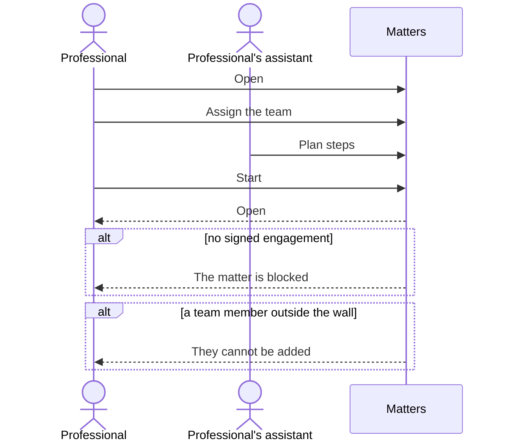

🏠 [Specs](../../../../README.md) › 🏷️ [Sectors](../../../README.md) › ⚖️ [SC11 Professional firms](../../README.md) ›
📝 [Use cases](../README.md) › 📝 [Use cases: FL-SC11-02 Matters and documents](README.md) ›
📝 UC-SC11-04 Open and organise matters

# 📝 UC-SC11-04 Open and organise matters

**Status:** ✅ specified

## Summary

The professional opens the matter with its team, parties and steps; only the team sees it.

## Personas

- [U36 Professional](../../../../01-users/personas/u36-professional.md)
- [U37 Professional's assistant](../../../../01-users/personas/u37-assistant.md)

## Goal

Matters organised and seen only by their team.

## Trigger

A signed engagement.

## Frequency

Per matter.

## Preconditions

- The SC11 sector pack is installed for the company,
  [UC-F14-02](../../../../02-functional/f14-plugin-store/use-cases/01-find-and-install/uc-f14-02-install-a-plugin-or-sector-pack.md),
  and its users have their roles,
  [UC-F1-06](../../../../02-functional/f01-administration/use-cases/04-edit-a-role/uc-f01-06-edit-a-role-and-its-record-rules.md).

## Postconditions

- **Success:** the matter is open.
- **Failed:** the matter is blocked.

## Main flow

1. The professional opens the matter on
   [S-SC11-04 Matters](../../screens/02-matters-and-documents/s-sc11-04-matters.md).
2. The team is set ([BR-SC11-06](../../business-rules/br-sc11-06-secrecy-and-access-walls.md)).
3. The professional's assistant plans steps and deadlines,
   [UC-SC11-08](../04-deadlines-and-filings/uc-sc11-08-follow-deadlines-hearings-and-limitation-periods.md).
4. The matter is open.

## Alternative flows

- 1a. A matter template: steps come from the template.

## Error flows

- 1e. No signed engagement: the matter is blocked.
- 2e. A team member outside the wall: they cannot be added.
- Any step: a call to a service or an outside system fails: it is retried first
  ([BR-F3-32](../../../../02-functional/f03-assistant/business-rules/br-f03-32-retry-before-an-error.md)), then the
  error message pattern ([D122](../../../../06-decisions/ux/d122-error-message-standard.md)) says what failed; what was
  typed is kept.

## Business rules

- [BR-SC11-06 Secrecy and access walls](../../business-rules/br-sc11-06-secrecy-and-access-walls.md)

## Entities

- [E-SC11-05 Matter](../../data/e-sc11-05-matter.md)

## Permissions

The professional and assistant roles; the record rules of their role and site apply,
[UC-F1-06](../../../../02-functional/f01-administration/use-cases/04-edit-a-role/uc-f01-06-edit-a-role-and-its-record-rules.md).

## Notifications

None beyond the in-app updates of the records concerned.

## Audit events

Every creation, change and state change of matter records, with who, when and the values before and after (T3).

## AI involvement

The AI assistant answers questions on the matter records of this use case, with links, and prepares them as drafts the
user confirms. It works within the user's rights,
[BR-F3-34](../../../../02-functional/f03-assistant/business-rules/br-f03-34-every-capability-is-reachable-from-the-assistant.md),
and never deletes or does anything irreversible without the user's confirmation,
[BR-F3-07](../../../../02-functional/f03-assistant/business-rules/br-f03-07-no-deletes-no-irreversible-acts.md).

## API, MCP and A2A exposure

Through the API and webhooks (T5) and the MCP and A2A gateway (T6), with the caller's rights,
[BR-F3-34](../../../../02-functional/f03-assistant/business-rules/br-f03-34-every-capability-is-reachable-from-the-assistant.md),
reading, creating and changing the records of this use case; nothing irreversible without a person's confirmation.

## Screens

- [S-SC11-04 Matters](../../screens/02-matters-and-documents/s-sc11-04-matters.md)

## Flowchart

See [FL-SC11-02 Matters and documents](../../flows/fl-sc11-02-matters-and-documents.md#flowchart).

## Sequence diagram

## Acceptance criteria

1. **Given** the example firm's M-221 for Acme with a team of 3 and a wall **when** it opens **then** only the 3 see it.
2. **Given** M-221 without letter **when** it is opened **then** the matter is blocked.

## Non-functional notes

[D408](../../../../06-decisions/technical/d408-performance-and-profiles.md)'s targets
([performance](../../../../05-non-functional/performance.md)): 95 % of screens within 1 second; lists paged on the
server, the first page within 1 second; reports within 5 seconds or in the background. WCAG 2.2 AA and RGAA
([D46](../../../../06-decisions/ux/d46-accessibility-standard.md)).

## Regulatory references

Legal values from the France country pack:
[CR-FR-154 Lawyers' professional secrecy](../../../../10-country-packs/france/professional-firms/cr-fr-154-lawyer-secrecy.md).

## Related use cases

- [UC-SC11-09 Manage documents with versions and e-signature](uc-sc11-09-manage-documents-with-versions-and-e-signature.md)

## Open questions

None.

---

⬅️ [UC-SC11-03](../01-client-intake/uc-sc11-03-sign-the-engagement-letter-and-fee-agreement.md) · ⬆️ [Up](README.md) ·
➡️ [UC-SC11-05 Record time and disbursements](../03-time-and-billing/uc-sc11-05-record-time-and-disbursements.md)
