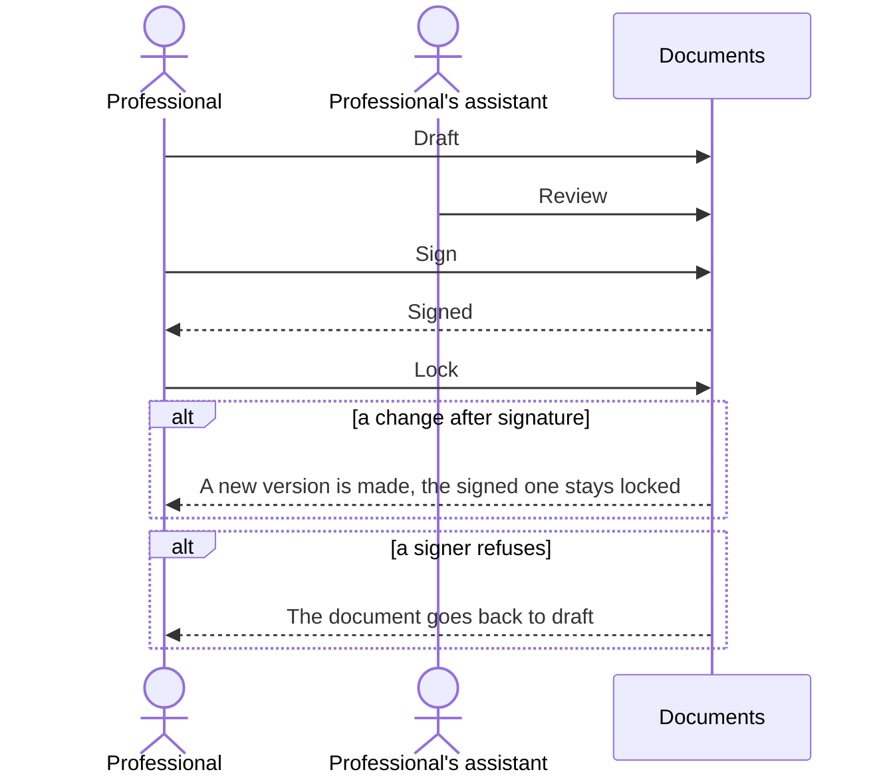

🏠 [Specs](../../../../README.md) › 🏷️ [Sectors](../../../README.md) › ⚖️ [SC11 Professional firms](../../README.md) ›
📝 [Use cases](../README.md) › 📝 [Use cases: FL-SC11-02 Matters and documents](README.md) ›
📝 UC-SC11-09 Manage documents with versions and e-signature

# 📝 UC-SC11-09 Manage documents with versions and e-signature

**Status:** ✅ specified

## Summary

The professional drafts, reviews and has documents signed; each keeps its versions and signed ones are locked.

## Personas

- [U36 Professional](../../../../01-users/personas/u36-professional.md)
- [U37 Professional's assistant](../../../../01-users/personas/u37-assistant.md)

## Goal

Documents versioned and signed.

## Trigger

A document to prepare.

## Frequency

Daily.

## Preconditions

- The SC11 sector pack is installed for the company,
  [UC-F14-02](../../../../02-functional/f14-plugin-store/use-cases/01-find-and-install/uc-f14-02-install-a-plugin-or-sector-pack.md),
  and its users have their roles,
  [UC-F1-06](../../../../02-functional/f01-administration/use-cases/04-edit-a-role/uc-f01-06-edit-a-role-and-its-record-rules.md).

## Postconditions

- **Success:** the signed version is locked.
- **Failed:** the document stays a draft.

## Main flow

1. The professional drafts on [S-SC11-09 Documents](../../screens/02-matters-and-documents/s-sc11-09-documents.md),
   [UC-F2-13](../../../../02-functional/f02-no-code-configuration/use-cases/07-benchmark-additions/uc-f02-13-manage-documents-in-a-workspace.md).
2. The professional's assistant reviews; a new version is kept.
3. It is signed,
   [UC-F2-14](../../../../02-functional/f02-no-code-configuration/use-cases/07-benchmark-additions/uc-f02-14-send-documents-for-e-signature.md).
4. The signed version is locked ([BR-SC11-10](../../business-rules/br-sc11-10-documents-versioned-and-signed.md)).

## Alternative flows

- 1a. Templates: the draft starts from a template.

## Error flows

- 4e. A change after signature: a new version is made; the signed one stays locked.
- 3e. A signer refuses: the document goes back to draft.
- Any step: a call to a service or an outside system fails: it is retried first
  ([BR-F3-32](../../../../02-functional/f03-assistant/business-rules/br-f03-32-retry-before-an-error.md)), then the
  error message pattern ([D122](../../../../06-decisions/ux/d122-error-message-standard.md)) says what failed; what was
  typed is kept.

## Business rules

- [BR-SC11-10 Documents versioned and signed](../../business-rules/br-sc11-10-documents-versioned-and-signed.md)

## Entities

- [E-SC11-10 Matter document](../../data/e-sc11-10-matter-document.md)

## Permissions

The professional and assistant roles; the record rules of their role and site apply,
[UC-F1-06](../../../../02-functional/f01-administration/use-cases/04-edit-a-role/uc-f01-06-edit-a-role-and-its-record-rules.md).

## Notifications

None beyond the in-app updates of the records concerned.

## Audit events

Every creation, change and state change of matter document records, with who, when and the values before and after (T3).

## AI involvement

The AI assistant answers questions on the matter document records of this use case, with links, and prepares them as
drafts the user confirms. It works within the user's rights,
[BR-F3-34](../../../../02-functional/f03-assistant/business-rules/br-f03-34-every-capability-is-reachable-from-the-assistant.md),
and never deletes or does anything irreversible without the user's confirmation,
[BR-F3-07](../../../../02-functional/f03-assistant/business-rules/br-f03-07-no-deletes-no-irreversible-acts.md).

## API, MCP and A2A exposure

Through the API and webhooks (T5) and the MCP and A2A gateway (T6), with the caller's rights,
[BR-F3-34](../../../../02-functional/f03-assistant/business-rules/br-f03-34-every-capability-is-reachable-from-the-assistant.md),
reading, creating and changing the records of this use case; nothing irreversible without a person's confirmation.

## Screens

- [S-SC11-09 Documents](../../screens/02-matters-and-documents/s-sc11-09-documents.md)

## Flowchart

See [FL-SC11-02 Matters and documents](../../flows/fl-sc11-02-matters-and-documents.md#flowchart).

## Sequence diagram

## Acceptance criteria

1. **Given** the example firm's contract v4 on M-221 **when** both sign **then** v4 is locked.
2. **Given** contract v4 signed **when** a change is typed **then** a new version is made; the signed one stays locked.

## Non-functional notes

[D408](../../../../06-decisions/technical/d408-performance-and-profiles.md)'s targets
([performance](../../../../05-non-functional/performance.md)): 95 % of screens within 1 second; lists paged on the
server, the first page within 1 second; reports within 5 seconds or in the background. WCAG 2.2 AA and RGAA
([D46](../../../../06-decisions/ux/d46-accessibility-standard.md)).

## Regulatory references

Legal values from the France country pack:
[CR-FR-020 Proof of acceptance and e-signature](../../../../10-country-packs/france/invoicing/cr-fr-020-electronic-acceptance-and-signature.md).

## Related use cases

- [UC-SC11-10 Exchange securely with the client in the portal](uc-sc11-10-exchange-securely-with-the-client-in-the-portal.md)

## Open questions

None.

---

⬅️ [UC-SC11-08](../04-deadlines-and-filings/uc-sc11-08-follow-deadlines-hearings-and-limitation-periods.md) ·
⬆️ [Up](README.md) · ➡️ [UC-SC11-10](uc-sc11-10-exchange-securely-with-the-client-in-the-portal.md)
