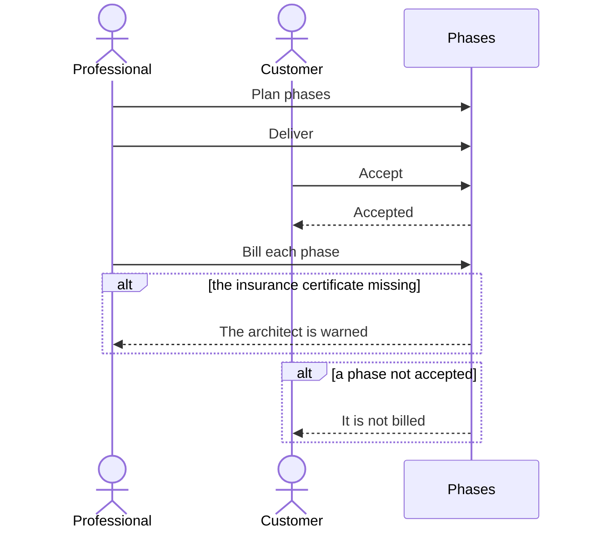

🏠 [Specs](../../../../README.md) › 🏷️ [Sectors](../../../README.md) › ⚖️ [SC11 Professional firms](../../README.md) ›
📝 [Use cases](../README.md) › 📝 [Use cases: FL-SC11-02 Matters and documents](README.md) ›
📝 UC-SC11-13 Run architects' and engineers' projects by phase

# 📝 UC-SC11-13 Run architects' and engineers' projects by phase

**Status:** ✅ specified

## Summary

An architect plans the project's phases, delivers each, and bills its fees per phase; insurance applies.

## Personas

- [U36 Professional](../../../../01-users/personas/u36-professional.md)
- [U09 Customer](../../../../01-users/personas/u09-customer.md)

## Goal

Phases delivered and billed.

## Trigger

A signed architect's contract.

## Frequency

Per project.

## Preconditions

- The SC11 sector pack is installed for the company,
  [UC-F14-02](../../../../02-functional/f14-plugin-store/use-cases/01-find-and-install/uc-f14-02-install-a-plugin-or-sector-pack.md),
  and its users have their roles,
  [UC-F1-06](../../../../02-functional/f01-administration/use-cases/04-edit-a-role/uc-f01-06-edit-a-role-and-its-record-rules.md).

## Postconditions

- **Success:** each phase is billed when done.
- **Failed:** the phase waits.

## Main flow

1. The architect plans phases on [S-SC11-13 Phases](../../screens/02-matters-and-documents/s-sc11-13-phases.md).
2. Each phase is delivered with its documents.
3. The client accepts the phase.
4. The phase is billed, [BR-SC11-13](../../business-rules/br-sc11-13-architect-phases-billed.md),
   [UC-F6-16](../../../../02-functional/f06-customers-and-sales/use-cases/05-benchmark-additions/uc-f06-16-bill-usage-commitments-and-milestones.md).

## Alternative flows

- 1a. An amendment: phases and fees change by amendment.

## Error flows

- 1e. The insurance certificate missing: the architect is warned.
- 3e. A phase not accepted: it is not billed.
- Any step: a call to a service or an outside system fails: it is retried first
  ([BR-F3-32](../../../../02-functional/f03-assistant/business-rules/br-f03-32-retry-before-an-error.md)), then the
  error message pattern ([D122](../../../../06-decisions/ux/d122-error-message-standard.md)) says what failed; what was
  typed is kept.

## Business rules

- [BR-SC11-13 Architects' phases billed](../../business-rules/br-sc11-13-architect-phases-billed.md)

## Entities

- [E-SC11-05 Matter](../../data/e-sc11-05-matter.md)
- [E-SC11-07 Fee bill](../../data/e-sc11-07-fee-bill.md)

## Permissions

The professional and customer roles; the record rules of their role and site apply,
[UC-F1-06](../../../../02-functional/f01-administration/use-cases/04-edit-a-role/uc-f01-06-edit-a-role-and-its-record-rules.md).

## Notifications

None beyond the in-app updates of the records concerned.

## Audit events

Every creation, change and state change of matter, fee bill records, with who, when and the values before and after
(T3).

## AI involvement

The AI assistant answers questions on the matter, fee bill records of this use case, with links, and prepares them as
drafts the user confirms. It works within the user's rights,
[BR-F3-34](../../../../02-functional/f03-assistant/business-rules/br-f03-34-every-capability-is-reachable-from-the-assistant.md),
and never deletes or does anything irreversible without the user's confirmation,
[BR-F3-07](../../../../02-functional/f03-assistant/business-rules/br-f03-07-no-deletes-no-irreversible-acts.md).

## API, MCP and A2A exposure

Through the API and webhooks (T5) and the MCP and A2A gateway (T6), with the caller's rights,
[BR-F3-34](../../../../02-functional/f03-assistant/business-rules/br-f03-34-every-capability-is-reachable-from-the-assistant.md),
reading, creating and changing the records of this use case; nothing irreversible without a person's confirmation.

## Screens

- [S-SC11-13 Phases](../../screens/02-matters-and-documents/s-sc11-13-phases.md)

## Flowchart

See [FL-SC11-02 Matters and documents](../../flows/fl-sc11-02-matters-and-documents.md#flowchart).

## Sequence diagram

## Acceptance criteria

1. **Given** the example firm's project with a design phase at 15 % of 60,000 EUR **when** the phase is accepted
   **then** 9,000 EUR is billed.
2. **Given** a project without certificate **when** it is planned **then** the architect is warned.

## Non-functional notes

[D408](../../../../06-decisions/technical/d408-performance-and-profiles.md)'s targets
([performance](../../../../05-non-functional/performance.md)): 95 % of screens within 1 second; lists paged on the
server, the first page within 1 second; reports within 5 seconds or in the background. WCAG 2.2 AA and RGAA
([D46](../../../../06-decisions/ux/d46-accessibility-standard.md)).

## Regulatory references

Legal values from the France country pack:
[CR-FR-153 Architects' insurance and contract](../../../../10-country-packs/france/professional-firms/cr-fr-153-architect-insurance-and-contract.md).

## Related use cases

- [UC-SC11-06 Bill fees and request advances](../03-time-and-billing/uc-sc11-06-bill-fees-and-request-advances.md)

## Open questions

None.

---

⬅️ [UC-SC11-12](../04-deadlines-and-filings/uc-sc11-12-prepare-client-filings-and-their-evidence.md) ·
⬆️ [Up](README.md) ·
➡️ [UC-SC11-14](../06-firm-management/uc-sc11-14-follow-work-in-progress-and-the-recovery-rate.md)
