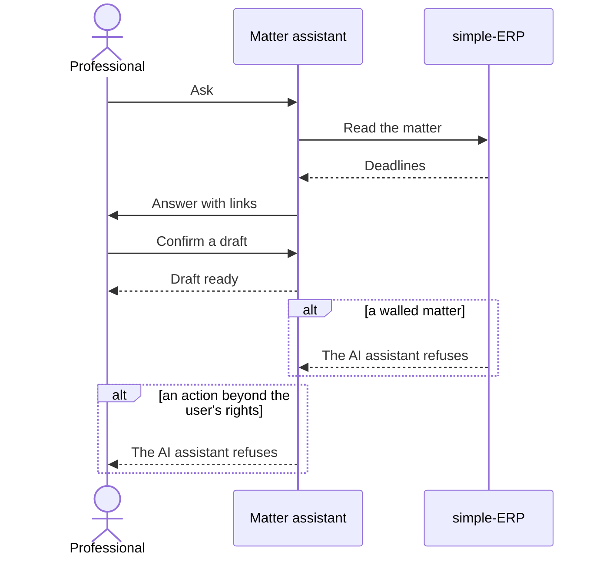

🏠 [Specs](../../../../README.md) › 🏷️ [Sectors](../../../README.md) › ⚖️ [SC11 Professional firms](../../README.md) ›
📝 [Use cases](../README.md) › 📝 [Use cases: FL-SC11-02 Matters and documents](README.md) ›
📝 UC-SC11-20 Ask the AI assistant about a matter

# 📝 UC-SC11-20 Ask the AI assistant about a matter

**Status:** ✅ specified

## Summary

The professional or the professional's assistant asks the AI assistant about deadlines, time or a draft, within their
role's rights and walls.

## Personas

- [U36 Professional](../../../../01-users/personas/u36-professional.md)
- [U37 Professional's assistant](../../../../01-users/personas/u37-assistant.md)

## Goal

Answers without hunting, walls kept.

## Trigger

A question to the AI assistant.

## Frequency

Daily.

## Preconditions

- The SC11 sector pack is installed for the company,
  [UC-F14-02](../../../../02-functional/f14-plugin-store/use-cases/01-find-and-install/uc-f14-02-install-a-plugin-or-sector-pack.md),
  and its users have their roles,
  [UC-F1-06](../../../../02-functional/f01-administration/use-cases/04-edit-a-role/uc-f01-06-edit-a-role-and-its-record-rules.md).

## Postconditions

- **Success:** the answer cites the records, or the draft is confirmed.
- **Failed:** the AI assistant says it cannot answer or act, and why.

## Main flow

1. The professional asks on
   [S-SC11-20 Matter assistant](../../screens/02-matters-and-documents/s-sc11-20-matter-assistant.md): "What is due on
   M-221 this week?".
2. The AI assistant reads within the user's rights and walls.
3. The AI assistant lists the appeal due on 20 November.
4. The professional asks for a file summary; the AI assistant drafts it,
   [UC-F3-04](../../../../02-functional/f03-assistant/use-cases/04-summarise-or-draft/uc-f03-04-summarise-and-draft.md).

## Alternative flows

- 1a. A professional's assistant asks for unbilled time: the AI assistant lists it.

## Error flows

- 2e. A walled matter: the AI assistant refuses.
- 4e. An action beyond the user's rights: the AI assistant refuses.
- Any step: a call to a service or an outside system fails: it is retried first
  ([BR-F3-32](../../../../02-functional/f03-assistant/business-rules/br-f03-32-retry-before-an-error.md)), then the
  error message pattern ([D122](../../../../06-decisions/ux/d122-error-message-standard.md)) says what failed; what was
  typed is kept.

## Business rules

- [BR-SC11-06 Secrecy and access walls](../../business-rules/br-sc11-06-secrecy-and-access-walls.md)
- [BR-F3-34 All capabilities via the AI assistant](../../../../02-functional/f03-assistant/business-rules/br-f03-34-every-capability-is-reachable-from-the-assistant.md)
- [BR-F3-07 No deletes, no irreversible acts](../../../../02-functional/f03-assistant/business-rules/br-f03-07-no-deletes-no-irreversible-acts.md)

## Entities

- [E-SC11-05 Matter](../../data/e-sc11-05-matter.md)
- [E-SC11-09 Deadline](../../data/e-sc11-09-deadline.md)

## Permissions

The professional and assistant roles; the record rules of their role and site apply,
[UC-F1-06](../../../../02-functional/f01-administration/use-cases/04-edit-a-role/uc-f01-06-edit-a-role-and-its-record-rules.md).

## Notifications

None beyond the in-app updates of the records concerned.

## Audit events

Every creation, change and state change of matter, deadline records, with who, when and the values before and after
(T3).

## AI involvement

The AI assistant answers questions on the matter, deadline records of this use case, with links, and prepares them as
drafts the user confirms. It works within the user's rights,
[BR-F3-34](../../../../02-functional/f03-assistant/business-rules/br-f03-34-every-capability-is-reachable-from-the-assistant.md),
and never deletes or does anything irreversible without the user's confirmation,
[BR-F3-07](../../../../02-functional/f03-assistant/business-rules/br-f03-07-no-deletes-no-irreversible-acts.md).

## API, MCP and A2A exposure

Through the API and webhooks (T5) and the MCP and A2A gateway (T6), with the caller's rights,
[BR-F3-34](../../../../02-functional/f03-assistant/business-rules/br-f03-34-every-capability-is-reachable-from-the-assistant.md),
reading, creating and changing the records of this use case; nothing irreversible without a person's confirmation.

## Screens

- [S-SC11-20 Matter assistant](../../screens/02-matters-and-documents/s-sc11-20-matter-assistant.md)

## Flowchart

See [FL-SC11-02 Matters and documents](../../flows/fl-sc11-02-matters-and-documents.md#flowchart).

## Sequence diagram

## Acceptance criteria

1. **Given** the example firm's M-221 with an appeal due 20 November **when** the professional asks **then** the
   AI assistant lists it.
2. **Given** a professional outside M-221's wall **when** he asks about it **then** the AI assistant refuses.

## Non-functional notes

[D408](../../../../06-decisions/technical/d408-performance-and-profiles.md)'s targets
([performance](../../../../05-non-functional/performance.md)): 95 % of screens within 1 second; lists paged on the
server, the first page within 1 second; reports within 5 seconds or in the background. WCAG 2.2 AA and RGAA
([D46](../../../../06-decisions/ux/d46-accessibility-standard.md)).

## Regulatory references

None specific to this use case; the sector's legal rules are listed in [SC11 regulatory](../../regulatory.md).

## Related use cases

- [UC-SC11-08 Follow deadlines, hearings and limitation periods](../04-deadlines-and-filings/uc-sc11-08-follow-deadlines-hearings-and-limitation-periods.md)

## Open questions

None.

---

⬅️ [UC-SC11-19 Report the firm's performance](../06-firm-management/uc-sc11-19-report-the-firm-s-performance.md) ·
⬆️ [Up](README.md) ·
➡️ [UC-SC11-21 Run a notary's office](../07-notaries-brokers-officers-and-auditors/uc-sc11-21-run-a-notarys-office.md)
