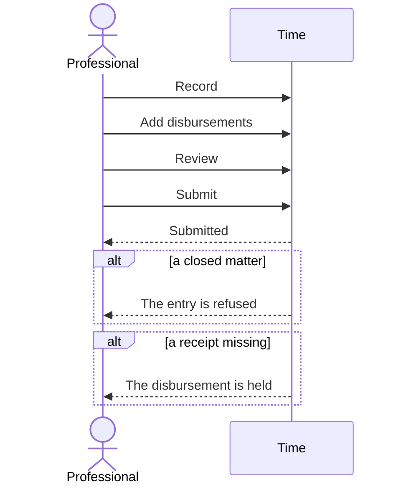

🏠 [Specs](../../../../README.md) › 🏷️ [Sectors](../../../README.md) › ⚖️ [SC11 Professional firms](../../README.md) ›
📝 [Use cases](../README.md) › 📝 [Use cases: FL-SC11-03 Time and billing](README.md) ›
📝 UC-SC11-05 Record time and disbursements

# 📝 UC-SC11-05 Record time and disbursements

**Status:** ✅ specified

## Summary

The professional records time and disbursements per matter, reviews and submits them.

## Personas

- [U36 Professional](../../../../01-users/personas/u36-professional.md)

## Goal

All time recorded on its matter.

## Trigger

Work on a matter.

## Frequency

Daily.

## Preconditions

- The SC11 sector pack is installed for the company,
  [UC-F14-02](../../../../02-functional/f14-plugin-store/use-cases/01-find-and-install/uc-f14-02-install-a-plugin-or-sector-pack.md),
  and its users have their roles,
  [UC-F1-06](../../../../02-functional/f01-administration/use-cases/04-edit-a-role/uc-f01-06-edit-a-role-and-its-record-rules.md).

## Postconditions

- **Success:** time is submitted.
- **Failed:** time stays a draft.

## Main flow

1. The professional records time on [S-SC11-05 Time](../../screens/03-time-and-billing/s-sc11-05-time.md).
2. Disbursements are added with receipts.
3. The professional reviews the week.
4. Time is submitted ([BR-SC11-08](../../business-rules/br-sc11-08-time-billed-from-records.md)).

## Alternative flows

- 1a. A timer: the timer records time.

## Error flows

- 1e. A closed matter: the entry is refused.
- 2e. A receipt missing: the disbursement is held.
- Any step: a call to a service or an outside system fails: it is retried first
  ([BR-F3-32](../../../../02-functional/f03-assistant/business-rules/br-f03-32-retry-before-an-error.md)), then the
  error message pattern ([D122](../../../../06-decisions/ux/d122-error-message-standard.md)) says what failed; what was
  typed is kept.

## Business rules

- [BR-SC11-08 Time billed from records](../../business-rules/br-sc11-08-time-billed-from-records.md)

## Entities

- [E-SC11-06 Time entry](../../data/e-sc11-06-time-entry.md)

## Permissions

The professional roles; the record rules of their role and site apply,
[UC-F1-06](../../../../02-functional/f01-administration/use-cases/04-edit-a-role/uc-f01-06-edit-a-role-and-its-record-rules.md).

## Notifications

None beyond the in-app updates of the records concerned.

## Audit events

Every creation, change and state change of time entry records, with who, when and the values before and after (T3).

## AI involvement

The AI assistant answers questions on the time entry records of this use case, with links, and prepares them as drafts
the user confirms. It works within the user's rights,
[BR-F3-34](../../../../02-functional/f03-assistant/business-rules/br-f03-34-every-capability-is-reachable-from-the-assistant.md),
and never deletes or does anything irreversible without the user's confirmation,
[BR-F3-07](../../../../02-functional/f03-assistant/business-rules/br-f03-07-no-deletes-no-irreversible-acts.md).

## API, MCP and A2A exposure

Through the API and webhooks (T5) and the MCP and A2A gateway (T6), with the caller's rights,
[BR-F3-34](../../../../02-functional/f03-assistant/business-rules/br-f03-34-every-capability-is-reachable-from-the-assistant.md),
reading, creating and changing the records of this use case; nothing irreversible without a person's confirmation.

## Screens

- [S-SC11-05 Time](../../screens/03-time-and-billing/s-sc11-05-time.md)

## Flowchart

See [FL-SC11-03 Time and billing](../../flows/fl-sc11-03-time-and-billing.md#flowchart).

## Sequence diagram

## Acceptance criteria

1. **Given** the example firm's 2.5 hours on M-221 on 12 November at 250 EUR **when** it is submitted **then** 625 EUR
   is unbilled.
2. **Given** M-180 closed **when** time is recorded **then** the entry is refused.

## Non-functional notes

[D408](../../../../06-decisions/technical/d408-performance-and-profiles.md)'s targets
([performance](../../../../05-non-functional/performance.md)): 95 % of screens within 1 second; lists paged on the
server, the first page within 1 second; reports within 5 seconds or in the background. WCAG 2.2 AA and RGAA
([D46](../../../../06-decisions/ux/d46-accessibility-standard.md)).

## Regulatory references

None specific to this use case; the sector's legal rules are listed in [SC11 regulatory](../../regulatory.md).

## Related use cases

- [UC-SC11-06 Bill fees and request advances](uc-sc11-06-bill-fees-and-request-advances.md)

## Open questions

None.

---

⬅️ [UC-SC11-04 Open and organise matters](../02-matters-and-documents/uc-sc11-04-open-and-organise-matters.md) ·
⬆️ [Up](README.md) · ➡️ [UC-SC11-06 Bill fees and request advances](uc-sc11-06-bill-fees-and-request-advances.md)
