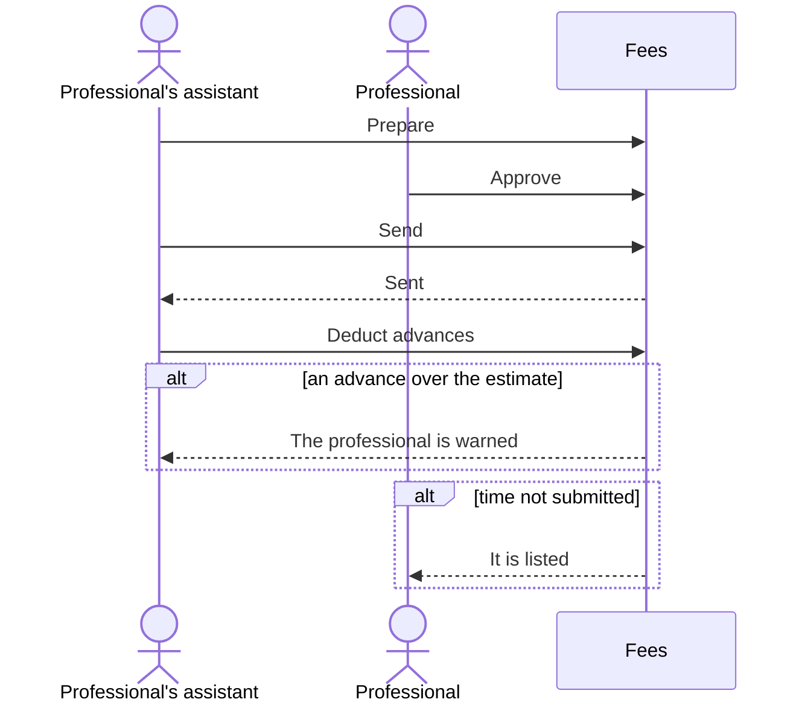

🏠 [Specs](../../../../README.md) › 🏷️ [Sectors](../../../README.md) › ⚖️ [SC11 Professional firms](../../README.md) ›
📝 [Use cases](../README.md) › 📝 [Use cases: FL-SC11-03 Time and billing](README.md) ›
📝 UC-SC11-06 Bill fees and request advances

# 📝 UC-SC11-06 Bill fees and request advances

**Status:** ✅ specified

## Summary

The AI assistant prepares bills by the fee model and advance requests within the estimate; the professional approves and
sends them.

## Personas

- [U37 Professional's assistant](../../../../01-users/personas/u37-assistant.md)
- [U36 Professional](../../../../01-users/personas/u36-professional.md)

## Goal

Fees billed as agreed.

## Trigger

Month end or a step.

## Frequency

Monthly.

## Preconditions

- The SC11 sector pack is installed for the company,
  [UC-F14-02](../../../../02-functional/f14-plugin-store/use-cases/01-find-and-install/uc-f14-02-install-a-plugin-or-sector-pack.md),
  and its users have their roles,
  [UC-F1-06](../../../../02-functional/f01-administration/use-cases/04-edit-a-role/uc-f01-06-edit-a-role-and-its-record-rules.md).

## Postconditions

- **Success:** the bill is sent.
- **Failed:** the bill stays a draft.

## Main flow

1. The AI assistant prepares the bill on [S-SC11-06 Fees](../../screens/03-time-and-billing/s-sc11-06-fees.md).
2. The professional approves, with write-offs.
3. The bill is sent.
4. Advances are deducted on the final bill
   ([BR-SC11-09](../../business-rules/br-sc11-09-advances-within-the-estimate.md)).

## Alternative flows

- 1a. A success fee on result: it is added as agreed.

## Error flows

- 1e. An advance over the estimate: the professional is warned.
- 2e. Time not submitted: it is listed.
- Any step: a call to a service or an outside system fails: it is retried first
  ([BR-F3-32](../../../../02-functional/f03-assistant/business-rules/br-f03-32-retry-before-an-error.md)), then the
  error message pattern ([D122](../../../../06-decisions/ux/d122-error-message-standard.md)) says what failed; what was
  typed is kept.

## Business rules

- [BR-SC11-08 Time billed from records](../../business-rules/br-sc11-08-time-billed-from-records.md)
- [BR-SC11-09 Advances within the estimate](../../business-rules/br-sc11-09-advances-within-the-estimate.md)

## Entities

- [E-SC11-07 Fee bill](../../data/e-sc11-07-fee-bill.md)

## Permissions

The professional's assistant and professional roles; the record rules of their role and site apply,
[UC-F1-06](../../../../02-functional/f01-administration/use-cases/04-edit-a-role/uc-f01-06-edit-a-role-and-its-record-rules.md).

## Notifications

None beyond the in-app updates of the records concerned.

## Audit events

Every creation, change and state change of fee bill records, with who, when and the values before and after (T3).

## AI involvement

The AI assistant answers questions on the fee bill records of this use case, with links, and prepares them as drafts the
user confirms. It works within the user's rights,
[BR-F3-34](../../../../02-functional/f03-assistant/business-rules/br-f03-34-every-capability-is-reachable-from-the-assistant.md),
and never deletes or does anything irreversible without the user's confirmation,
[BR-F3-07](../../../../02-functional/f03-assistant/business-rules/br-f03-07-no-deletes-no-irreversible-acts.md).

## API, MCP and A2A exposure

Through the API and webhooks (T5) and the MCP and A2A gateway (T6), with the caller's rights,
[BR-F3-34](../../../../02-functional/f03-assistant/business-rules/br-f03-34-every-capability-is-reachable-from-the-assistant.md),
reading, creating and changing the records of this use case; nothing irreversible without a person's confirmation.

## Screens

- [S-SC11-06 Fees](../../screens/03-time-and-billing/s-sc11-06-fees.md)

## Flowchart

See [FL-SC11-03 Time and billing](../../flows/fl-sc11-03-time-and-billing.md#flowchart).

## Sequence diagram

## Acceptance criteria

1. **Given** the example firm's M-221 with a 3,000 EUR advance and 4,500 EUR of time **when** the final bill is sent
   **then** 1,500 EUR is due.
2. **Given** an advance of 6,000 EUR on a 5,000 EUR estimate **when** it is prepared **then** the professional is
   warned.

## Non-functional notes

[D408](../../../../06-decisions/technical/d408-performance-and-profiles.md)'s targets
([performance](../../../../05-non-functional/performance.md)): 95 % of screens within 1 second; lists paged on the
server, the first page within 1 second; reports within 5 seconds or in the background. WCAG 2.2 AA and RGAA
([D46](../../../../06-decisions/ux/d46-accessibility-standard.md)).

## Regulatory references

None specific to this use case; the sector's legal rules are listed in [SC11 regulatory](../../regulatory.md).

## Related use cases

- [UC-SC11-07 Hold client funds on trust accounts](uc-sc11-07-hold-client-funds-on-trust-accounts.md)

## Open questions

None.

---

⬅️ [UC-SC11-05 Record time and disbursements](uc-sc11-05-record-time-and-disbursements.md) · ⬆️ [Up](README.md) ·
➡️ [UC-SC11-07 Hold client funds on trust accounts](uc-sc11-07-hold-client-funds-on-trust-accounts.md)
